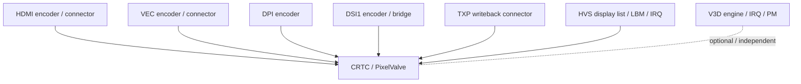

# NetBSD BCM2711 HDMI DDC / VC4 DRM2対応 設計書

- 文書バージョン: 0.9
- 作成日: 2026-11-22
- 最終更新日: 2026-11-24
- 対象リポジトリ: [https://github.com/ebijun/src](https://github.com/ebijun/src)
- 対象ブランチ: `vc4-drmkms`
- 対象ハードウェア: Raspberry Pi 4 / BCM2711
- 対象ソフトウェア: NetBSD ARM / DRM2 / LinuxKPI / VC4 DRM

---

## 1. 目的

Raspberry Pi 4のBCM2711 HDMI出力を、NetBSD上のVC4 DRM/KMSドライバから利用できるようにする。

特に、HDMIコネクタのEDID取得に必要なDDC通信を実現する。

Linux版VC4 DRMドライバはLinux I2C adapterを使用する。一方、NetBSDではI2Cコントローラが`i2c_controller`として管理されるため、両者の接続が必要になる。

本設計では、次の機能を段階的に実装する。

1. BCM2711 HDMI DDCコントローラの初期化
2. NetBSD I2Cコントローラとしての登録
3. LinuxKPI I2C adapterとの接続
4. VC4 HDMIドライバからのEDID取得
5. HDMIモード検出・設定の動作確認

## 2. 現在のソース構成

作業ブランチは`vc4-drmkms`。

確認時点では、ローカル作業ツリーはoriginと同期しており、未コミット変更はなかった。

主な関連ファイルは以下のとおり。

| ファイル                                                                 | 役割                     |
| -------------------------------------------------------------------- | ---------------------- |
| `sys/external/bsd/drm2/dist/drm/vc4/vc4_hdmi.c`                      | VC4 HDMIコネクタ・EDID処理    |
| `sys/external/bsd/drm2/include/linux/i2c.h`                          | LinuxKPI I2C adapter定義 |
| `sys/arch/arm/broadcom/bcm2835_bsc.c`                                | BCM2835 BSC転送処理        |
| `sys/arch/arm/broadcom/bcm2835_bsc_fdt.c`                            | BCM2835 BSCのFDT attach |
| `sys/arch/arm/broadcom/bcm2835_bscreg.h`                             | BCM2835 BSCレジスタ定義      |
| `sys/arch/arm/broadcom/bcm2835_bscvar.h`                             | BCM2835 BSC softc定義    |
| `sys/arch/arm/broadcom/files.bcm2835`                                | Broadcom ARMドライバ登録     |
| `sys/external/gpl2/dts/dist/arch/arm/boot/dts/broadcom/bcm2711.dtsi` | BCM2711 Device Tree    |

## 3. 確認済み事項

### 3.1 VC4 HDMIドライバ

`vc4_hdmi.c`では、EDIDを次のように取得している。

```
edid = drm_get_edid(connector, vc4->hdmi->ddc);
```

DDC adapterの取得には次のLinux APIが使用されている。

```
hdmi->ddc = of_find_i2c_adapter_by_node(ddc_node);
```

終了時には次の処理がある。

```
put_device(&hdmi->ddc->dev);
```

これらはLinuxのI2C adapter/device管理を前提としている。

NetBSD LinuxKPIでは`struct i2c_adapter`の`dev`がLinuxの`struct device`と同一ではないため、そのままの移植はできない。

### 3.2 NetBSD既存BCM2835 BSC

既存ドライバは以下のファイルで構成される。

- `bcm2835_bsc.c`
- `bcm2835_bsc_fdt.c`
- `bcm2835_bscreg.h`
- `bcm2835_bscvar.h`

FDT compatibleは以下のみ。

```
{ .compat = "brcm,bcm2835-i2c" },
```

このドライバはBCM2835 BSCレジスタを直接操作する。

代表的なレジスタは以下のとおり。

| レジスタ     | オフセット |
| -------- | ----- |
| BSC_C    | 0x00  |
| BSC_S    | 0x04  |
| BSC_DLEN | 0x08  |
| BSC_A    | 0x0c  |
| BSC_FIFO | 0x10  |
| BSC_DIV  | 0x14  |

BCM2711 HDMI DDCは異なるレジスタ構造を使用するため、既存ドライバにcompatibleを追加するだけでは対応できない。

### 3.3 BCM2711 Device Tree

BCM2711 DTSには、HDMI DDC用のI2Cノードが2つ存在する。

compatible:

```
compatible = "brcm,bcm2711-hdmi-i2c";
```

レジスタ領域は2つ。

```
reg = <...>, <...>;
reg-names = "bsc", "auto-i2c";
```

クロック設定:

```
clock-frequency = <97500>;
```

NetBSDで確認したDTSノードには割り込みプロパティが存在しない。

そのため、初期実装ではポーリング方式を使用する。

### 3.4 FDT API

NetBSDには名前によるレジスタ取得APIが存在する。

```
int fdtbus_get_reg_byname(int, const char *,
    bus_addr_t *, bus_size_t *);
```

以下のように使用できる。

```
fdtbus_get_reg_byname(phandle, "bsc",
    &bsc_addr, &bsc_size);

fdtbus_get_reg_byname(phandle, "auto-i2c",
    &auto_addr, &auto_size);
```

### 3.5 Linux BCM2711 DDC実装

Linux側の実装は次のファイル。

`drivers/i2c/busses/i2c-brcmstb.c`

対応compatible:

```
"brcm,bcm2711-hdmi-i2c"
```

BCM2711では`bsc`と`auto-i2c`の2領域を使用する。

初期化時には`auto-i2c`の以下のレジスタを操作する。

```
#define AUTOI2C_CTRL0              0x26c
#define AUTOI2C_CTRL0_RELEASE_BSC  BIT(1)
```

処理内容:

```
writel(AUTOI2C_CTRL0_RELEASE_BSC,
    autoi2c + AUTOI2C_CTRL0);
```

続いてBSCの`iic_enable`を0にする。

Linux実装は割り込みが利用できない場合、ポーリング方式にフォールバックする。

### 3.6 Linux BCM2711 BSCレジスタ構造

Linuxドライバの構造体から確認できるレジスタ配置。

| レジスタ           | オフセット       |
| -------------- | ----------- |
| chip_address   | 0x00        |
| data_in[0..7]  | 0x04 - 0x20 |
| cnt_reg        | 0x24        |
| ctl_reg        | 0x28        |
| iic_enable     | 0x2c        |
| data_out[0..7] | 0x30 - 0x4c |
| ctlhi_reg      | 0x50        |
| scl_param      | 0x54        |

この配置はBCM2835 BSCとは異なる。

Linux実装ではデータレジスタ群を使用し、転送方向・START/STOP条件を制御する。

実際の転送単位や分割条件については、Linuxドライバの転送処理を詳細に確認してからNetBSD側に反映する。


### 3.7 Linux upstream転送処理の詳細確認（2026-11-23）

Linux upstreamの `drivers/i2c/busses/i2c-brcmstb.c` を確認し、BCM2711 HDMI DDCに関係する初期化・転送処理を整理した。確認対象はGitHubのLinux `master` ブランチ上のファイル（確認時blob SHA: `52762249d46aafda0310772c688ae6cdf9a3b2f9`）。

#### 3.7.1 データレジスタ幅と1回の転送量

BCM2711では `data_regsz = sizeof(u32)`、すなわち1データレジスタあたり4バイトとして扱われる。データレジスタは8個なので、1回のBSCデータ転送で扱う上限は32バイトとなる。

- 送信データ: `data_in[0..7]`（0x04～0x20）
- 受信データ: `data_out[0..7]`（0x30～0x4c）
- 1回の転送長: 最大32バイト
- 32バイトを超えるメッセージ: Linux実装では32バイト以下の複数転送に分割

`ctlhi_reg` の `BSC_CTLHI_REG_DATAREG_SIZE_MASK`（bit 6）をセットし、4バイト幅を選択する。NetBSD実装でもこの設定と、データレジスタへのバイト詰め・取り出し順序を再現する必要がある。

#### 3.7.2 BSC制御ビット

Linuxドライバで使用される主なビットは以下のとおり。

| レジスタ | ビット／マスク | 意味 |
| --- | ---: | --- |
| `ctl_reg` | `0x03` | DTF転送方向フィールド |
| `ctl_reg` | `0x30` | SCL選択 |
| `ctl_reg` | `0x40` | 割り込み許可 |
| `ctl_reg` | `0x80` | クロック分周 |
| `iic_enable` | `0x40` | RESTART |
| `iic_enable` | `0x20` | NOSTART |
| `iic_enable` | `0x10` | NOSTOP |
| `iic_enable` | `0x04` | NOACK制御 |
| `iic_enable` | `0x02` | INTRP（転送完了状態） |
| `iic_enable` | `0x01` | ENABLE（転送開始） |
| `ctlhi_reg` | `0x40` | 4バイトデータレジスタ幅 |
| `ctlhi_reg` | `0x02` | IGNORE_ACK |

DTFはwriteで0、readで1を設定する。combined transfer用の値としてread/write方向の組み合わせも定義されているが、通常のメッセージ転送では各メッセージの方向に応じて設定する。

#### 3.7.3 転送開始・完了・後処理

Linux実装の1コマンドの概略は次のとおり。

1. `iic_enable.INTRP` が立っていないことを確認し、前回転送中でないことを確認する（最大100ms）。
2. 割り込みモードではcompletionを初期化する。ポーリングモードではINTRPビットを監視する。
3. `ctl_reg.INT_EN` を有効にする。
4. `iic_enable.ENABLE` をセットして転送を開始する。
5. 完了を待つ。タイムアウトは100ms。
6. 通常のread/writeコマンドでは `iic_enable.NOACK` を確認し、NACKならエラーとする。
7. `cnt_reg` と `iic_enable` に0を書き、コマンド状態をクリアする。

ポーリング時もLinux実装は `iic_enable.INTRP` を完了判定に使用する。NetBSD側では割り込みを初期段階で実装せず、同じ状態ビットをタイムアウト付きで監視する方針とする。NetBSDの遅延・待機APIは実装時に適切なものを選ぶ。

#### 3.7.4 START / RESTART / STOPの扱い

Linuxドライバは各 `i2c_msg` の前に `iic_enable` のSTART/STOP関連ビットを設定し、メッセージ間の条件を制御する。

- 次のメッセージが通常のメッセージなら、現在のメッセージをNOSTOPで終え、次のメッセージでRESTARTを発行する。
- 最終メッセージではRESTART/NOSTOPを解除し、転送終端でSTOPを発行する。
- `I2C_M_NOSTART` が指定された場合は、アドレス再送とSTART条件を抑制する。
- 1メッセージが32バイトを超える場合、途中チャンクではSTOPを発行せず、次チャンクをNOSTART | NOSTOPで継続する。

したがって、LinuxKPI bridgeは複数の `i2c_msg` を個別の `iic_exec()` に単純分割してはならない。メッセージ列全体のSTART/RESTART/STOP意味を保てる転送経路が必要である。

#### 3.7.5 アドレス処理

7-bitアドレスの場合、Linux実装は `i2c_8bit_addr_from_msg()` でread/writeビットを含むアドレス値を生成し、`chip_address` に設定する。

10-bitアドレスでは、上位アドレスバイトと下位アドレスバイトを別々に送信し、readの場合はRESTART後にreadビット付き上位バイトを再送する処理がある。EDID/DDCの初期用途は7-bitアドレス（0x50、必要に応じて0x30）だが、NetBSD側が対応するI2C機能の範囲はbridgeの実装時に明示する。

#### 3.7.6 クロック設定

Linuxドライバは対応する離散的な周波数テーブルを持つ。DTSの `clock-frequency = <97500>` に対しては、SCL選択値 `SPD_390K`（選択フィールド値1）とDIV_CLKを設定する。

このため、NetBSD初期実装ではDTS値97500Hzを読み取り、対応する `ctl_reg` 設定を行う。任意の周波数を計算して設定する実装ではなく、Linuxと同様にサポートする値を明確に扱う。

#### 3.7.7 エラーと未確定事項

Linux実装では、busy待ち・転送完了待ちの両方に100msのタイムアウトがある。通常のread/writeでNACKを検出するとリモートI/Oエラーを返す。NetBSD側ではNetBSDのエラー値へ適切に対応付ける。

Linuxコードの確認で転送チャンク上限32バイト、4バイトレジスタ幅、完了判定、NACK判定、メッセージ間条件の実装方針は確認できた。一方、実機での信号波形・タイミング、DDC拡張ブロックを含むEDID取得、実際の起動DTBでのノード有効状態は引き続き実機検証事項である。

---

## 4. 設計方針

### 4.1 BCM2711専用ドライバを新設する

既存のBCM2835 BSCドライバは変更せず、BCM2711 HDMI DDC専用ドライバを新設する。

予定ファイル:

```
sys/arch/arm/broadcom/
    bcm2711_hdmi_i2c.c
    bcm2711_hdmi_i2c_reg.h
```

デバイス名:

```
bcm2711ddc
```

FDT compatible:

```
brcm,bcm2711-hdmi-i2c
```

### 4.2 FDT attach

FDTから次の領域を取得する。

- `bsc`
- `auto-i2c`

それぞれ`bus_space_map()`でマッピングする。

クロックについては、BCM2711 DDCノードに`clocks`プロパティがない構成を確認しているため、既存BCM2835 BSCのようにFDT clock取得を必須にしない。

### 4.3 BSC解放処理

Linux実装に合わせ、以下を行う。

1. `auto-i2c + 0x26c`へ`BIT(1)`を書き込む。
2. `bsc + 0x2c`へ0を書き込む。

この処理はBCM2711専用ドライバに実装する。

### 4.4 転送方式

初期実装はポーリング方式とする。

Linux実装の動作を参考にし、以下を実装する。

- I2Cアドレス設定
- 書き込みデータの設定
- 読み込みデータの取得
- 転送長設定
- 転送方向設定
- START/STOP/RESTART制御
- NACK検出
- タイムアウト処理

データレジスタの数と幅から転送単位を確認し、必要に応じて転送を分割する。

転送単位、FIFO相当の扱い、最大転送長はLinux実装とハードウェア仕様を照合して確定する。

### 4.5 NetBSD I2C接続

最終的にはNetBSDの`struct i2c_controller`として登録する。

必要な関数:

```
ic_acquire_bus
ic_release_bus
ic_exec
```

`ic_exec`からBCM2711専用転送関数を呼び出す。

I2Cバスの排他制御はNetBSDのI2C frameworkに従う。

### 4.6 LinuxKPI adapter bridge

VC4側は`struct i2c_adapter`を必要とする。

NetBSDの`i2c_controller`とLinuxKPIの`i2c_adapter`を接続するbridgeを用意する。

bridgeの責務:

- `i2c_adapter`の生成
- `i2c_algorithm`の登録
- `i2c_transfer()`からNetBSD I2C転送への変換
- ロック処理の変換
- adapterとFDT phandleの対応付け
- adapterの寿命管理

LinuxKPIの既存`i2c_add_adapter()`等はstubであるため、必要な管理機構を調査して実装する。

### 4.7 VC4 HDMI接続

最終的には`vc4_hdmi.c`のDDC取得部分をNetBSD向けに接続する。

Linuxの以下のAPIをそのまま使うことはできない可能性が高い。

```
of_find_i2c_adapter_by_node()
put_device()
```

NetBSD向けのadapter検索・解放方法を設計する。

---

## 5. 実装段階

| 段階 | 内容                          | 状態     |
| -- | --------------------------- | ------ |
| 1  | BCM2711専用ドライバ骨格・FDT attach  | 作業開始前  |
| 2  | 2領域のmapとBSC解放処理             | 段階1に含む |
| 3  | レジスタ定義の専用ヘッダー化              | 未着手    |
| 4  | ポーリングによるI2C転送               | 未着手    |
| 5  | NetBSD I2C controller登録     | 未着手    |
| 6  | LinuxKPI I2C adapter bridge | 未着手    |
| 7  | VC4 HDMI DDC接続              | 未着手    |
| 8  | EDID取得・HDMI表示確認             | 未着手    |

各段階でビルドを確認し、問題を小さく切り分ける。

---

## 6. 未確認事項・リスク

### 6.1 実機Device Tree

DTSの`status = "disabled"`は確認できているが、実機起動時のDTBやoverlay適用後にDDCノードが有効になっているかは未確認。

実機のDevice Treeで以下を確認する必要がある。

- DDC0/1のstatus
- reg / reg-names
- clock-frequency
- interruptsの有無
- HDMIノードのDDC phandle

### 6.2 BCM2711転送タイミング

Linux実装のレジスタ制御をNetBSDに移植する際、次を実機で検証する。

- busy状態の解除
- NOACK検出
- 転送完了判定
- タイムアウト
- RESTART条件
- 長い転送の分割
- EDIDのsegment pointer対応

### 6.3 EDID拡張ブロック

EDIDの先頭ブロックだけでなく、CTA拡張ブロック等の読み出しも確認する。

DDCでは通常、EDIDのsegment pointerアドレス0x30とEDIDアドレス0x50を使用する場合がある。

NetBSDの既存EDID読み出し処理が拡張ブロックを正しく扱えるか、実装を確認する必要がある。

### 6.4 I2C API変換

Linuxの`i2c_transfer()`は複数メッセージを一連のトランザクションとして処理できる。

NetBSDの`iic_exec()`は1回の呼び出しで1つのI2Cアドレスを扱うため、異なるアドレスを含む複数メッセージをどう変換するかが課題となる。

特にDDCの0x30と0x50を連続して扱うケースを確認する。

### 6.5 adapterの寿命管理

Linuxの`put_device()`とNetBSD LinuxKPIのデバイス構造は同一ではない。

参照カウントやdetach時の処理を含め、NetBSD側の管理方法を明確にする必要がある。

---

## 7. 現時点の結論

BCM2711 HDMI DDCは既存BCM2835 BSCとは別のハードウェアインターフェースであり、専用ドライバを新設する方針とする。

まずFDTから2つのレジスタ領域を取得し、BSC解放処理を行うところまで実装する。

その後、ポーリングによる転送、NetBSD I2C controller登録、LinuxKPI adapter bridge、VC4 HDMI接続の順に進める。

既存BCM2835 BSCの動作を壊さないことを重視し、段階ごとにビルド・実機確認を行う。

---

## 8. 参考ソース

- NetBSD作業ブランチ: [https://github.com/ebijun/src/tree/vc4-drmkms](https://github.com/ebijun/src/tree/vc4-drmkms)
- Linux BCM2711/BCMSTB I2C driver: [https://github.com/torvalds/linux/blob/master/drivers/i2c/busses/i2c-brcmstb.c](https://github.com/torvalds/linux/blob/master/drivers/i2c/busses/i2c-brcmstb.c)
- NetBSD BCM2835 BSC driver: `sys/arch/arm/broadcom/bcm2835_bsc.c`
- NetBSD BCM2835 BSC FDT attach: `sys/arch/arm/broadcom/bcm2835_bsc_fdt.c`
- NetBSD LinuxKPI I2C: `sys/external/bsd/drm2/include/linux/i2c.h`
- NetBSD VC4 HDMI: `sys/external/bsd/drm2/dist/drm/vc4/vc4_hdmi.c`

## 9. NetBSD `-current`への追従方針

VC4 DRM/KMS移植はNetBSD `-current`のカーネルAPI、LinuxKPI、DRM2、FDT、ARM Broadcom関連コードに依存する。そのため、長期間ベースコードから乖離しないよう、定期的に作業ブランチへ `trunk` の変更を取り込む。

### 9.1 追従頻度

基本方針は次のとおり。

- 通常の開発中は週1回を目安に追従を検討する。
- 大きな実装段階（DDC FDT attach、I2C転送、LinuxKPI bridge、VC4 HDMI接続など）が完了した時点でも追従する。
- DRM2、LinuxKPI、FDT、bus_space、ARM Broadcom関連に大きな変更があった場合は、週次を待たずに内容を確認する。
- 開発を長期間停止していた場合は、再開時にまず差分を確認する。

これは機械的に毎週mergeするという意味ではない。変更内容を確認し、作業の区切りとビルド可能な状態を確保してから取り込む。

### 9.2 追従前の確認

作業ブランチに未コミット変更がないことを確認する。未コミット変更がある場合は、先に内容を整理してコミットするか、安全な方法で退避する。

```sh
git switch vc4-drmkms
git status --short
git fetch origin
```

取り込まれていない `trunk` のコミットと変更規模を確認する。

```sh
git log --oneline --decorate HEAD..origin/trunk
git diff --stat HEAD...origin/trunk
```

特に次の領域に関係する変更を確認する。

- `sys/external/bsd/drm2/`
- `sys/dev/i2c/` および LinuxKPI I2C関連
- `sys/dev/fdt/`
- `sys/arch/arm/broadcom/`
- カーネル構成・ビルドシステム関連

### 9.3 取り込みと検証

差分を確認したうえで、作業ブランチへmergeする。

```sh
git merge --no-ff origin/trunk
```

コンフリクトが発生した場合は、NetBSD本体側の変更を無条件に採用せず、VC4移植側の意図と照合して解決する。解決後は差分を確認し、対象カーネルをビルドする。

ビルドが成功したら作業ブランチをpushする。

```sh
git status
git log --oneline -5
git push origin vc4-drmkms
```

共有済みの作業ブランチでは、履歴を書き換えるrebaseよりmergeを基本とする。追従mergeとVC4移植の機能変更は、原因を追跡しやすくするため別々のコミットにする。

### 9.4 ビルド失敗時

追従merge後にビルドが失敗した場合は、まずエラーがNetBSD `trunk` のAPI変更によるものか、既存のVC4移植コードに起因するものかを切り分ける。merge直後の状態とビルドログを保存し、修正を小さな単位で行う。原因が分からないまま追加の機能変更を重ねない。


---

## 10. GitHub Actionsによるクロスビルド確認

### 10.1 ワークフロー構成

作業ブランチにはGitHub Actionsのワークフローが設定されている。

ファイル:

```
.github/workflows/kernel-build.yml
```

ワークフロー名:

```
NetBSD Kernel Cross-Compile CI
```

トリガーは次のとおり。

- `vc4-drmkms` ブランチへのpush
- `main` ブランチへのpush
- `main` を対象とするpull request

現在の作業ブランチ `vc4-drmkms` へのpushで自動実行される。

実行環境とビルド対象:

| 項目 | 設定 |
| --- | --- |
| 実行環境 | `ubuntu-latest` |
| NetBSD machine | `evbarm` |
| ABI | `earmv7hf` |
| カーネル構成 | `GENERIC` |
| 並列度 | `-j4` |
| ビルド | build.shでtoolsおよびkernel=GENERIC |
| 成果物 | `obj/sys/arch/evbarm/compile/GENERIC/netbsd` |

成功時は `netbsd-kernel-earmv7hf` という名前でカーネルをArtifactとして保存する。

このCIはクロスコンパイル確認であり、Raspberry Pi 4実機での起動・HDMI表示・DDC通信を保証するものではない。また、現行設定はearmv7hfのみであり、AArch64（aarch64/earmv8）ビルドは対象外である。

### 10.2 2026-11-23時点の実行結果

確認対象:

- Run #67
  - commit: `f53ee9b37f3f12e412d4c42bbfbcb56143e67eee`
  - URL: https://github.com/ebijun/src/actions/runs/45153182432
  - 結果: **failure**
- Run #66
  - commit: `4e8518db1f025a53aa031ef93dda837f9c6d3e7b`
  - URL: https://github.com/ebijun/src/actions/runs/45152966915
  - 結果: **failure**

Run #67は当初確認時には実行中だったが、その後GitHub Actions上で完了し、failureとなった。Run #66とRun #67のログでは、いずれも `vc4_hdmi.o` のコンパイルでビルドが停止している。

### 10.3 主なコンパイルエラー

ログから確認できた主な不足・不整合は次のとおり。

**CEC関連**

- `struct cec_msg` が不完全型
- `struct cec_adap_ops` の定義・メンバーが不足
- `cec_received_msg()`、`cec_transmit_done()`、`cec_allocate_adapter()`、`cec_register_adapter()`、`cec_unregister_adapter()` 等の宣言がない
- `CEC_TX_STATUS_OK`、`CEC_TX_STATUS_NACK` 等の定義がない

**ASoC / HDMI audio関連**

- `snd_soc_card_set_drvdata()`、`devm_snd_soc_register_card()` 等の宣言がない
- ASoC component、DAI、PCM設定に関する構造体定義が不完全
- 関連するstatic定義が未使用となる警告（`-Werror`でエラー扱い）

**Device Tree / I2C関連**

- `of_parse_phandle()`、`of_node_put()`、`of_find_i2c_adapter_by_node()` の宣言がない
- Linux `struct device` に期待される `of_node` メンバーがNetBSD LinuxKPI側にない
- `EPROBE_DEFER` が未定義
- `put_device()` の宣言がない

**Clock / GPIO / IRQ / PM関連**

- `devm_clk_get()`、`of_get_named_gpio_flags()`、`devm_request_threaded_irq()` 等の宣言・互換実装が不足
- `struct of_phandle_args` 相当のGPIO関連型が不完全
- `pm_runtime_enable()` が未定義

**ポインタ演算**

- `vc4_hdmi.c` の先頭付近（97～100行）およびCEC処理付近で、`void *`に対する算術演算がエラーとなる
- NetBSDのコンパイラ設定では `-Werror=pointer-arith` によりエラーになるため、適切な型付きポインタまたは整数アドレス型への変換が必要

これらは単にヘッダーを追加すればすべて解決するとは限らない。NetBSD LinuxKPIにAPI自体が存在しないケース、構造体の互換定義が不足しているケース、Linux側の機能をNetBSDで無効化・代替する設計が必要なケースを分けて調査する。

### 10.4 CIを使った開発手順

今後は次のサイクルを基本とする。

1. ローカルで変更を小さく実施する。
2. ローカルで対象カーネルのビルドを行う。
3. ビルドが通った変更をコミットして `vc4-drmkms` にpushする。
4. GitHub Actionsの該当commitの実行結果を確認する。
5. 失敗した場合は最初のコンパイルエラーを起点に原因を分類する。
6. 修正後、再度ローカルビルドとActionsの両方で確認する。

CIの失敗ログは、NetBSD側に不足しているLinuxKPI APIや型定義を発見するための継続的な調査資料として利用する。

GitHub Actionsの結果を確認するときは、ブランチ全体の最新実行だけでなく、対象commit SHAに紐づくrunを確認する。これにより、別のpushによる実行結果との取り違えを防ぐ。

### 10.5 現時点での評価と次の課題

現行CIはNetBSD kernel cross-compileの自動確認手段として有効である。一方、現在はVC4 HDMIソースのCEC、ASoC、Device Tree、I2C、clock、GPIO、IRQ、PMなど複数のLinux API互換性が不足しており、`vc4_hdmi.o` で停止している。

今後はエラーを機能領域ごとに整理し、次の順で扱う。

1. VC4 HDMIの必須表示経路と、初期段階では不要なCEC/ASoC機能を切り分ける。
2. NetBSD LinuxKPIに既存実装があるAPIは、その実装・ヘッダーを調査して不足を補う。
3. Linux専用APIでNetBSDに対応する仕組みがないものは、単純なスタブ追加を避け、NetBSDのFDT、I2C、clock、GPIO、IRQ等の仕組みに置き換える。
4. `void *`ポインタ演算は、対象のレジスタ領域・データ領域に応じた型を明示して修正する。
5. 各修正後にローカルビルドとGitHub Actionsの結果を照合する。

CIが成功しても、実機でのDDC/EDID取得およびHDMI表示確認は別途必要である。


### 10.6 `vc4_hdmi.c` コンパイルエラーの機能別切り分け

Run #67のコンパイルログと作業ブランチ上の `vc4_hdmi.c` を照合し、エラーを機能単位に分類した。ここでの分類は原因と移植上の依存関係を整理したものであり、修正が適用済みであることや、各APIの実機動作を確認したことを意味しない。

#### 10.6.1 レジスタアクセス

対象は `HDMI_READ` / `HDMI_WRITE` および関連するレジスタアクセスマクロ。レジスタベースの型が `void *` のままバイトオフセット演算されると、NetBSDの `-Werror=pointer-arith` で失敗する。

修正時は、レジスタ幅・アクセスAPIに合わせた型付きポインタ（例: `uint8_t *`）を使用する。HDMI core側だけでなく、HD側など同種のマクロも確認する。これは機能依存が少なく、最初に対処できる局所的な型問題である。

#### 10.6.2 HDMI CEC

CEC部分では、次のようなLinux CEC frameworkの型・関数が不足している。

- `struct cec_msg`、`struct cec_adap_ops`
- `cec_get_drvdata()`
- `cec_allocate_adapter()`、`cec_register_adapter()`、`cec_unregister_adapter()`
- `cec_transmit_done()`、`cec_received_msg()`
- `CEC_CAP_*`、`CEC_TX_STATUS_*` 等の定数

関数宣言だけを追加してもCEC framework自体の互換性は得られない。CECは初期のHDMI映像出力・DDC/EDID確認には必須ではないため、初期ビルドではCEC機能を無効化し、CEC framework移植を後段に分離する方針が適切である。

ソースには `CONFIG_DRM_VC4_HDMI_CEC` による条件コンパイルが存在する。NetBSD側では `sys/external/bsd/drm2/drm/files.drmkms` のVC4設定にある `makeoptions vc4drm CPPFLAGS+="-DCONFIG_DRM_VC4_HDMI_CEC"` が定義元である（10.7節参照）。

#### 10.6.3 HDMI Audio / ASoC

Audio部分ではLinux ASoCに属する以下の型・関数が不足している。

- `struct snd_soc_card`、`struct snd_soc_dai_link`、`struct snd_soc_dai_link_component`
- `struct snd_soc_component_driver`、`struct snd_soc_dai_ops`、`struct snd_soc_dai_driver`
- `struct snd_pcm_hardware`
- `snd_soc_card_set_drvdata()`、`devm_snd_soc_register_card()`、`devm_snd_soc_register_component()` 等

これは単なるヘッダー不足ではなく、ASoCサブシステムの移植範囲に関係する。CECとは独立した機能であり、CECを無効化してもAudio部分は残る。現状の `vc4_hdmi.c` ではAudioコードはCECとは独立して無条件にコンパイルされる。NetBSD側のAudio専用opt-inマクロを新設して分離する方針を10.7節に記録する。初期の映像/DDC確認ではAudioを後段に回す。

#### 10.6.4 Device Tree / DDC / I2C

HDMI DDC adapter取得処理はLinuxのOF・I2C device管理を前提としている。

- `of_parse_phandle()`、`of_node_put()`
- `of_find_i2c_adapter_by_node()`
- `put_device()`
- `EPROBE_DEFER`
- Linux `struct device` の `of_node` メンバー

NetBSD LinuxKPIの `struct i2c_adapter.dev` はLinuxの `struct device` と同じではない。前方宣言や関数プロトタイプだけを追加しても、ノードとadapterの関連付け・寿命管理は解決しない。

BCM2711 HDMI DDC専用のNetBSD I2C controllerを用意し、LinuxKPI `i2c_adapter` bridgeを介してVC4に接続する設計を基本とする。既存BCM2835 BSCにcompatibleを追加するだけの対応は行わない。

#### 10.6.5 Clock / Runtime PM

不足APIとして `devm_clk_get()` および `pm_runtime_enable()` が確認されている。ClockはHDMIハードウェア初期化に関係するため、NetBSD側の既存clock frameworkと接続する方法を調べる。Runtime PMは空のスタブで済ませず、NetBSDの電源管理との整合を確認する。初期段階で固定電源状態を利用できるかは、初期化・停止経路を確認して判断する。

#### 10.6.6 HPD GPIO

HPD取得部分では `enum of_gpio_flags`、`of_get_named_gpio_flags()`、`OF_GPIO_ACTIVE_LOW` 等が不足している。Linux OF GPIO APIをそのまま宣言するのではなく、NetBSD FDT GPIO APIおよびGPIO frameworkに置き換える。HPDは接続検出に関係するため、固定接続を仮定した試験で代替できるかは検出経路と実機条件を確認して判断する。

#### 10.6.7 IRQ

`devm_request_threaded_irq()` のエラーはCEC IRQ登録経路に属する。通常のHDMI表示経路で必要となるIRQと混同しない。初期段階でCECを無効化する場合は、CEC用threaded IRQ登録も同じ条件で除外する。NetBSDの通常IRQ登録とLinuxKPI threaded IRQ互換層は別の課題として扱う。

#### 10.6.8 段階的な対応順序

| 段階 | 対応内容 | 目的 |
| --- | --- | --- |
| Phase 1 | レジスタポインタ演算の修正。CECとAudioを独立してビルド対象から分離 | `vc4_hdmi.o` の不要な依存を減らし、基本コードのコンパイルを進める |
| Phase 2 | Clock、FDT、HPD GPIO、Runtime PMのNetBSD側接続方針を確定 | HDMI初期化・接続検出に必要な基盤を整える |
| Phase 3 | BCM2711 HDMI DDC専用I2C controllerとLinuxKPI adapter bridgeを実装 | VC4からDDC通信を利用可能にする |
| Phase 4 | EDID取得、モード検出、HDMI表示を実機確認 | 基本映像経路を検証する |
| Phase 5 | CEC frameworkおよびHDMI Audio / ASoCを個別に移植 | 追加機能を段階的に有効化する |

Phase 1では、CECを無効化する設定がどこで定義されているかを先に確認する。またAudioはCECとは別の条件で囲む必要がある。条件コンパイルの変更前に、NetBSD側のVC4 Makefile、Kconfig相当の設定、LinuxKPIのconfig headerおよびコンパイルフラグを調査する。

各段階で最初のエラーから順に修正し、ローカルビルドとGitHub Actionsの両方で確認する。コンパイルが通ったことと、DDC/EDID・HDMI表示が実機で動作することは別々に判定する。


### 10.7 CEC設定マクロとAudio条件コンパイルの調査

2026-11-23時点の `vc4-drmkms` ブランチを調査し、CECマクロの定義元とAudioコードの条件コンパイル範囲を確認した。

#### 10.7.1 CECマクロの定義元

定義元はLinux Kconfigではなく、NetBSD側の次のファイルである。

```
sys/external/bsd/drm2/drm/files.drmkms
```

同ファイルの「Broadcom VC4 DRMKMS」節に、次の設定がある。

```make
makeoptions	vc4drm	CPPFLAGS+="-DCONFIG_DRM_VC4_HDMI_CEC"
```

VC4の各ソースファイルは同節で `vc4drm` 条件によりカーネルへ組み込まれる。このため、上記makeoptionsがVC4コンパイル時の `CONFIG_DRM_VC4_HDMI_CEC` を定義し、CECコードを有効化している。CECの有効化はカーネルconfigの `options` ではなく、`files.drmkms` のコンパイルフラグによる。

調査した `sys/external/bsd/drm2/dist/drm/vc4/` には `Kconfig` と `Makefile` は存在しない。したがって、Linux側KconfigでCECを選択解除する方法ではなく、NetBSD側の `files.drmkms` からこのdefineを外すのが最小の設定変更となる。

#### 10.7.2 CECを無効化する際のソース側注意点

`vc4_hdmi.c` にはCEC関連の条件コンパイルが既に存在するが、CEC依存がすべて囲まれているわけではない。現状確認できた箇所は次のとおり。

- `#include "media/cec.h"` が無条件。
- `struct vc4_hdmi` 内の `struct cec_adapter *`、`struct cec_msg` およびCEC状態フィールドが無条件。
- CEC IRQ handler、CEC adapter ops、bind時のadapter登録・IRQ登録・エラー処理は `CONFIG_DRM_VC4_HDMI_CEC` で条件コンパイルされている。
- `vc4_hdmi_unbind()` 内の `cec_unregister_adapter()` は無条件。

したがって、`files.drmkms` からdefineを削除するだけでは、CECヘッダーや型が不足している環境でコンパイルが通るとは限らない。CECを完全に無効化するには、CECヘッダー、構造体メンバー、unbind時の解除処理も同じ `#ifdef CONFIG_DRM_VC4_HDMI_CEC` で保護する必要がある。既存のCEC handler・bind処理のガードは維持する。

#### 10.7.3 Audioコードの現状

現行 `vc4_hdmi.c` ではAudio/ASoC関連が無条件にコンパイルされる。主な範囲は次のとおり。

- ファイル先頭の `sound/dmaengine_pcm.h`、`sound/pcm_drm_eld.h`、`sound/pcm_params.h`、`sound/soc.h` のinclude。
- `struct vc4_hdmi_audio` と `struct vc4_hdmi` 内の `audio` メンバー。
- HDMI Audio infoframeを作る `vc4_hdmi_set_audio_infoframe()`。
- DAI、PCM、ASoC component、controls、DAPM、DMA設定などのAudio callback群。
- `vc4_hdmi_audio_init()`。
- bind末尾の `vc4_hdmi_audio_init(hdmi)` 呼び出し。

CECの条件マクロはAudioコードを保護しない。CECを無効化してもASoC型・関数のコンパイルエラーは残る。

#### 10.7.4 Audioを分離する条件コンパイル案

NetBSD側のVC4 HDMI Audio専用opt-inマクロとして `CONFIG_DRM_VC4_HDMI_AUDIO` を設ける案を推奨する。初期段階では `files.drmkms` にこのマクロを定義せず、ASoC互換層が整った段階で明示的に有効化する。

条件コンパイルは以下の依存範囲を一体として扱う。

1. 4つのsoundヘッダーinclude。
2. `struct vc4_hdmi_audio` と `struct vc4_hdmi` の `audio` メンバー。
3. `vc4_hdmi_set_audio_infoframe()`。
4. Audio callback・ASoC component・DAI・PCM・DMA定義一式（`vc4_hdmi_audio_set_mai_clock()` から `vc4_hdmi_audio_init()` まで）。
5. bind関数内の `vc4_hdmi_audio_init()` 呼び出しと、その戻り値によるエラー分岐。

概念的なガード配置は次の形とする。

```c
#ifdef CONFIG_DRM_VC4_HDMI_AUDIO
#include <sound/dmaengine_pcm.h>
#include <sound/pcm_drm_eld.h>
#include <sound/pcm_params.h>
#include <sound/soc.h>
#endif

#ifdef CONFIG_DRM_VC4_HDMI_AUDIO
struct vc4_hdmi_audio {
        /* existing ASoC / PCM state */
};
#endif

struct vc4_hdmi {
        /* common HDMI state */
#ifdef CONFIG_DRM_VC4_HDMI_AUDIO
        struct vc4_hdmi_audio audio;
#endif
};

#ifdef CONFIG_DRM_VC4_HDMI_AUDIO
static void vc4_hdmi_set_audio_infoframe(struct drm_encoder *encoder)
{
        /* existing implementation */
}

/* All ASoC, PCM, DAI and DMA callbacks and definitions. */

static int vc4_hdmi_audio_init(struct vc4_hdmi *hdmi)
{
        /* existing implementation */
}
#endif

/* In vc4_hdmi_bind(): */
#ifdef CONFIG_DRM_VC4_HDMI_AUDIO
        ret = vc4_hdmi_audio_init(hdmi);
        if (ret)
                goto err_destroy_encoder;
#endif
```

上記はガード範囲を示す設計例であり、そのまま適用する完成パッチではない。実際の編集では既存関数の開始・終了位置を確認し、Audio専用関数の未使用警告やAudio初期化のエラー経路も含めて整合させる。Linux upstreamのKconfig設定を変更するのではなく、NetBSD側でAudioをopt-inにするための移植用スイッチとして扱う。

#### 10.7.5 推奨する最小変更順序

| 順序 | 対象 | 変更 |
| --- | --- | --- |
| 1 | `sys/external/bsd/drm2/drm/files.drmkms` | `-DCONFIG_DRM_VC4_HDMI_CEC` を一旦削除 |
| 2 | `vc4_hdmi.c` | CEC include、構造体メンバー、unbindの解除処理を既存CECマクロで保護 |
| 3 | `vc4_hdmi.c` | Audio関連一式を `CONFIG_DRM_VC4_HDMI_AUDIO` で保護 |
| 4 | `files.drmkms` | ASoC移植が完了するまでAudioマクロは定義しない |
| 5 | ビルド | `vc4_hdmi.o` を再ビルドし、次の未解決機能を確認 |

CECとAudioを別々に制御することで、CEC frameworkやASoCを移植する前でも、HDMI映像・DDC/EDID経路のコンパイルを先に進められる。

なお、この節は調査と設計方針の記録であり、上記のソース変更はまだ実施していない。次段階ではまずCECのdefine削除とCEC依存箇所のガードを小さな変更として行い、ビルド結果を確認してからAudioガードを追加する。


### 10.8 CECのみを無効化する変更計画（ソース編集前の調査）

本節は、Audioを変更せずCECだけを無効化するための差分範囲を、現在の `vc4_hdmi.c` と `files.drmkms` に基づいて整理したもの。ここでは設計と変更対象を記録し、ソースコード自体はまだ変更しない。

#### 10.8.1 ビルド設定

対象ファイル:

```
sys/external/bsd/drm2/drm/files.drmkms
```

VC4設定内の次の1行を削除する。

```make
makeoptions	vc4drm	CPPFLAGS+="-DCONFIG_DRM_VC4_HDMI_CEC"
```

include pathの指定、VC4ソースファイルの `file ... vc4drm` 登録、Audio関連の設定は変更しない。これによりCEC用defineだけがコンパイルコマンドから外れる。カーネル構成を再生成・再ビルドした後、実際のコンパイルコマンドにdefineが残っていないことも確認する。

#### 10.8.2 vc4_hdmi.cで追加保護が必要な箇所

現状のソース調査では、CEC関連コードの一部は既に `#ifdef CONFIG_DRM_VC4_HDMI_CEC` で保護されているが、次の参照は無条件のままである。defineを削除する前に、これらを同じマクロで保護する必要がある。

| 箇所 | 現状 | 変更方針 |
| --- | --- | --- |
| `#include "media/cec.h"` | 無条件include | CECマクロで囲む |
| `CEC_CLOCK_FREQ` / `CEC_CLOCK_DIV` | CEC用定数 | CECマクロで囲むか、未使用なら削除 |
| `struct vc4_hdmi` のCECメンバー4個 | 無条件メンバー | CECマクロで囲む |
| `vc4_hdmi_connector_detect()` 内2か所 | `cec_phys_addr_invalidate()` が無条件 | 各呼び出しをCECマクロで囲む |
| `vc4_hdmi_connector_get_modes()` 内 | `cec_s_phys_addr_from_edid()` が無条件 | 呼び出しをCECマクロで囲む |
| `vc4_hdmi_unbind()` | `cec_unregister_adapter()` が無条件 | 呼び出しをCECマクロで囲む |

一方、次の箇所は現状既にCECマクロで保護されているため、ガードを維持する。

- CEC IRQ handler、CECメッセージ処理、CEC adapter ops（約1133行以降）
- `vc4_hdmi_bind()` の `struct cec_connector_info` ローカル変数
- CEC adapter生成、CECハードウェア設定、threaded IRQ登録、adapter登録（bind内）
- `err_delete_cec_adap` および `err_destroy_conn` のエラーラベルと処理

#### 10.8.3 追加するガードの形

includeと定数は次のように保護する。

```c
#ifdef CONFIG_DRM_VC4_HDMI_CEC
#include "media/cec.h"

#define CEC_CLOCK_FREQ 40000
#define CEC_CLOCK_DIV  (HSM_CLOCK_FREQ / CEC_CLOCK_FREQ)
#endif
```

CECメンバーは共通HDMI状態構造体の中でまとめて保護する。

```c
struct vc4_hdmi {
        /* common HDMI state */

#ifdef CONFIG_DRM_VC4_HDMI_CEC
        struct cec_adapter *cec_adap;
        struct cec_msg cec_rx_msg;
        bool cec_tx_ok;
        bool cec_irq_was_rx;
#endif
};
```

connector detect内の2か所とEDID取得後の呼び出しも個別に保護する。

```c
#ifdef CONFIG_DRM_VC4_HDMI_CEC
        cec_phys_addr_invalidate(vc4->hdmi->cec_adap);
#endif
```

```c
#ifdef CONFIG_DRM_VC4_HDMI_CEC
        cec_s_phys_addr_from_edid(vc4->hdmi->cec_adap, edid);
#endif
```

unbind時も同様にする。

```c
#ifdef CONFIG_DRM_VC4_HDMI_CEC
        cec_unregister_adapter(hdmi->cec_adap);
#endif
        vc4_hdmi_connector_destroy(hdmi->connector);
```

これらはガード配置を示す抜粋であり、関数全体の置換コードではない。実際の編集では既存インデントと周辺エラー経路を維持する。

#### 10.8.4 変更しない範囲

今回の「CECだけを無効化」では、次の項目を変更しない。

- Audio / ASoC関連include、構造体、callback、初期化関数と `vc4_hdmi_audio_init()` 呼び出し
- HDMI DDC/I2C、EDID取得、HPD、clock、Runtime PM
- HDMI本体のIRQや通常の表示経路
- CECレジスタ定義そのもの（CECコードが無効化されてもレジスタヘッダー全体を削除しない）

したがって、この変更でCEC関連のコンパイル依存は減るが、Audio/ASoCおよびOF/I2C/clock/GPIO/PM関連のエラーは残る見込みである。CEC無効化の成否とAudioの問題を混同しない。

#### 10.8.5 適用後の確認手順

1. `files.drmkms` からCEC defineだけを削除する。
2. 上表の無条件CEC参照を `#ifdef CONFIG_DRM_VC4_HDMI_CEC` で保護する。
3. `vc4_hdmi.c` の差分を確認し、Audio関連行に変更がないことを確認する。
4. カーネル構成・ビルド環境に応じて必要な再生成を行い、古いオブジェクトを使わず `vc4_hdmi.o` を再コンパイルする。
5. コンパイルコマンドに `-DCONFIG_DRM_VC4_HDMI_CEC` が残っていないことを確認する。
6. CEC関連の不完全型・未定義関数エラーが消えたか確認する。
7. 次に残るエラーを別機能（特にAudio/ASoC）として記録し、CEC変更と同じコミットに混在させない。

この変更はCEC機能を無効にするもので、HDMI CEC端子の動作確認ではない。また、CECコードを条件コンパイルで除外しても、CEC以外のエラーが原因で `vc4_hdmi.o` 全体のビルドが失敗する可能性はある。


### 10.9 GitHub Actions Run #72 の失敗分析（2026-11-23）

対象は Run #72、commit `5e6b1b11f04f3a25a40cc39377db5e5d45bc29cd`（CEC無効化）、job `build-kernel`、`earmv7hf / evbarm / GENERIC`。Checkoutと依存導入は成功し、`vc4_hdmi.o` のコンパイルで停止した。ログ上、CEC frameworkの型・関数に関するエラーは見当たらず、CECを無効化した目的に対しては前進した。ただしオブジェクト全体は以下の別機能の問題で失敗している。

#### 10.9.1 Audio / ASoC

ログでは `struct snd_soc_component_driver`、`snd_soc_dai_ops`、`snd_soc_dai_driver`、`snd_soc_dai_link`、`snd_soc_card`、`snd_dmaengine_pcm_config` が不完全、または必要なメンバーを持たない。さらに `snd_soc_card_set_drvdata()`、`devm_snd_soc_register_card()`、`devm_snd_soc_register_component()`、`devm_snd_dmaengine_pcm_register()`、`snd_soc_dai_init_dma_data()` 等が未宣言で、PCM rate/format/streamやDMA bus-width定数も不足している。Audio controls/widgets/routesが未使用となる警告も発生し、`-Werror` で停止する。

これは単純なinclude不足ではなく、NetBSD DRM2 sound互換層にLinux ASoCの構造体定義・メンバー・関数群が不足していることを示す。前方宣言では構造体メンバー参照や実体サイズを解決できない。初期の映像/DDC移植からAudioを分離するため、10.7.4節の方針どおり `CONFIG_DRM_VC4_HDMI_AUDIO` をNetBSD側opt-inスイッチとして導入し、Audio用include、構造体メンバー、callback/DAI/PCM/DMA定義、bind時のAudio初期化とエラー経路を一括してガードする。Audio専用static変数もガード内に含め、unused警告を残さない。ASoC移植完了後に再度有効化する。

#### 10.9.2 Clock

`devm_clk_get()` が暗黙宣言となり、戻り値がintと扱われて `struct clk *` への変換警告が出ている。前方宣言だけでは解決しない。DRM2 LinuxKPIに既存の宣言・実装があるか調べ、なければNetBSD clock frameworkおよびFDT clock取得との接続を設計する。仮のプロトタイプだけを追加してリンクを通す対応は避ける。

#### 10.9.3 OF / Device Tree / DDC I2C

`of_parse_phandle()`、`of_node_put()`、`of_find_property()`、`of_get_address()`、`of_find_i2c_adapter_by_node()` が未宣言。`struct device` に `of_node` がなく、`EPROBE_DEFER` と `put_device()` も不足する。これはLinux OF/device modelとNetBSD LinuxKPIの構造差であり、宣言を足すだけではnodeの取得・参照寿命やI2C adapterとの関連付けを解決しない。NetBSD FDT nodeの取得方法、BCM2711 HDMI DDC専用I2C controller、LinuxKPI `i2c_adapter` bridgeを一体で設計する。`EPROBE_DEFER` も単なる定数追加ではなく、DDC controller未attach時のprobe/bind延期方針が必要。`put_device()` はNetBSD側オブジェクト寿命との対応を確認してから扱う。

#### 10.9.4 HPD GPIO

`enum of_gpio_flags` のサイズ不明、`of_get_named_gpio_flags()` 未宣言、`OF_GPIO_ACTIVE_LOW` 未定義、および `dev->of_node` 不在が報告された。`hpd_gpio_flags` のunusedはGPIO API不成立に伴う二次エラー。NetBSD FDT GPIO APIとGPIO controllerの取得方法に置き換える。

#### 10.9.5 HD register access

次のHD側マクロが `void *` に対してオフセット演算しており、`-Werror=pointer-arith` で失敗する。

```c
#define HD_READ(offset) readl(vc4->hdmi->hd_regs + offset)
#define HD_WRITE(offset, val) writel(val, vc4->hdmi->hd_regs + offset)
```

レジスタ領域の宣言型とMMIO helperの期待型を確認した上で、バイトオフセットなら例えば次のように型を明示する。

```c
#define HD_READ(offset) \\
        readl((uint8_t *)vc4->hdmi->hd_regs + (offset))
#define HD_WRITE(offset, val) \\
        writel((val), (uint8_t *)vc4->hdmi->hd_regs + (offset))
```

HDMI core側の `HDMI_READ/HDMI_WRITE` にも同種の問題がないか確認する。

#### 10.9.6 Runtime PM

`pm_runtime_enable()` が未宣言で、コンパイラは `pm_runtime_disable()` を候補として示す。LinuxKPI Runtime PM互換層にenable操作が存在するか、宣言だけ不足しているかを調べる。空のスタブは避け、bind/unbindの対称性とHDMI blockの電源・clock状態を保証する方法を確認する。

#### 10.9.7 対応順序

| 順序 | 領域 | 対応 |
| --- | --- | --- |
| 1 | Audio / ASoC | 専用opt-inマクロで全体を分離 |
| 2 | HD register access | MMIO型を確認しvoid pointer演算を修正 |
| 3 | Clock | 既存LinuxKPI実装とNetBSD clock接続を調査 |
| 4 | OF / DDC I2C | NetBSD FDTとI2C bridgeへ置換 |
| 5 | HPD GPIO | NetBSD FDT GPIO APIへ置換 |
| 6 | Runtime PM | 既存PM互換層と電源管理方針を確認 |

Run #72は `vc4_hdmi.o` で停止しているため、他のVC4 objectやカーネルリンクの成否はこのRunから判断しない。次の独立変更はAudio分離とし、CEC無効化の差分とは分ける。各runはbranch最新状態だけでなく対象commit SHAと対応づけて記録する。CIコンパイル成功と実機のDDC/EDID・HDMI表示・Audio動作は別々に判定する。


### 10.10 Audio / ASoC分離およびHD register型修正の実施計画

本節はRun #72で残ったAudio/ASoCとHD register accessのコンパイル問題について、次のソース変更の境界・確認項目を定義する。ここでは設計方針を記録し、`vc4_hdmi.c` と `files.drmkms` の実変更はまだ行わない。変更はAudio分離とMMIO型修正の2件に分け、差分とCI結果を個別に確認できるようにする。

#### 10.10.1 Audio分離の目的とビルド方針

NetBSD側のVC4 HDMI初期移植では、まずHDMI映像・connector・DDC/EDID経路をコンパイル可能にする。Linux ASoC互換層が不足しているAudioは、CECと同様にNetBSD側のopt-inマクロ `CONFIG_DRM_VC4_HDMI_AUDIO` で独立して無効化する。

- Audio無効が既定状態であり、`files.drmkms` では `-DCONFIG_DRM_VC4_HDMI_AUDIO` を定義しない。
- CEC用 `CONFIG_DRM_VC4_HDMI_CEC` とAudio用マクロを混同しない。
- Linux upstreamのKconfigやLinux本来の機能構成は変更しない。これはNetBSD移植ビルド用の制御である。
- Audio機能を削除するのではなく、ASoC互換層の移植後に再有効化できる状態で保持する。
- Audio無効時にもHDMI映像・DDC/EDIDに必要なコード、共通HDMI register access、connector処理はコンパイル対象に残す。

#### 10.10.2 Audioガードの対象範囲

対象ファイルは `sys/external/bsd/drm2/dist/drm/vc4/vc4_hdmi.c`。現行ソースではsoundヘッダーが無条件includeであり、`struct vc4_hdmi_audio` と `struct vc4_hdmi.audio` メンバーも無条件で定義されている。Audio callback/DAI/PCM/DMA定義は連続した領域にまとまっている。

次の依存範囲をすべて同じ `#ifdef CONFIG_DRM_VC4_HDMI_AUDIO` で保護する。

1. `<sound/dmaengine_pcm.h>`、`<sound/pcm_drm_eld.h>`、`<sound/pcm_params.h>`、`<sound/soc.h>` の4つのinclude。
2. `struct vc4_hdmi_audio` 定義全体。
3. `struct vc4_hdmi` 内の `struct vc4_hdmi_audio audio;` メンバー。
4. Audio専用の `vc4_hdmi_set_audio_infoframe()` と、そのほかAudioだけから参照される関数・データ。
5. `vc4_hdmi_audio_set_mai_clock()` から `vc4_hdmi_audio_init()` までのASoC component、DAI、PCM、DMA、callback、control/widget/route定義一式。
6. `vc4_hdmi_bind()` 内の `vc4_hdmi_audio_init(hdmi)` 呼び出しと、その戻り値を受けるAudio初期化専用のエラー分岐。

概念的な配置:

```c
#ifdef CONFIG_DRM_VC4_HDMI_AUDIO
#include <sound/dmaengine_pcm.h>
#include <sound/pcm_drm_eld.h>
#include <sound/pcm_params.h>
#include <sound/soc.h>
#endif

#ifdef CONFIG_DRM_VC4_HDMI_AUDIO
struct vc4_hdmi_audio {
        /* existing Audio/ASoC state */
};
#endif

struct vc4_hdmi {
        /* common HDMI state */
#ifdef CONFIG_DRM_VC4_HDMI_AUDIO
        struct vc4_hdmi_audio audio;
#endif
        /* remaining common HDMI state */
};

#ifdef CONFIG_DRM_VC4_HDMI_AUDIO
/* Audio infoframe helper, ASoC callbacks, DAI/PCM/DMA data,
 * controls/widgets/routes and vc4_hdmi_audio_init().
 */
#endif

/* In vc4_hdmi_bind(): */
#ifdef CONFIG_DRM_VC4_HDMI_AUDIO
        ret = vc4_hdmi_audio_init(hdmi);
        if (ret)
                goto err_destroy_encoder;
#endif
```

このコードはガード範囲の説明であり、そのまま貼り付ける完成パッチではない。実編集時には `vc4_hdmi_set_audio_infoframe()` の全参照元を確認し、Audio以外から呼ばれている場合は共通側に残すか、呼び出し側を適切にガードする。Audio専用static変数・配列・関数がガード外に残ると `-Werror=unused-*` が再発するため、参照関係を確認してまとめて保護する。

bind関数のエラーラベルはCECの `err_delete_cec_adap` / `err_destroy_conn` と独立に扱う。Audio初期化呼び出しをガードしただけで、CEC側の既存ラベルやconnector/encoderのcleanup順序を変更しない。Audio初期化を無効にした場合、Audio登録失敗にしか使われないラベルや変数があれば、それらも依存関係に従って整理する。ただし共通の `err_destroy_encoder` など他機能が使用するラベルは残す。

#### 10.10.3 Audio分離の確認項目

- `files.drmkms` に `CONFIG_DRM_VC4_HDMI_AUDIO` のdefineを追加しない。
- soundヘッダーとASoC型への参照がAudioガード外に残っていない。
- `struct vc4_hdmi` のAudioメンバー参照がAudioガード外に残っていない。
- Audio専用関数・配列・staticデータが無効ビルド時に未使用警告を発生させない。
- `vc4_hdmi_audio_init()` が無効ビルドから呼ばれない。
- CECガードとAudioガードが独立しており、CEC無効化の動作を変えない。
- HDMI connector、EDID、DDC、HPD、映像モード設定、共通HDMI register accessをAudio分離のためにガードしない。

#### 10.10.4 HD register accessの型問題

Run #72で指摘されたHD register accessのマクロは、現行 `vc4_hdmi.c` の次の定義である。

```c
#define HD_READ(offset) readl(vc4->hdmi->hd_regs + offset)
#define HD_WRITE(offset, val) writel(val, vc4->hdmi->hd_regs + offset)
```

`hd_regs` は `void __iomem *` として保持されており、NetBSDのビルド設定では `void *` のポインタ演算が `-Werror=pointer-arith` で拒否される。レジスタオフセットはバイト単位であるため、byte pointerへ明示的にcastしてから加算する。

修正案:

```c
#define HD_READ(offset) \\
        readl((char __iomem *)vc4->hdmi->hd_regs + (offset))
#define HD_WRITE(offset, val) \\
        writel((val), (char __iomem *)vc4->hdmi->hd_regs + (offset))
```

`char` pointerを使うことで追加の整数型ヘッダーに依存せず、オフセットがバイト単位であることを表現する。実際の適用前にLinuxKPIの `readl()` / `writel()` 宣言が `void __iomem *` 相当を受け取ること、NetBSD側で `__iomem` がどのように定義されるかを確認する。必要なら既存DRM2コードのMMIO accessorの書き方に合わせる。

現行ファイルには同様の形をした `HDMI_READ/HDMI_WRITE` も存在する。

```c
#define HDMI_READ(offset) readl(vc4->hdmi->hdmicore_regs + offset)
#define HDMI_WRITE(offset, val) writel(val, vc4->hdmi->hdmicore_regs + offset)
```

Run #72で報告されたHD側エラーを直す際、HDMI core側も同じ `void __iomem *` 加算になっていることを見落とさない。コンパイラが指摘している範囲を確認し、同じ型問題が発生する場合は同じbyte-pointer方針で修正する。ただし今回の変更差分では、実際にエラーとなったマクロを起点に必要最小限の変更とし、MMIO accessor全体の設計変更やレジスタ幅・順序の変更は行わない。

#### 10.10.5 HD register修正の検証

- `hd_regs` と `hdmicore_regs` の宣言型を確認する。
- offsetがbyte単位であることを確認する。
- `readl/writel` に渡るアドレスが元のMMIO base + 同一offsetとなり、アクセス幅やレジスタ値を変更しないことを確認する。
- `-Werror=pointer-arith` が解消したことをActionsログで確認する。
- Audio分離と同時に修正する場合でも、Git diffではAudioガードとHD register macro変更を別々にレビューできるようにする。

#### 10.10.6 変更・CIの進め方

1. まず `vc4_hdmi.c` のAudio依存範囲を再確認し、`CONFIG_DRM_VC4_HDMI_AUDIO` のガードを追加する。CEC関連行は変更しない。
2. 差分でAudio依存だけがガードされ、映像/DDC/EDID経路が残っていることを確認する。
3. HD register macroのbyte-pointer castを別の小さな差分として追加する。HDMI core側macroもコンパイルエラーの有無を確認する。
4. `git diff --check` と対象ファイルの差分確認後にcommit/pushする。
5. GitHub Actionsの対象commit SHAとRun番号を記録し、まず `vc4_hdmi.o` のAudio/ASoCおよびpointer-arithエラーが消えたか確認する。
6. その後に残るClock、OF/DDC、HPD GPIO、Runtime PMを個別課題として扱う。

Audio分離はASoC互換層を完成させる変更ではなく、Audioを使わずに映像/DDC移植を進めるための一時的なNetBSD opt-in制御である。HD register castもポインタ演算の型を明示する局所修正であり、実機でのHDMI動作確認の代わりにはならない。


### 10.11 Run #75結果とVC4 DRM coreのNetBSD/Linux-KPI境界

本節は、Audio分離およびHD register pointer arithmetic修正後に実行したGitHub Actions Run #75の結果を記録し、次の作業対象である `vc4_drv.c` とNetBSD DRM2/LinuxKPIの境界を整理する。

対象:
- ブランチ: `vc4-drmkms`
- 対象ソースコミット: `3b51dee5b19c128c16052bcb1eadf049e53b068f`
- GitHub Actions Run #75: [45262628653](https://github.com/ebijun/src/actions/runs/45262628653)
- 主な対象: `sys/external/bsd/drm2/dist/drm/vc4/vc4_drv.c`
- NetBSD側互換層: `sys/external/bsd/drm2/include/linux/` および `sys/external/bsd/drm2/dist/include/drm/`

#### 10.11.1 Run #75で確認できたこと

Run #75では、前段の変更により次のエラー群が解消した。

- HDMI Audio / ASoCの型・関数不足はエラー一覧から消えた。Audioを初期移植の対象外にした分離方針は有効だった。
- `HD_READ` / `HD_WRITE` の `void *` pointer arithmeticエラーは消えた。MMIO baseをbyte pointerへcastする局所修正は有効だった。

一方、ビルドは成功していない。少なくとも `vc4_drv.o`、`vc4_hdmi.o`、`vc4_hvs.o` に未解決項目が残る。Run #75は「AudioとHD registerの問題を切り分けた段階」であり、VC4全体のNetBSD対応完了を意味しない。

#### 10.11.2 `vc4_drm_fops` とNetBSD DRM device file operation

Run #75の `vc4_drv.c` では、次のLinux用file operations定義がNetBSDビルドに露出している。

```c
static const struct file_operations vc4_drm_fops = {
        .owner = THIS_MODULE,
        .open = drm_open,
        .release = drm_release,
        .unlocked_ioctl = drm_ioctl,
        .mmap = vc4_mmap,
        .poll = drm_poll,
        .read = drm_read,
        .compat_ioctl = drm_compat_ioctl,
        .llseek = noop_llseek,
};
```

Run #75のエラーは `struct file_operations` が不完全、`owner` メンバーがない、`drm_open` / `drm_release` / `noop_llseek` が宣言されていない、というものだった。

NetBSD側の `sys/external/bsd/drm2/include/linux/fs.h` は `sys/file.h` 等をincludeし、`file_inode()` を提供する最小互換ヘッダーであり、Linuxの `struct file_operations` を定義していない。これは単なるinclude不足ではない。LinuxのDRM character device file operationsをNetBSDのfileopsへそのまま移植することはできない。

一方、NetBSD側の `sys/external/bsd/drm2/dist/include/drm/drm_drv.h` には `struct drm_driver` の `fops` メンバーに加え、`__NetBSD__` 専用の `ioctl_override` が存在する。また、同ファイルの `gem_prime_mmap` もNetBSD用に `off_t *`、`uvm_object **` 等を受け取る別シグネチャへ分岐している。したがってDRM coreにはすでにOS固有境界が一部設けられている。

次の調査では、NetBSD DRM2のDRM device node生成・open/ioctl/mmap処理を追い、VC4が必要とする操作がDRM core側で提供される範囲を確定する。Linux用 `vc4_drm_fops` をNetBSD向けに模造したり、空のfileopsを追加したりしない。

検討する方向:
1. Linux専用の `vc4_drm_fops` 定義と `.fops = &vc4_drm_fops` 初期化を `#ifndef __NetBSD__` で隔離できるかを調べる。
2. NetBSD DRM coreが `.fops` を参照せず、DRM2固有のdevice node/fileopsおよび `.ioctl_override` を使用する経路を確認する。
3. VC4固有ioctlがNetBSD DRM coreのioctl dispatchへ正しく登録されるか確認する。
4. `vc4_mmap`、GEM mmap、PRIME mmapの責務を分け、Linux VMA callbackをNetBSD UVM callbackへ誤って流用しない。

`#ifndef __NetBSD__` による隔離は有力な候補だが、DRM coreの実際の登録経路を確認する前に確定修正として適用しない。

#### 10.11.3 DRM component masterとNetBSD device attach

`vc4_drv.c` は単独のplatform deviceだけで完結せず、VC4の複数ブロックをcomponentとして束ねるLinux component frameworkを前提としている。

現行VC4 master側の処理:
- `vc4_match_add_drivers()` が `component_drivers[]` の各platform driverを検索する。
- `platform_find_device_by_driver()` と `component_match_add()` でmasterに参加するdeviceを登録する。
- `component_master_add_with_match()` がmasterを登録する。
- masterのbind callbackで `drm_dev_alloc()`、GEM初期化、`component_bind_all()`、KMS初期化、`drm_dev_register()`、fbdev初期化を行う。
- unbind callbackではcomponent unbindとDRM/KMS/GEM資源の解放を行う。

NetBSD側 `sys/external/bsd/drm2/include/linux/component.h` の現状は、`component_ops` と `component_add()` / `component_del()` の最小stubに限られる。master側の `component_master_ops`、`component_match`、`component_master_add_with_match()`、`component_bind_all()`、`component_unbind_all()`、`component_match_add()` は提供されていない。また `platform_find_device_by_driver()` も今回のNetBSD側ソースでは利用できない。

これは関数宣言を足すだけの問題ではない。VC4ではHDMI/HVS/CRTC/V3D等の子deviceのattach完了を待ち、master bind時にそれぞれのbind callbackを実行し、失敗時には部分bindを逆順に解除する必要がある。no-op stubではDRM deviceが登録されても表示ハードウェアが初期化されず、動作上の誤りを隠す。

次の調査で確定すること:
- NetBSD FDT/platform attachで各VC4ブロックがどのdevice_t階層として生成されるか。
- 各VC4 component driverのprobe/attachとbind/unbind相当処理の対応関係。
- HDMI/HVS/CRTC等の依存関係とbind順序。
- 子deviceが未attach、attach失敗、detachされる場合のmaster側の状態遷移。
- NetBSDのdevice frameworkに合わせたmaster orchestrationをVC4側に実装するか、LinuxKPI component frameworkを意味のある形で実装するか。

初期表示を優先する場合でも、VC4の全componentを無条件にbind済みとみなすstubは採用しない。まず表示に必須のHDMI/HVS/CRTC経路を特定し、V3D等のoptional componentを欠く構成での成立条件も確認する。

#### 10.11.4 IRQ callbackとGEM PRIME mmapのOS別シグネチャ

Run #75では、VC4 IRQ callbackの型がDRM coreの期待する型と一致しないエラーも発生した。

VC4側ヘッダー `vc4_drv.h` の宣言はLinux形式の `irqreturn_t vc4_irq(int irq, void *arg)` である。一方、NetBSDの `sys/external/bsd/drm2/include/drm/drm_irq_netbsd.h` は `DRM_IRQ_ARGS` を `void *arg` と定義し、`struct drm_driver.irq_handler` は `irqreturn_t (*)(void *)` になる。NetBSD DRM2のIRQ登録モデルはLinuxのIRQ番号引数を含むhandler ABIとは異なる。

対応方針:
- Linux callback本体を安易に変更せず、NetBSD IRQ登録側が渡す引数とVC4 softc/DRM deviceの取得方法を確認する。
- 必要であればNetBSD専用wrapperを用意し、正しいdevice contextを受け取って共通IRQ処理へ橋渡しする。
- IRQ番号を使わないからといって引数を単純に捨てるのではなく、request_irq/free_irqとhandlerの引数契約を一体で確認する。

同じく `gem_prime_mmap` は、Linux側の `struct vm_area_struct *` を受け取るcallbackと、NetBSD DRM2側の `off_t *`、`size_t`、`uvm_object **` 等を受け取るcallbackでシグネチャが異なる。NetBSDの `drm_drv.h` にはOS別メンバー宣言が既に存在するため、VC4側の `vc4_prime_mmap` を確認し、NetBSD用のUVM mapping処理を実装するか、既存のDRM CMA helperへ委譲できるかを判断する。関数ポインタのcastで警告を隠すことは禁止する。

#### 10.11.5 `vc4_drv.c` の次の調査・実装順序

次の作業は次の順で行う。各段階の調査結果と差分を分け、GitHub Actionsで確認する。

1. **DRM device node境界の調査**: NetBSD DRM coreのdevice node登録、fileops、ioctl dispatch、mmap経路を読む。VC4のLinux `.fops` がNetBSDで不要か、NetBSD固有経路が何を要求するかを確定する。
2. **component orchestrationの調査**: NetBSD FDT/platform device階層とVC4 component driverのattach/bind関係を一覧化する。必要なcomponentとoptional componentを分ける。
3. **IRQ ABIの調査**: `drm_irq_netbsd.h`、DRM IRQ登録関数、VC4 IRQ handlerの呼び出し元・引数を照合し、NetBSD wrapperの設計を決める。
4. **GEM/PRIME mmap ABIの調査**: `vc4_prime_mmap` とNetBSD UVM helperのシグネチャ・所有権・offset処理を照合する。
5. **小さな修正を個別に適用**: 調査で境界が明らかになったものから一項目ずつ変更する。component frameworkは特に、stub追加でビルドだけ通すことを避ける。
6. **CIで再確認**: 変更commitとActions Runを対応づけ、最初に `vc4_drv.o` のエラーがどう変化したか、その後のobjectで新たなエラーが出たかを記録する。

#### 10.11.6 Run #75で残った他ファイルの課題

`vc4_drv.c` の境界調査と並行して、次の局所問題も別差分として扱う。

- `vc4_hdmi.c`: CEC無効化後にも `vc4_hdmi_connector_detect()` の切断経路に `cec_phys_addr_invalidate()` が無条件で残っている。CECを使わない構成では、この呼び出しも `#ifdef CONFIG_DRM_VC4_HDMI_CEC` で保護する。先行変更でCEC guardの重複と漏れが生じたため、同関数の両方の切断経路を確認してから修正する。
- `vc4_hdmi.c` / `vc4_hvs.c`: `struct seq_file` はNetBSD LinuxKPIの `linux/seq_file.h` で前方宣言されているだけで、Linuxのseq_file実装は提供されていない。メンバーアクセスを行うdebugfs callbackは、単にheaderを追加しても解決しない。NetBSD debugfs実装との対応を確認し、初期移植で不要なdebugfs機能を適切に隔離できるか、実装が必要かを決める。
- `vc4_hvs.c`: `hvs->regs + SCALER_DLIST_START` のような `void *` 加算が報告されている。レジスタoffsetの単位と `regs` の宣言を確認し、byte pointerへの明示castで修正する。HDMI側と同じく、アクセス幅やoffsetの意味を変えない。

#### 10.11.7 作業原則

- ビルドエラーを「ヘッダー不足」と即断せず、LinuxとNetBSDで型・callback・device lifecycleの契約が異なる場合はOS境界の問題として扱う。
- NetBSD DRM2に存在する `__NetBSD__` 専用実装、`pdev->pd_dev`、`device_t`、FDT attach、UVM、bus_spaceの既存設計を優先して調べる。
- 不足APIをno-op stubや関数ポインタcastで埋めてCIだけ通すことはしない。実際のbind/unbind、資源所有権、IRQ、mmapの意味を保つ。
- 変更前に対象関数の全参照元とcleanup経路を確認し、変更後は `git diff --check` と対象差分をレビューする。
- GitHub Actionsはコンパイル検証であり、実機のHDMI表示、EDID取得、割り込み動作を証明するものではない。
- まず表示に必要な最小構成を明確にし、Audio/CEC/debugfs/V3D等のoptional機能とHDMI映像経路を分離して段階的に有効化する。


### 10.12 NetBSD DRM cdevsw / ioctl / mmap経路の追加調査

10.11で次の調査項目としたDRM device node/file operationsについて、NetBSD DRM2の実装を追跡した結果を記録する。今回の調査で、Linuxの `struct file_operations` をNetBSD側に追加する必要はなく、VC4 driver側ではLinux専用 `.fops` をNetBSDビルドから除外する方向が妥当であることが確認できた。一方、NetBSD DRMのmmap callbackはVC4側に別途実装・接続する必要がある。

調査した主なファイル:
- `sys/external/bsd/drm2/drm/drm_cdevsw.c`
- `sys/external/bsd/drm2/dist/drm/drm_drv.c`
- `sys/external/bsd/drm2/dist/drm/drm_ioctl.c`
- `sys/external/bsd/drm2/dist/drm/drm_file.c`
- `sys/external/bsd/drm2/drm/drm_gem_vm.c`
- `sys/external/bsd/drm2/dist/drm/drm_prime.c`
- `sys/external/bsd/drm2/dist/include/drm/drm_drv.h`
- `sys/external/bsd/drm2/include/linux/fs.h`

#### 10.12.1 NetBSDのDRM file operationsは共通cdevswが担当する

NetBSD DRM2には `sys/external/bsd/drm2/drm/drm_cdevsw.c` があり、ここでDRM共通の `drm_cdevsw` と `drm_fileops` が定義されている。

- `drm_cdevsw` はデバイス番号からDRM minorを取得するopen entry pointを提供する。
- open成功時に `drm_file_alloc(dminor)` で `struct drm_file` を作成し、NetBSDの `fd_clone()` で `drm_fileops` を使うfile descriptorを構成する。
- `drm_fileops` はNetBSDの `fo_read`、`fo_ioctl`、`fo_poll`、`fo_close`、`fo_kqfilter`、`fo_mmap` 等を持つ。
- closeはNetBSD側の `drm_close()` がfile contextを解放し、open countとlast-close処理を管理する。

この経路はLinuxの `drm_stub_open()` がdriverの `file_operations` に切り替える方式とは異なる。NetBSDではDRM core共通のcdevsw/fileopsがDRM file descriptorの入口となり、個々のdriverがLinux `struct file_operations` を供給する設計ではない。

したがって、Run #75で問題となった `vc4_drm_fops` はNetBSD用に代替定義するのではなく、Linux専用定義とdriver初期化子を次のように隔離する方針が妥当である。

```c
#ifndef __NetBSD__
static const struct file_operations vc4_drm_fops = {
        .owner = THIS_MODULE,
        .open = drm_open,
        .release = drm_release,
        .unlocked_ioctl = drm_ioctl,
        .mmap = vc4_mmap,
        .poll = drm_poll,
        .read = drm_read,
        .compat_ioctl = drm_compat_ioctl,
        .llseek = noop_llseek,
};
#endif

static struct drm_driver vc4_drm_driver = {
        /* common DRM callbacks */
#ifndef __NetBSD__
        .fops = &vc4_drm_fops,
#endif
};
```

これはLinuxのfileops ABIをNetBSD側へ移植する提案ではない。NetBSD DRM coreが独自fileopsを持つため、Linux専用メンバー参照をコンパイル対象から外す提案である。適用時には `vc4_mmap` を含むLinux VMA専用関数がNetBSD側で未使用static function警告を出さないよう、定義範囲も確認する。

#### 10.12.2 NetBSD open/closeとVC4 driver callbackの接続

NetBSDの `drm_cdevsw.c:drm_open()` は `drm_file_alloc()` を呼ぶ。`drm_file_alloc()` は `drm_file.c` にあり、共通GEM/syncobj/PRIME file-private stateを初期化した後、次のdriver callbackを実行する。

```c
if (dev->driver->open) {
        ret = dev->driver->open(dev, file);
        if (ret < 0)
                goto out_prime_destroy;
}
```

したがってVC4の `.open = vc4_open` は、Linuxの `drm_open()` を経由しなくてもNetBSD共通open処理から呼び出される。VC4の `vc4_open()` が確保する `struct vc4_file` と `vc4_close()` 相当の後処理は、NetBSD共通file close pathでどのdriver callbackが呼ばれるかを含めて整合を確認する。Linux `drm_release()` 自体をNetBSD用に定義する必要はない。

#### 10.12.3 ioctl dispatchと `ioctl_override` の意味

NetBSD `drm_cdevsw.c` の `drm_ioctl_shim()` は、driverの `ioctl_override` が設定されていればそれを呼び、未設定なら通常の `drm_ioctl()` を呼ぶ。

通常の `drm_ioctl()` は `drm_ioctl.c` のNetBSD実装であり、ioctl番号が `DRM_COMMAND_BASE` 以上のdriver-private ioctlなら、`drm_driver.ioctls` と `num_ioctls` からdescriptorを選択してdispatchする。これはVC4の次の定義と直接接続する。

```c
.ioctls = vc4_drm_ioctls,
.num_ioctls = ARRAY_SIZE(vc4_drm_ioctls),
```

よって、VC4は通常の `drm_ioctl()` dispatchを利用するため、初期移植で `.ioctl_override` を設定する必要はない。`ioctl_override` はdriver-private ioctlを追加するためのフックではなく、NetBSD cdevswから通常のDRM ioctl処理全体を置き換えるoverrideである。安易に設定すると共通DRM ioctl、permission check、suspend/unplug保護、引数zero-padding等を迂回する危険がある。

#### 10.12.4 NetBSD mmapは `mmap_object` とUVMで実装される

NetBSDの `drm_fileops.fo_mmap` は `drm_cdevsw.c:drm_fop_mmap()` へ入り、次のdriver callbackを呼ぶ。

```c
error = -(*dev->driver->mmap_object)(dev, *offp, len, prot, uobjp,
    offp, file->filp);
```

このcallbackの型は `sys/external/bsd/drm2/dist/include/drm/drm_drv.h` の `__NetBSD__` 分岐で定義されている。

```c
int (*mmap_object)(struct drm_device *, off_t, size_t, int,
    struct uvm_object **, voff_t *, struct file *);
const struct uvm_pagerops *gem_uvm_ops;
```

NetBSDのGEM mmap実装は `sys/external/bsd/drm2/drm/drm_gem_vm.c` にあり、`drm_gem_mmap_object()` はGEM VMA offsetを検索し、許可されたGEM objectについて `gemo_uvmobj` とoffsetを返す。pager側ではdriverの `gem_uvm_ops` が必要になる。従って `mmap_object` と `gem_uvm_ops` は役割が異なる。

- `mmap_object`: DRM file descriptorのmmap入口から呼ばれる、byte offset/lengthをUVM objectへ変換するdriver/core callback。
- `gem_uvm_ops`: GEM objectのUVM pager operation。GEM objectのfault/reference/detach等を処理する。
- `gem_prime_mmap`: PRIME dma-buf mmap用callback。NetBSDではUVM引数を受け取る別ABIである。

現在のVC4 driver initializerはNetBSD用 `.gem_uvm_ops = &drm_gem_cma_uvm_ops` を設定しているが、確認した `vc4_drm_driver` 初期化子には `.mmap_object` の指定がない。NetBSDの `drm_fop_mmap()` は `mmap_object` を直接呼ぶため、これを別途接続しないままではmmap時に成立しない。次の実装前に、VC4 GEM objectがCMA pagerを利用する条件と既存の `drm_gem_mmap_object()` / `drm_gem_or_legacy_mmap_object()` のどちらが適切かを確定する。単純に関数ポインタをcastしてはならない。

#### 10.12.5 PRIME mmap callbackの型差と既存NetBSD helper

`drm_driver.gem_prime_mmap` はNetBSDとLinuxで異なる型を持つ。NetBSD側は `off_t *`、`size_t`、`prot`、`uvm_object **` 等を受け取り、Linux側は `struct vm_area_struct *` を受け取る。

NetBSDの `drm_prime.c:drm_gem_prime_mmap()` はNetBSD ABIで実装され、GEM objectの `obj->funcs->mmap` があればそれを呼ぶ。なければ `driver->mmap_object` に処理を委譲する。Linux側の `fops->mmap` へは進まない。

Run #75で `vc4_prime_mmap` と `drm_driver.gem_prime_mmap` の関数ポインタ型不一致が出たため、VC4側のLinux VMA callbackをそのまま登録することはできない。対応方針は以下のとおり。

1. VC4の `vc4_prime_mmap` の実装内容とGEM object function tableを確認する。
2. NetBSD UVM ABIで同等の処理を実装できるか確認する。
3. 標準 `drm_gem_prime_mmap()` へ委譲できるなら、そのNetBSDシグネチャを使う。
4. object-specific mappingが必要ならNetBSD専用wrapperを作り、offset、length、protection、UVM object参照の契約を明示する。

関数ポインタcastやダミーcallbackでコンパイルエラーを隠すことは禁止する。

#### 10.12.6 `vc4_drv.c` に対する修正候補と未確定事項

今回の調査から、`vc4_drv.c` のfile operations部分は次の小さな変更候補として確定できた。

- `vc4_drm_fops` 定義を `#ifndef __NetBSD__` で囲む。
- `drm_driver` 初期化子の `.fops = &vc4_drm_fops` も `#ifndef __NetBSD__` で囲む。
- NetBSD用の `struct file_operations`、`drm_open`、`drm_release`、`noop_llseek` を追加しない。
- `.ioctls` / `.num_ioctls` は残す。NetBSD DRM cdevswが通常の `drm_ioctl()` を経由してdriver-private ioctlをdispatchするためである。
- `.open = vc4_open` / `.postclose = vc4_close` はDRM coreのdriver callbackであり、Linux fileopsのopen/releaseとは別物なので残す。

ただし、以下はまだ実装判断を確定していない。

- VC4の `mmap_object` に適切なNetBSD GEM/legacy mapping helper。
- `vc4_prime_mmap` のNetBSD UVM callback実装または標準helperへの置換。
- `vc4_mmap` とLinux `vm_operations_struct` 依存コードをどこまでNetBSDビルドから除外するか。
- NetBSDの `drm_file_alloc()` / `drm_file_free()` とVC4 `open/postclose` callbackの対応関係を含むclose lifecycleの最終確認。

#### 10.12.7 次の作業

次の変更は `vc4_drv.c` のLinux-only fops隔離だけに限定する。mmap callbackやcomponent frameworkを同じcommitで変更しない。

1. `vc4_drm_fops` 定義と `.fops` 初期化子をNetBSDビルドから隔離する。
2. `vc4_mmap` 等Linux VMA専用関数のunused warningを確認する。
3. `git diff --check` と差分確認を行う。
4. GitHub Actionsで `vc4_drv.o` のfile_operations関連エラーが消えることを確認する。
5. 次の独立課題として `mmap_object` と `gem_prime_mmap` のNetBSD UVM接続を設計する。
6. その後にcomponent master orchestrationへ進む。

この段階のゴールはVC4 DRMのNetBSD fileopsを実装することではなく、NetBSD DRM2が既に提供するcdevsw/fileops経路を正しく利用し、Linux専用 `.fops` ABIへの不要な依存を取り除くことである。


### 10.13 `vc4_drv.c` Linux file operationsのNetBSD除外

10.12の調査結果に基づき、VC4 driverのLinux専用file operationsをNetBSDビルド対象から除外した。

対象:
- `sys/external/bsd/drm2/dist/drm/vc4/vc4_drv.c`
- commit: `2a2f7f02194853335450bf06ead53d56ebc98418`
- commit message: `drm/vc4: exclude Linux file operations on NetBSD`

#### 10.13.1 変更内容

Linux `struct file_operations` に依存する `vc4_drm_fops` 定義を `__NetBSD__` で除外した。

```c
#ifndef __NetBSD__
static const struct file_operations vc4_drm_fops = {
        .owner = THIS_MODULE,
        .open = drm_open,
        .release = drm_release,
        .unlocked_ioctl = drm_ioctl,
        .mmap = vc4_mmap,
        .poll = drm_poll,
        .read = drm_read,
        .compat_ioctl = drm_compat_ioctl,
        .llseek = noop_llseek,
};
#endif /* !__NetBSD__ */
```

同時に `struct drm_driver vc4_drm_driver` の `.fops` 初期化も同じ条件で囲んだ。

```c
        .ioctls = vc4_drm_ioctls,
        .num_ioctls = ARRAY_SIZE(vc4_drm_ioctls),
#ifndef __NetBSD__
        .fops = &vc4_drm_fops,
#endif /* !__NetBSD__ */
```

`vc4_vm_ops` は既に `#ifndef __NetBSD__` で囲まれていたため変更していない。`.ioctls` / `.num_ioctls`、`.open = vc4_open`、`.postclose = vc4_close` も維持した。これらはNetBSD DRM cdevsw/fileopsから呼ばれるDRM driver callbackであり、Linux file_operationsの `.open` / `.release` と同一のものではない。

#### 10.13.2 期待する効果と未確認事項

この変更により、NetBSDコンパイル時に以下のLinux file operations型・関数を参照しなくなる。

- `struct file_operations` および `.owner`
- Linux DRM file operationの `drm_open` / `drm_release` / `drm_ioctl`
- `drm_poll` / `drm_read` / `drm_compat_ioctl`
- `noop_llseek`
- Linux VMA mmap entryである `vc4_mmap`

NetBSDでは共通 `drm_cdevsw` / `drm_fileops` がopen/ioctl/read/poll/close/mmapを処理するため、上記Linux fileopsをdriver側で登録しないことが今回の変更意図である。

ただし、この変更はNetBSD GEM mmapを完成させるものではない。NetBSD `drm_fop_mmap()` は `drm_driver.mmap_object` を呼ぶため、VC4の `.mmap_object` は別途設計・実装が必要である。`gem_uvm_ops` や `gem_prime_mmap` の型・動作も今回変更していない。

#### 10.13.3 CI確認

この変更commitをpushすると `vc4-drmkms` branchのGitHub Actionsが自動実行される。現時点ではソース差分をGitHub branch上で確認した段階であり、Actionsの結果は未確認として扱う。

次の確認項目:
1. `vc4_drv.o` で `file_operations`、`owner`、`drm_open`、`drm_release`、`noop_llseek` のエラーが消えること。
2. `vc4_mmap` 等のLinux専用static関数がNetBSDビルドでunused warning/errorにならないこと。
3. `vc4_drm_driver` initializerで `.fops` に関するエラーが出ないこと。
4. 新たに現れた最初のエラーを記録し、fileops問題とは別の課題として切り分けること。

CI成功前に「vc4_drv.cがビルド可能になった」とは判断しない。


### 10.14 GitHub Actions #78/#79 によるVC4 file operations変更後の検証

#### 10.14.1 確認対象

2026-11-24にGitHub branch `vc4-drmkms` の状態を確認した。

- Repository: `ebijun/src`
- branch HEAD: `cd0f5173ab2728c0fe46e41528dd21edff86a1e2`
- file operations変更commit: `2a2f7f02194853335450bf06ead53d56ebc98418`
- 記録更新commit: `cd0f5173ab2728c0fe46e41528dd21edff86a1e2`
- CI #78: run ID `45304017094`、failure
- CI #79: run ID `45304333435`、failure
- 対象job: `build-kernel` / `Build Tools and Kernel (earmv7hf)`

参照:
- [Actions #78](https://github.com/ebijun/src/actions/runs/45304017094)
- [Actions #79](https://github.com/ebijun/src/actions/runs/45304333435)
- [file operations変更commit](https://github.com/ebijun/src/commit/2a2f7f02194853335450bf06ead53d56ebc98418)

#### 10.14.2 file operations変更の評価

GitHub上の `sys/external/bsd/drm2/dist/drm/vc4/vc4_drv.c` を確認し、次の2箇所が `#ifndef __NetBSD__` で囲まれていることを確認した。

1. Linux `struct file_operations vc4_drm_fops` の定義。
2. `struct drm_driver vc4_drm_driver` の `.fops = &vc4_drm_fops` 初期化。

Actions #79の `vc4_drv.o` ログでは、以前のLinux file operationsに関する `file_operations`、`.owner`、`drm_open`、`drm_release`、`noop_llseek`、`.fops` のエラーは確認できなかった。

従って、Linux file operationsをNetBSDビルドから除外する変更はソースに反映され、当該エラー群を先へ進めたと評価する。ただし、これは `vc4_drv.o` のコンパイル成功を意味しない。

#### 10.14.3 Actions #79で残った主なエラー

ログから確認したエラーを機能別に整理する。

| 対象 | エラー・問題 | 次の調査方針 |
|---|---|---|
| `vc4_drv.c:192` | `irq_handler` がNetBSD側の `irqreturn_t (*)(void *)` とLinux側の `vc4_irq(int, void *)` で不一致 | NetBSD DRM driver IRQ callbackの契約を確認し、適切なwrapperを設計 |
| `vc4_drv.c:220` | `gem_prime_mmap` がNetBSD UVM ABIとLinux `vm_area_struct *` ABIで不一致 | NetBSD用標準GEM/PRIME mmap helperへの委譲可否を調査 |
| `vc4_drv.c:244-256` | `component_match`、`component_match_add`、`platform_find_device_by_driver`、`put_device` 等が未定義または型不一致 | Linux component frameworkをそのまま移植せず、NetBSD側のcomponent対応状況と代替構成を調査 |
| `vc4_drv.c:271` | `struct device` に `coherent_dma_mask` がない | NetBSD Linux-KPIのDMA mask APIと `pdev->pd_dev` の対応を確認 |
| `vc4_drv.c:278-281` | OF node検索・参照関数が未定義 | NetBSD FDT APIとの接続、既存KPI実装を調査 |
| `vc4_drv.c:291` | `mutex_init` の型・引数が不一致 | Linux mutex wrapperを使うべき箇所か、NetBSD mutex APIとの境界を確認 |
| `vc4_drv.c:301,320,346-375` | component master bind/unbind APIと構造体が未実装 | VC4 component orchestrationのNetBSD設計を独立して行う |
| `vc4_drv.c:396-418` | platform driver登録API、module alias、未使用register関数 | NetBSDのdriver attach/module構成に合わせて初期化経路を整理 |
| `vc4_hdmi.c` | `seq_file`、GPIO、CEC、clock、OF、I2C adapter、runtime PM関連の未定義API・型不一致 | HDMIの各Linux-KPI依存を個別に分類。CEC無効化方針との整合も確認 |
| `vc4_hvs.c` | `seq_file` の不完全型、`void *` pointer arithmetic | debugfs/seq_file互換とMMIO register型を調査 |

このほか、`vc4_hdmi.c` では `EPROBE_DEFER`、`struct device.of_node`、`enum of_gpio_flags` 等もエラーとなった。これらは単純なヘッダー追加だけで解決するとは限らず、NetBSD側の構造体・APIの有無を先に確認する。

#### 10.14.4 CI結果の解釈

#78と#79はいずれもfailureであり、kernel artifact uploadはskipされた。#79の失敗箇所は `Build Tools and Kernel (earmv7hf)` である。

#79のログは `vc4_drv.o` だけでなく `vc4_hdmi.o`、`vc4_hvs.o` にも到達して複数のコンパイルエラーを報告している。したがって、今回のfile operations隔離は部分的な前進だが、VC4全体のNetBSDビルドは未達である。

#### 10.14.5 次の作業順序

一度に多数の互換層を変更せず、次の順に小さく切り分ける。

1. `vc4_drv.c` のIRQ callback ABIを確認する。
2. `gem_prime_mmap` と `mmap_object` のNetBSD UVM経路を整理する。関数ポインタcastで回避しない。
3. component master / platform driver orchestrationを、NetBSD DRM2の実装範囲と照合して設計する。
4. `struct device` / DMA / OF / mutexのLinux-KPI境界を個別に確認する。
5. `vc4_hdmi.c` と `vc4_hvs.c` のdebugfs、CEC、clock、GPIO、OF依存を別課題として扱う。
6. 各変更後にGitHub Actionsを実行し、最初に残るエラーが解消したか確認する。

次の着手点は `vc4_drv.c:192` のIRQ callback ABIとする。component framework全体の変更を同じパッチへ混在させない。


### 10.15 VC4 HDMI Audio / CEC のNetBSDビルド設定実体確認

本節では、2026-11-25時点の `vc4-drmkms` ブランチをGitHub上で確認し、`CONFIG_DRM_VC4_HDMI_AUDIO` と `CONFIG_DRM_VC4_HDMI_CEC` の実際の定義箇所を確定する。従来の調査メモにはCECのdefineが `files.drmkms` に存在するとの記録があるが、現在のブランチのファイル内容とは一致しないため、過去の状態と現状を区別する。

#### 10.15.1 確認したファイルと状態

確認対象:

- `sys/external/bsd/drm2/drm/files.drmkms`
- `sys/external/bsd/drm2/dist/drm/vc4/vc4_hdmi.c`
- 本ドキュメント

現行 `sys/external/bsd/drm2/drm/files.drmkms` の `# Broadcom VC4 DRMKMS` セクションでは、`vc4drm` 用のinclude pathを追加し、次のソースを `vc4drm` として登録している。

```make
# Broadcom VC4 DRMKMS
makeoptions	vc4drm	CPPFLAGS+="-I$S/external/bsd/drm2/include"
makeoptions	vc4drm	CPPFLAGS+="-I$S/external/bsd/drm2/include/drm"
makeoptions	vc4drm	CPPFLAGS+="-I$S/external/bsd/drm2/include/linux"
makeoptions	vc4drm	CPPFLAGS+="-I$S/external/bsd/drm2/include/sound"
makeoptions	vc4drm	CPPFLAGS+="-I$S/external/bsd/drm2/include/media"
makeoptions	vc4drm	CPPFLAGS+="-I$S/external/bsd/drm2/dist/include"
makeoptions	vc4drm	CPPFLAGS+="-I$S/external/bsd/drm2/dist/include/drm"
makeoptions	vc4drm	CPPFLAGS+="-I$S/external/bsd/drm2/dist/include/uapi"
makeoptions	vc4drm	CPPFLAGS+="-I$S/external/bsd/drm2/dist/drm/vc4"
makeoptions	vc4drm	CPPFLAGS+="-I$S/external/bsd/common/include"

file	external/bsd/drm2/dist/drm/vc4/vc4_drv.c		vc4drm
file	external/bsd/drm2/dist/drm/vc4/vc4_kms.c		vc4drm
file	external/bsd/drm2/dist/drm/vc4/vc4_crtc.c		vc4drm
file	external/bsd/drm2/dist/drm/vc4/vc4_hdmi.c		vc4drm
file	external/bsd/drm2/dist/drm/vc4/vc4_hvs.c		vc4drm
file	external/bsd/drm2/dist/drm/vc4/vc4_plane.c		vc4drm
file	external/bsd/drm2/dist/drm/vc4/vc4_v3d.c		vc4drm
```

このセクションには、次の定義は存在しない。

```make
-DCONFIG_DRM_VC4_HDMI_AUDIO
-DCONFIG_DRM_VC4_HDMI_CEC
```

従って、少なくともこの `files.drmkms` の `vc4drm` 用CPPFLAGS設定は、Audio/CECのどちらも明示的に有効化していない。sound/include pathが存在することは、Audio機能の有効化を意味しない。また、CECのdefineをこのファイルから削除したという過去の記録は、現行ファイルの状態を説明するものではない。

#### 10.15.2 現行 `vc4_hdmi.c` の条件コンパイル

現行 `sys/external/bsd/drm2/dist/drm/vc4/vc4_hdmi.c` では、次の条件コンパイルが確認できる。

| 対象 | 条件 |
|---|---|
| Sound関連4ヘッダー | `CONFIG_DRM_VC4_HDMI_AUDIO` |
| `struct vc4_hdmi_audio` | `CONFIG_DRM_VC4_HDMI_AUDIO` |
| `struct vc4_hdmi` のaudioメンバー | `CONFIG_DRM_VC4_HDMI_AUDIO` |
| Audio処理関数群 | `CONFIG_DRM_VC4_HDMI_AUDIO` |
| `vc4_hdmi_audio_init()` 呼び出し | `CONFIG_DRM_VC4_HDMI_AUDIO` |
| CECヘッダー | `CONFIG_DRM_VC4_HDMI_CEC` |
| `struct vc4_hdmi` のCECメンバー | `CONFIG_DRM_VC4_HDMI_CEC` |
| CEC処理・初期化・終了処理 | `CONFIG_DRM_VC4_HDMI_CEC` |

ソース上の代表的な位置は、Audio includeが45行付近、Audio構造体が63行付近、Audio処理本体が720行から1153行付近、bind時のAudio初期化が1463行付近である。CECについても51行付近のinclude、95行付近の状態メンバー、1155行以降の処理本体などに条件コンパイルがある（行番号は確認時点のもの）。

このため、現行のソースでは両マクロが未定義なら、それぞれの条件ブロックは通常のCプリプロセッサ動作によりコンパイル対象から除外される。現行 `vc4_hdmi.c` はAudio/CECの独立したガードを既に持っている。

#### 10.15.3 ビルド設定について確定したこと・未確定のこと

確定したこと:

1. `sys/external/bsd/drm2/drm/files.drmkms` はVC4ソースの登録と `vc4drm` 用include pathを設定している。
2. 同ファイルの現行VC4セクションにはAudio/CECいずれの `-D` defineもない。
3. `vc4_hdmi.c` はAudioとCECを別々のマクロで条件コンパイルしている。
4. したがって、このファイルの設定だけを根拠に「CECは有効」「Audioは無効」と判定することはできない。両方とも明示的な有効化は見当たらない。

未確定のこと:

- カーネル構成、生成されたmakefile、他のmakeoptions、コマンドライン等から同名マクロが追加定義されていないか。
- GitHub Actionsが実際に実行したコンパイルコマンドに、どちらかのdefineが含まれていないか。
- CIが参照したcommitと今回確認したブランチ先端が一致するか。

従って「カーネル全体で未定義」と断言するには、Actionsログの実際のコンパイルコマンドまたは生成済みビルド設定を確認する必要がある。本節の結論は、GitHub上の現行 `files.drmkms` における明示的な定義の有無である。

#### 10.15.4 過去の記録との整合

10.8節には `files.drmkms` に `makeoptions vc4drm CPPFLAGS+="-DCONFIG_DRM_VC4_HDMI_CEC"` が存在するとの記載がある。この記述は、今回取得した現行ファイルには該当行がないため、過去の調査時点の状態を示す記録として扱う。現行設定の説明として引用してはならない。

10.10節の「Audio defineを追加しない」という方針は現行ファイルと整合する。一方、Audio/CECの実際の有効・無効を確定するには、最終的にCIコンパイルコマンドを確認する必要がある。

#### 10.15.5 次の確認手順

作業端末では、対象ブランチをcheckoutしたうえで次を実行する。

```sh
git switch vc4-drmkms

git grep -n 'CONFIG_DRM_VC4_HDMI_AUDIO'
git grep -n 'CONFIG_DRM_VC4_HDMI_CEC'

grep -n -A40 '^# Broadcom VC4 DRMKMS' \
    sys/external/bsd/drm2/drm/files.drmkms

git diff --check
```

GitHub Actionsでは、`vc4_hdmi.c` のコンパイルコマンドを確認し、`-DCONFIG_DRM_VC4_HDMI_AUDIO` と `-DCONFIG_DRM_VC4_HDMI_CEC` の有無を記録する。必要ならコンパイル時の `-dM -E` 相当のプリプロセッサマクロ一覧も確認する。

現時点では、ビルド設定ファイルへの追加変更は行わない。Audio/CECのどちらも `files.drmkms` から有効化されていないことを確認できたため、まずActionsの実コンパイル条件を確定する。映像/DDC経路を維持したままAudio/CECをopt-inにする既存方針は維持する。


### 10.16 GitHub Actions #79の実コンパイルコマンドによるAudio / CEC条件の確定

10.15節で未確定としていた「Actionsが実際にどのマクロ条件で `vc4_hdmi.c` をコンパイルしたか」について、GitHub Actions #79のjob logを取得して確認した。

#### 10.16.1 調査対象

- Repository: `ebijun/src`
- Branch: `vc4-drmkms`
- Workflow run: [Actions #79](https://github.com/ebijun/src/actions/runs/45304333435)
- Run ID: `45304333435`
- Job: `build-kernel`
- Job ID: `138144332177`
- 対象step: `Build Tools and Kernel (earmv7hf)`
- コンパイル対象: `sys/external/bsd/drm2/dist/drm/vc4/vc4_hdmi.c`
- コンパイラ: `armv7--netbsdelf-eabihf-gcc`

#### 10.16.2 実際のコンパイルコマンド

job logの `vc4_hdmi.o` compile行を確認した。主要な部分は次の通り。

```sh
/home/runner/work/src/src/./tools/bin/armv7--netbsdelf-eabihf-gcc \
    -mfloat-abi=soft -mapcs-frame -ffreestanding \
    -std=gnu11 -Werror -Wall -Wpointer-arith \
    -nostdinc \
    -DCOMPAT_UTILS -DARM_GENERIC_TODR \
    -DDIAGNOSTIC -DDRM2 -D_KERNEL -D_KERNEL_OPT \
    -I.../sys/external/bsd/drm2/include \
    -I.../sys/external/bsd/drm2/include/sound \
    -I.../sys/external/bsd/drm2/include/media \
    -I.../sys/external/bsd/drm2/dist/include \
    -I.../sys/external/bsd/drm2/dist/drm/vc4 \
    -c .../sys/external/bsd/drm2/dist/drm/vc4/vc4_hdmi.c \
    -o vc4_hdmi.o
```

ログの実コマンド全体を検査した結果:

| マクロ | compile command内の `-D` | 判定 |
|---|---|---|
| `CONFIG_DRM_VC4_HDMI_AUDIO` | なし | 未定義 |
| `CONFIG_DRM_VC4_HDMI_CEC` | なし | 未定義 |

job log全体にもこれらのマクロ名は現れなかった。したがって、少なくともRun #79の `vc4_hdmi.c` コンパイルでは、AudioとCECの両マクロは定義されていない。通常のCプリプロセッサ動作により、両方の `#ifdef` ブロックは除外された状態でコンパイルされたと判断できる。

#### 10.16.3 この確認から確定したビルド条件

Run #79の実ビルド条件は次の通り。

- HDMI Audio: 無効（`CONFIG_DRM_VC4_HDMI_AUDIO` 未定義）。
- HDMI CEC: 無効（`CONFIG_DRM_VC4_HDMI_CEC` 未定義）。
- HDMI本体、connector、DDC/EDID等の共通コード: `vc4_hdmi.c` のコンパイル対象。
- sound/media include path: コンパイルコマンドには存在するが、これらのinclude pathは機能を有効化するdefineではない。
- コンパイルは `-Werror` と `-Wpointer-arith` を有効にして実行されている。

これにより、10.15節で残していた「Actionsの実コンパイルコマンドにdefineが含まれているか」という未確定事項は、Run #79について解消した。Audio/CECの無効化は、単に `files.drmkms` の記述から推測したものではなく、CIの実コマンドから確認できた。

#### 10.16.4 ビルド失敗との関係

Run #79は成功ではない。job logでは `vc4_hdmi.o` の失敗として、少なくとも次のNetBSD/LinuxKPI境界の不足が報告されている。

- `of_find_i2c_adapter_by_node()`、`of_node_put()`、`of_find_property()`、`of_get_named_gpio_flags()` の宣言不足。
- `EPROBE_DEFER)、`OF_GPIO_ACTIVE_LOW`、`enum of_gpio_flags` の不足。
- NetBSD LinuxKPIの `struct device` に `of_node` がない。
- `pm_runtime_enable()`、`put_device()` の宣言不足。

これらはAudio/CECを無効にした状態でも残る問題であり、Audio/CECの条件設定が原因ではない。次の作業ではOF/FDT、I2C adapter参照、GPIO、Runtime PM、device参照寿命の境界を個別に扱う。

#### 10.16.5 適用範囲と注意

この結論は、Run #79の対象commitに対する `earmv7hf / evbarm / GENERIC` ビルドの実測結果である。異なるcommit、別のkernel config、別アーキテクチャの全ビルド条件まで自動的に保証するものではない。今後のCIで同じ条件を維持する場合は、各runの `vc4_hdmi.c` compile commandを確認する。

現時点では、Audio/CECを有効化する変更も、無効化のための追加define変更も不要である。現行CIの実条件は既に両機能無効であり、次の修正対象は `vc4_hdmi.c` のOF/FDT・I2C・GPIO・Runtime PM依存とする。


### 10.17 VC4 HDMIのOF/FDT依存とNetBSD実装の照合

10.16節で確認したRun #79の失敗項目について、現行 `vc4-drmkms` ブランチのLinux-KPIヘッダー、NetBSD FDT/I2C/GPIO実装、および `vc4_hdmi.c` の呼び出し側を照合した。本節はGitHub上の現行ソースを対象とする。ビルド・実機動作の検証を行ったものではない。

#### 10.17.1 Linux-KPI側のdeviceとNetBSDのFDT nodeの違い

確認した定義:

- `sys/external/bsd/drm2/include/linux/device.h`
- `sys/external/bsd/drm2/include/linux/platform_device.h`
- `sys/external/bsd/drm2/include/linux/of_device.h`
- `sys/external/bsd/drm2/include/linux/of_platform.h`
- `sys/external/bsd/drm2/include/linux/of_address.h`
- `sys/dev/fdt/fdtvar.h`
- `sys/dev/ofw/openfirm.h`

現行Linux-KPIの `struct device` は次の最小構造であり、Linuxの `dev->of_node` は存在しない。

```c
struct device {
        device_t bsdev;
};
```

一方、NetBSDの `struct platform_device` は `pd_dev` とLinux-KPI用の `dev` を持つ。

```c
struct platform_device {
        device_t        pd_dev;
        struct device   dev;
        /* ... */
};
```

NetBSDではデバイスのFDT nodeはLinuxの `struct device_node *` として保持されるのではなく、device handleからOF node番号へ変換して扱う仕組みがある。

```c
devhandle_to_of(device_handle(dev))
```

この変換関数は `sys/dev/ofw/openfirm.h` で宣言されている。FDT側のAPIは主に `int` のnode/phandle値を受け取る。したがってLinuxの `dev->of_node` を単にメンバー追加して既存のLinux APIを実装するだけでは不十分であり、NetBSD device handleから得られるnode値との対応をLinux-KPI境界で明示する必要がある。

#### 10.17.2 OF APIとNetBSD FDT APIの対応

| VC4/Linux側のAPI | NetBSD側で確認したAPI・実装 | 差異・対応方針 |
|---|---|---|
| `dev->of_node` | `device_handle()`、`devhandle_to_of()`、platform deviceの `pd_dev` | Linuxのnode pointerは存在しない。device handleからnode番号を得る境界が必要 |
| `of_parse_phandle(node, prop, index)` | `fdtbus_get_phandle(node, prop)`、必要に応じ `fdtbus_get_phandle_from_native()` | NetBSD APIは整数node値を扱う。Linuxのnode pointer/refcountモデルを持ち込まない |
| `of_node_put(node)` | 対応するnode参照解放APIは今回確認したFDT API群には見当たらない | 整数node番号を保持する設計なら通常はput操作を必要としない。Linux互換関数を安易にpointer用no-opとして追加しない |
| `of_find_property(node, name, len)` | `fdtbus_get_prop(node, name, &len)`、`of_hasprop(node, name)` | propertyの存在確認とデータ取得は分離して利用できる |
| `of_get_address(node, index, ...)` | `fdtbus_get_reg(node, index, &addr, &size)` | NetBSD側はbus address/sizeを出力引数で返す。Linuxの `const __be32 *` を返すAPIとは型・変換が異なる |
| `of_device_is_available(node)` | `fdtbus_status_okay(node)` | FDT nodeのstatus判定に対応する既存APIがある |
| `of_device_is_compatible(node, ...)` | `of_compatible()`、`of_compatible_match()` 等 | compatible照合APIはNetBSD側に存在する |

`sys/dev/fdt/fdtvar.h` には `fdtbus_get_phandle()`、`fdtbus_get_prop()`、`fdtbus_get_reg()`、`fdtbus_status_okay()` 等が宣言されている。`sys/dev/ofw/openfirm.h` には `devhandle_to_of()`、`of_getprop_uint32()`、`of_hasprop()` 等が宣言されている。

現行の `sys/external/bsd/drm2/include/linux/of_device.h` は `of_match_device()` の簡易実装だけで、nodeアクセスAPIを提供していない。`linux/of.h` は今回確認したブランチ上のパスには存在しない。`of_address.h` と `of_platform.h` も現状はincludeを束ねる薄いヘッダーであり、OF API本体の実装ではない。

#### 10.17.3 HDMI DDC I2C adapterの取得

VC4側の `vc4_hdmi_bind()` は次の順序でDDC nodeを取得し、I2C adapterを探す。

```c
ddc_node = of_parse_phandle(dev->of_node, "ddc", 0);
if (!ddc_node)
        return -ENODEV;

hdmi->ddc = of_find_i2c_adapter_by_node(ddc_node);
of_node_put(ddc_node);
if (!hdmi->ddc)
        return -EPROBE_DEFER;
```

NetBSD側では次の実装が確認できた。

- `sys/dev/fdt/fdt_i2c.h`: `fdtbus_i2c_get_tag(int)`、`fdtbus_i2c_acquire(int, const char *)`
- `sys/dev/fdt/fdt_i2c.c`: I2C controllerを `i2c_tag_t` とFDT phandleの組で登録・検索する
- controller登録時のnode取得: `devhandle_to_of(device_handle(dev))`
- `fdtbus_i2c_acquire(node, "ddc")` はpropertyから参照先nodeを得て、登録済みcontrollerの `i2c_tag_t` を返す

ただし、これはLinuxの `struct i2c_adapter *` を返す `of_find_i2c_adapter_by_node()` と同じAPIではない。Linux-KPIの `struct i2c_adapter` は `sys/external/bsd/drm2/include/linux/i2c.h` に定義され、`linux_i2c.c` はそのadapter経由の転送をNetBSD `i2c_tag_t` に橋渡しする。一方、今回確認した `fdtbus_i2c_get_tag()` / `fdtbus_i2c_acquire()` は `i2c_tag_t` を直接返し、Linux adapterの取得・参照寿命管理までは行わない。

したがって、VC4から `fdtbus_i2c_acquire()` の戻り値を `struct i2c_adapter *` として扱うことはできない。必要なのは、FDT nodeに対応するNetBSD `i2c_tag_t` とLinux-KPI `struct i2c_adapter` を結び付ける明示的なbridge/registryである。また、現行VC4の `put_device(&hdmi->ddc->dev)` と同じ寿命管理をNetBSD側でどう表現するかも別途決める必要がある。

#### 10.17.4 HDMI HPD GPIOの取得

VC4側は `hpd-gpios` propertyの存在を調べ、Linux GPIO番号とactive-low flagを取得する。

```c
if (of_find_property(dev->of_node, "hpd-gpios", &value)) {
        enum of_gpio_flags hpd_gpio_flags;

        hdmi->hpd_gpio = of_get_named_gpio_flags(dev->of_node,
            "hpd-gpios", 0, &hpd_gpio_flags);
        if (hdmi->hpd_gpio < 0)
                return hdmi->hpd_gpio;

        hdmi->hpd_active_low =
            hpd_gpio_flags & OF_GPIO_ACTIVE_LOW;
}
```

その後のVC4共通コードは `hdmi->hpd_gpio` を整数GPIO番号として `gpio_get_value_cansleep()` に渡す。

NetBSD側で確認したGPIO APIは次の通り。

- `sys/dev/fdt/fdt_gpio.h`: `struct fdtbus_gpio_pin` とacquire/release/read/write API
- `sys/dev/fdt/fdt_gpio.c`: FDT propertyのphandle/cellを解析し、GPIO controllerのcallbackを呼び出す
- `fdtbus_gpio_acquire(phandle, prop, flags)`: opaqueな `struct fdtbus_gpio_pin *` を返す
- `fdtbus_gpio_read()` / `fdtbus_gpio_read_raw()`: 論理値またはraw値を読み取る
- `fdtbus_gpio_release()`: acquireしたpinを解放する

NetBSDのGPIOは整数番号を返すLinux legacy GPIO APIとは異なり、pin objectを通じてcontrollerにアクセスする。従って `fdtbus_gpio_acquire()` の結果を `int hpd_gpio` に格納したり、`gpio_get_value_cansleep()` に渡したりすることはできない。active-lowの扱いもLinux `OF_GPIO_ACTIVE_LOW` とNetBSDのGPIO controller/pin APIの論理値・raw値の契約を確認してから決める必要がある。

現行 `sys/external/bsd/drm2/include/linux/of_gpio.h` は `linux/gpio/consumer.h` と `linux/of_device.h` をincludeするだけで、`of_get_named_gpio_flags()`、`enum of_gpio_flags`、`OF_GPIO_ACTIVE_LOW` の定義を提供していない。さらに今回確認したパスには `linux/gpio/consumer.h` 自体も見当たらない。ヘッダーをincludeするだけでは解決しない。

#### 10.17.5 VC4での呼び出し位置と影響範囲

現行 `sys/external/bsd/drm2/dist/drm/vc4/vc4_hdmi.c` の主なOF/FDT呼び出しは次の通り。

| 位置（確認時点） | 呼び出し | 条件・用途 |
|---|---|---|
| 1079 | `of_find_property(dev->of_node, "dmas", NULL)` | HDMI Audio初期化内。Audio macroが未定義のCIでは除外 |
| 1092 | `of_get_address(dev->of_node, 1, ...)` | HDMI Audio初期化内。Audio macroが未定義のCIでは除外 |
| 1360 | `of_parse_phandle(dev->of_node, "ddc", 0)` | HDMI bindの共通経路。Audio/CEC無効でも必要 |
| 1366 | `of_find_i2c_adapter_by_node(ddc_node)` | HDMI bindの共通経路。Audio/CEC無効でも必要 |
| 1367 | `of_node_put(ddc_node)` | HDMI bindの共通経路 |
| 1393 | `of_find_property(dev->of_node, "hpd-gpios", ...)` | HDMI HPD GPIOの共通経路 |
| 1396 | `of_get_named_gpio_flags(...)` | HDMI HPD GPIOの共通経路 |

従って、CIでAudio/CECが無効であっても、DDC phandle、I2C adapter lookup、HPD GPIOのOF/FDT依存は残る。Audio内の `of_find_property("dmas")` と `of_get_address()` は現行CIでの最初の修正対象ではない。

#### 10.17.6 修正設計の結論

今回の照合から、必要な作業を次のように分ける。

1. **device nodeの取得境界**: Linux `struct device.of_node` を前提とせず、NetBSD `device_t` / `platform_device.pd_dev` から `device_handle()` と `devhandle_to_of()` でnode番号を得る。どのdevice wrapperがその `device_t` を保持するかを明示してから実装する。
2. **phandle/property helper**: `of_parse_phandle` 相当を整数node番号で表現するのか、Linux互換 `struct device_node` wrapperを作るのかを決める。現在のFDT APIとの整合性からは整数node番号を使う方が自然だが、VC4側の型変更範囲を見て決定する。
3. **DDC I2C bridge**: `fdtbus_i2c_acquire()` の `i2c_tag_t` とLinux-KPI `struct i2c_adapter` の対応付けを実装する。戻り値型をキャストするだけの対応は禁止。参照取得・解放の契約も定義する。
4. **HPD GPIO bridge**: Linux整数GPIO番号を無理に再現するより、VC4側のHPD保持型とread/release経路をNetBSD `struct fdtbus_gpio_pin *` に合わせる案を優先検討する。active-lowの論理値はNetBSD GPIO APIの契約に従って扱う。
5. **Audio専用OF API**: Audioを有効化する段階で `dmas` propertyとbus address取得を改めて対応する。現行のAudio無効ビルドに対して先行実装しない。

現時点で `linux/of.h` にLinux互換のnode構造体・関数群を一括追加する変更は行わない。NetBSDのFDT nodeは整数handle/offsetを中心に構成されており、Linuxのnode pointerと参照カウントをそのまま模倣すると、不要な寿命管理や誤った型変換を導入するおそれがある。

#### 10.17.7 次の実装順序

- 第1段階: `struct device` と `platform_device.pd_dev` の対応を確認し、VC4 bindからNetBSD FDT node番号を取得する単一の内部helperを決める。
- 第2段階: `ddc` propertyの解決と、NetBSD `i2c_tag_t` からLinux-KPI adapterへのbridgeを設計する。
- 第3段階: HPD GPIOを `fdtbus_gpio_pin` ベースに変更し、acquire/read/releaseとactive-lowを実装する。
- 第4段階: Audioを有効化する段階でのみ `dmas` と `reg` の取得helperを実装する。

本節は現行ソースの照合結果と設計判断であり、まだCソースの修正やカーネルビルドを実施したものではない。次のパッチでは、まず第1段階のnode番号取得境界を最小変更で実装し、コンパイル結果を確認してからI2C/GPIOへ進む。


### 10.18 FDT node取得helperの設計

10.17節の照合結果を踏まえ、VC4 Linux-KPI側からNetBSD FDT nodeを取得するhelperを設計する。本節ではAPI契約と配置、呼び出し側の変更案を定義する。実装パッチやビルド検証はまだ行わない。

#### 10.18.1 設計方針

FDT nodeはLinuxの `struct device_node *` として保持せず、NetBSDのOF phandle整数値（`int`）として扱う。理由は次の通り。

- NetBSD `device_t` は `device_handle()` から `devhandle_t` を取得できる。
- FDT/OFデバイスのhandle種別は `DEVHANDLE_TYPE_OF` で識別できる。
- `devhandle_to_of()` はOF型handleを整数node値に変換する。
- NetBSD `fdtbus_*` / `of_*` APIは整数node値を受け取る。
- NetBSD側にはLinux `device_node` のget/put参照カウントをそのまま適用する根拠がない。

特に現行 `struct device` は `device_t bsdev` のみを持つ。現行 `platform_device` は `pd_dev` と `dev` を別メンバーとして持つが、`pd_dev` から `dev.bsdev` への初期化・同期を保証する実装は今回確認できていない。そのため、`dev->bsdev` を前提にする汎用helperや、`struct device` に `of_node` を追加する案は採用しない。

#### 10.18.2 helperの配置とAPI契約

helperは `sys/external/bsd/drm2/include/linux/platform_device.h` に置く。現状のVC4呼び出し元は `to_platform_device(dev)` で `struct platform_device *` を得ており、NetBSD固有の実deviceは `pdev->pd_dev` に明示的に存在するためである。

提案するAPI:

```c
static inline int
platform_device_of_node(const struct platform_device *pdev)
{
        devhandle_t handle;

        if (pdev == NULL || pdev->pd_dev == NULL)
                return -1;

        handle = device_handle(pdev->pd_dev);
        if (devhandle_type(handle) != DEVHANDLE_TYPE_OF)
                return -1;

        return devhandle_to_of(handle);
}
```

必要な宣言・include:

```c
#include <sys/device.h>
#include <dev/ofw/openfirm.h>
```

`sys/device.h` は `devhandle_t`、`device_handle()`、`devhandle_type()`、`DEVHANDLE_TYPE_OF` を提供する。`<dev/ofw/openfirm.h>` は `devhandle_to_of()` を宣言する。

戻り値契約:

- 0以上: NetBSD OF/FDT node値。呼び出し元はそのまま `fdtbus_*` / `of_*` APIへ渡す。
- -1: platform deviceがNULL、`pd_dev` がNULL、またはdevice handleがOF型ではない。
- node値は借用した整数値であり、helperは参照取得・解放を行わない。
- 呼び出し側は `of_node_put()` 相当を呼ばない。

`devhandle_to_of()` 自体は内部で `KASSERT(devhandle_type(handle) == DEVHANDLE_TYPE_OF)` を行うため、helper内で種別を確認してから呼ぶ。非OF handleを直接渡してはならない。

#### 10.18.3 VC4 HDMIでの使用方法

現行 `vc4_hdmi_bind()` は既に `struct platform_device *pdev` を取得している。したがって、nodeを必要とする共通処理では次のように置き換える。

```c
int node;

node = platform_device_of_node(pdev);
if (node < 0) {
        DRM_ERROR("device has no OF/FDT node\\n");
        return -ENXIO;
}

ddc_node = fdtbus_get_phandle(node, "ddc");
if (ddc_node < 0) {
        DRM_ERROR("Failed to find ddc node in device tree\\n");
        return -ENODEV;
}
```

この後のDDC I2C adapter bridgeは別段階であり、`ddc_node` を取得できたことだけでLinux `struct i2c_adapter *` が得られるわけではない。

HPD GPIOについても同じ `node` をproperty検索の起点として使用する。ただしGPIO取得は `fdtbus_gpio_acquire(node, "hpd-gpios", ...)` とopaque pin objectの保持に変更する必要があり、このhelper設計だけではGPIO部分は完成しない。

Audio専用 `vc4_hdmi_audio_init()` は `struct device *dev` しか直接受け取らないため、実装時には `to_platform_device(dev)` から `pdev` を得て同じhelperを使うか、Audio初期化関数の引数を `struct platform_device *pdev` に変更する。現行CIではAudioが無効なので、Audio対応は後段とする。

#### 10.18.4 このhelperをplatform_device限定にする理由

現行 `struct device` は `bsdev` を持つが、platform deviceの実deviceは `pd_dev` である。現時点で両者の同一性・初期化順序がコード上で保証されていることを確認できていない。したがって、次のような実装は避ける。

```c
/* 採用しない: bsdevの初期化を確認できていない */
node = devhandle_to_of(device_handle(dev->bsdev));
```

また、`to_platform_device()` は現在 `device_private(self)` を返すNetBSD固有の実装である。helperに渡す `pdev` は、この既存変換が正しくplatform deviceを返す呼び出し経路に限定する。通常のLinux `struct device *` 全般に適用できるAPIとして公開しない。

#### 10.18.5 エラー処理とprobe延期の扱い

node取得失敗と、DDC controller未登録は別のエラーである。

| 状態 | helper/API結果 | 呼び出し側の扱い |
|---|---|---|
| platform device / pd_devなし | `-1` | device構成異常として `-ENXIO` 等で失敗 |
| handleがOF型ではない | `-1` | FDT deviceではないため失敗 |
| nodeは取得できるが `ddc` propertyなし | `fdtbus_get_phandle()` が負値 | device tree設定不備として `-ENODEV` |
| ddc phandleはあるがI2C controller未登録 | `fdtbus_i2c_get_tag()` 等がNULL | probe/bind延期の仕組みが別途必要 |
| DDC controllerが登録済み | NetBSD `i2c_tag_t` | Linux-KPI adapter bridgeへ渡す |

Linuxの `-EPROBE_DEFER` を返すだけでNetBSD component frameworkが自動的にprobeを再実行するとは限らない。controller未登録時の再試行・attach順序は、FDT attachとcomponent bindの実際の呼び出し順を確認して別途設計する。

#### 10.18.6 実装前チェックリスト

- [ ] `platform_device.h` に `<dev/ofw/openfirm.h>` を追加し、上記helperを実装する。
- [ ] `device_handle(pdev->pd_dev)` がVC4 HDMI deviceについてOF型handleを返すことを確認する。
- [ ] `platform_device_of_node()` の戻り値が有効なFDT nodeであることを確認する。
- [ ] `vc4_hdmi_bind()` のDDC property取得を `fdtbus_get_phandle()` に置き換える。
- [ ] `of_node_put()` を削除する（node整数値に参照解放は不要）。
- [ ] `struct device` に `of_node` や未初期化の `bsdev` 依存を追加しない。
- [ ] I2C adapter bridgeとHPD GPIO変換は別パッチで実装・検証する。

このhelperはFDT node番号を得るための最小境界であり、Linux OF API全体の互換層ではない。実装後はまずコンパイルし、次に実機または診断ログで `pdev->pd_dev` のhandle種別とnode値を確認する。現段階ではドキュメント上の設計提案であり、ソースコードは未変更である。


### 10.19 `platform_device_of_node()` 仕様書

10.18節で設計したFDT node取得helperについて、実装者・呼び出し側が共有する仕様を定義する。本節をhelperのAPI契約とし、実装時に契約を変更する場合は本節も同時に更新する。

#### 10.19.1 目的と適用範囲

`platform_device_of_node()` は、NetBSD Linux-KPIの `struct platform_device` から、そのplatform deviceに対応するNetBSD OF/FDT node値を取得するための内部helperである。

- 対象はNetBSDのplatform deviceに限定する。
- Linuxの `struct device_node *` は生成・返却しない。
- 返却値はNetBSD `devhandle_to_of()` が返す整数node値であり、NetBSDの `fdtbus_*` / `of_*` APIに渡す。
- propertyの検索、phandleの解決、node参照カウント、I2C/GPIO資源の取得は行わない。
- Linux-KPI全般に公開する汎用OF helperではない。

#### 10.19.2 宣言・配置

実装ファイル:

`sys/external/bsd/drm2/include/linux/platform_device.h`

関数宣言:

```c
static inline int platform_device_of_node(
    const struct platform_device *pdev);
```

ヘッダーは、少なくとも以下の宣言が可視となるようにする。

```c
#include <sys/device.h>
#include <dev/ofw/openfirm.h>
```

既存のinclude順序や重複include guardに従い、同じヘッダーを重複して追加しない。実装本体は10.18.2節の提案コードを基準とする。

#### 10.19.3 入力契約

| 項目 | 仕様 |
|---|---|
| 引数 | `const struct platform_device *pdev` |
| NULL | 許容する。失敗値を返す |
| `pdev->pd_dev` | NetBSDの実device (`device_t`) であること。NULLは失敗 |
| device handle | `device_handle(pdev->pd_dev)` で取得 |
| handle種別 | `DEVHANDLE_TYPE_OF` であること |
| handle検査 | `devhandle_to_of()` を呼ぶ前に種別を検査する |

このhelperは `pdev->dev.bsdev`、`struct device.of_node`、`device_private()` を直接参照してはならない。`pd_dev` がNetBSD側の実deviceであるというplatform deviceの既存契約を利用する。

#### 10.19.4 戻り値契約

| 戻り値 | 意味 | 呼び出し側の処理 |
|---|---|---|
| `>= 0` | OF/FDT node値を取得できた | FDT/OF APIへ渡す |
| `-1` | 引数または実deviceがNULL、またはhandleがOF型でない | 呼び出し側で適切なerrnoへ変換する |

`-1` はこのhelper固有の失敗値であり、Linux errnoを直接返すものではない。呼び出し側はこの値を `-ENXIO` 等へ変換し、`-1` をそのまま上位のprobe/bind戻り値として返さない。

成功時のnode値はNetBSDのOF node識別子であり、Linux `struct device_node *` ではない。node値をポインタへcastしたり、Linux OF APIへそのまま渡してはならない。

#### 10.19.5 所有権・寿命・並行性

- node値はdevice handleから得た識別値であり、helperはnodeやFDT blobの参照カウントを増減しない。
- 呼び出し側はこの戻り値に対して `of_node_put()`、`of_node_get()` を呼ばない。
- 戻り値はFDT nodeの存在を表す識別値であり、DDC controllerやGPIO pin等の資源所有権を表さない。
- DDC/GPIO等の資源は、それぞれのNetBSD APIで個別に取得・解放する。
- helperは状態を保持せず、global cacheやstatic mutable dataを導入しない。
- `pdev` と `pdev->pd_dev` の寿命・attach順序は呼び出し側が保証する。helper自体はdevice detachとの同期を行わない。

#### 10.19.6 エラー分類

helperが返す `-1` は、NULL入力または非OF handleをまとめた結果である。詳細な原因を区別する必要がある場合は、helperの責務を拡張せず、呼び出し側で入力を検査して診断メッセージを出す。

node取得成功後のproperty・phandle・資源取得失敗はhelperのエラーではない。例えば:

- `ddc` propertyがない: FDT property解決側のエラー。
- phandle先のI2C controllerがまだ登録されていない: I2C attach順序・再試行側の問題。
- `hpd-gpios` がない、またはGPIO controllerが利用できない: GPIO property/acquire側の問題。

これらを `platform_device_of_node()` の戻り値に混在させない。

#### 10.19.7 呼び出し側の標準パターン

```c
int node;

node = platform_device_of_node(pdev);
if (node < 0) {
        device_printf(pdev->pd_dev,
            "device has no OF/FDT node\\n");
        return -ENXIO;
}

/* node is a NetBSD OF/FDT node identifier. */
ddc_node = fdtbus_get_phandle(node, "ddc");
if (ddc_node < 0)
        return -ENODEV;
```

上記はAPIの使用例であり、`fdtbus_get_phandle()` の戻り値やDDC adapter取得の実装は別途NetBSD側APIの契約に従う。node取得helperの成功をもってDDC controllerの存在・登録完了を仮定してはならない。

#### 10.19.8 実装時の受け入れ条件

実装パッチは次の条件を満たすこと。

1. `platform_device.h` に宣言・定義があり、必要な型・関数宣言を正しいヘッダーから取得する。
2. `pdev == NULL` と `pdev->pd_dev == NULL` を安全に拒否する。
3. `device_handle()` の結果が `DEVHANDLE_TYPE_OF` であることを確認してから `devhandle_to_of()` を呼ぶ。
4. 非OF handleに対して `devhandle_to_of()` を呼ばず、KASSERTを発生させない。
5. 成功時は `devhandle_to_of()` の結果をそのまま返し、ポインタ変換や独自node番号変換を行わない。
6. `struct device` に `of_node` を追加せず、`pdev->dev.bsdev` に依存しない。
7. 呼び出し側で失敗値をerrnoに変換し、成功nodeに対する `of_node_put()` を削除する。
8. VC4 HDMIの実際の `pdev->pd_dev` がOF型handleを持つことを、ビルドに加えて診断ログまたは実機で確認する。

#### 10.19.9 仕様上の未確定事項

本仕様はhelperの入力・出力・所有権を定義するものであり、VC4 HDMIのplatform device生成側が `pd_dev` にどのdevice handleを設定するかまでは保証しない。実装時にFDT node取得が失敗した場合は、helperを緩めて別メンバーを推測参照するのではなく、platform device生成・登録経路を調査する。

また、本helperの戻り値は現時点で `int` / `-1` とする設計である。NetBSDのOF node値に負値が使われないことを対象ブランチのAPI契約で再確認する。将来、より明確なエラー伝達が必要になった場合は、戻り値とnode出力引数を分離するAPIへの変更を検討し、その際は呼び出し側を含めて仕様を更新する。

この仕様書の追加時点では、helper本体のC実装・コンパイル・実機動作確認は未実施である。


### 10.20 実装対象helperの実装仕様 — `platform_device_of_node()`

10.19節のAPI契約を、実際に `platform_device.h` へ実装するための具体的な仕様に落とし込む。本節では関数本体、依存ヘッダー、処理順序、禁止事項、レビュー・検証項目を定める。ここで示すコードは実装予定コードであり、この追記時点ではソースへ適用していない。

#### 10.20.1 実装対象と既存構造

対象ファイル:

`sys/external/bsd/drm2/include/linux/platform_device.h`

現行ヘッダーには次の構造がある。

```c
struct platform_device {
        device_t        pd_dev;
        struct device   dev;
        uint64_t        id;
        /* ... */
};
```

同ヘッダーは既に `<sys/device.h>` をincludeしている。したがって `device_t`、`devhandle_t`、`device_handle()`、`devhandle_is_valid()`、`devhandle_type()`、`DEVHANDLE_TYPE_OF` は既存includeから参照できる。新たに同じヘッダーを重複includeしない。

`devhandle_to_of()` の宣言は `<dev/ofw/openfirm.h>` にあるため、このヘッダーを追加する。includeは既存のシステムヘッダー群の後、Linux-KPIヘッダー群の前に置く。

#### 10.20.2 実装する関数本体

実装予定コード:

```c
#include <dev/ofw/openfirm.h>

/*
 * Return the Open Firmware node handle for a platform device,
 * or -1 if the device has no valid OF device handle.
 */
static inline int
platform_device_of_node(const struct platform_device *pdev)
{
        devhandle_t handle;

        if (pdev == NULL || pdev->pd_dev == NULL)
                return -1;

        handle = device_handle(pdev->pd_dev);
        if (!devhandle_is_valid(handle))
                return -1;
        if (devhandle_type(handle) != DEVHANDLE_TYPE_OF)
                return -1;

        return devhandle_to_of(handle);
}
```

`devhandle_is_valid()` の検査を `devhandle_type()` より先に行う。さらに `devhandle_type()` がOF型であることを確認してから `devhandle_to_of()` を呼ぶ。`devhandle_to_of()` はOF型以外のhandleに対して使用してはならない。

#### 10.20.3 処理順序と失敗条件

| 順序 | 処理 | 失敗条件 | 戻り値 |
|---:|---|---|---:|
| 1 | `pdev` を検査 | NULL | -1 |
| 2 | `pdev->pd_dev` を検査 | NULL | -1 |
| 3 | `device_handle(pdev->pd_dev)` | — | handle |
| 4 | `devhandle_is_valid(handle)` | invalid handle | -1 |
| 5 | `devhandle_type(handle)` | `DEVHANDLE_TYPE_OF` 以外 | -1 |
| 6 | `devhandle_to_of(handle)` | OF node値を取得 | node値 |

NULL/invalid/non-OFを個別のerrnoに分類しない。関数の責務はOF node値の取得に限定し、詳細な診断やerrnoへの変換は呼び出し側で行う。

#### 10.20.4 戻り値と呼び出し側の規約

- 成功時は `devhandle_to_of(handle)` の返却値を変更せず返す。
- 失敗時は `-1` を返す。
- 呼び出し側は `node < 0` で失敗判定する。
- 呼び出し側は失敗を `-ENXIO` 等の適切なerrnoへ変換する。
- 成功したnode値はNetBSD OF/FDT APIにのみ渡す。
- node値に対して `of_node_put()` を呼ばない。
- helper内でproperty検索、phandle解決、I2C/GPIO取得、probe延期処理を行わない。

#### 10.20.5 実装してはならないこと

次の実装は行わない。

1. `struct device` にLinux互換の `of_node` メンバーを追加する。
2. `pdev->dev.bsdev` を実deviceだと仮定して参照する。
3. `device_private()` からplatform deviceを再取得する。
4. handle種別の確認前に `devhandle_to_of()` を呼ぶ。
5. invalid handleをOF handleとして扱う。
6. 整数node値を `struct device_node *` にcastする。
7. node値をglobal/static変数へcacheする。
8. helperの中で `of_node_get()` / `of_node_put()` 相当の参照管理を追加する。
9. DDC controller未登録やGPIO取得失敗をhelperの戻り値へ混在させる。

#### 10.20.6 呼び出し側変更の仕様

最初の利用箇所は `vc4_hdmi_bind()` とする。呼び出し側は既に取得している `struct platform_device *pdev` を渡す。

```c
int node;

node = platform_device_of_node(pdev);
if (node < 0) {
        device_printf(pdev->pd_dev,
            "device has no OF/FDT node\\n");
        return -ENXIO;
}
```

この `node` を `fdtbus_get_phandle(node, "ddc")` 等のNetBSD FDT APIに渡す。従来のLinux `of_parse_phandle(dev->of_node, ...)` と `of_node_put()` は、node値ベースのNetBSD APIへ置き換える範囲で削除する。I2C adapter取得とHPD GPIO取得は、それぞれ別のbridge/API変更として扱う。

#### 10.20.7 include・依存関係の仕様

| ヘッダー | 用途 | 対応 |
|---|---|---|
| `<sys/device.h>` | `device_t`、devhandle関連API | 既存include済み。重複追加しない |
| `<dev/ofw/openfirm.h>` | `devhandle_to_of()` | 新規include |
| `<sys/types.h>` | 基本型 | 既存includeを維持 |
| `<linux/device.h>` | Linux-KPI `struct device` | 既存includeを維持 |

helperは `platform_device` 定義の後に置く。これにより `pdev->pd_dev` のメンバー参照が可能になる。関数をヘッダー内の `static inline` とし、追加の外部シンボルやMakefile変更を必要としない形にする。

#### 10.20.8 実装レビュー・検証項目

実装パッチのレビューでは次を確認する。

- [ ] `<dev/ofw/openfirm.h>` が追加されている。
- [ ] `struct platform_device` の定義後にhelperが配置されている。
- [ ] `pdev` と `pdev->pd_dev` のNULL検査がある。
- [ ] `devhandle_is_valid()` をhandle種別判定より先に実行する。
- [ ] `DEVHANDLE_TYPE_OF` を確認した後にのみ `devhandle_to_of()` を呼ぶ。
- [ ] 失敗値は一貫して `-1`、成功値は `devhandle_to_of()` の値そのもの。
- [ ] `bsdev`、`of_node`、Linux `device_node` に依存していない。
- [ ] VC4 bind側が失敗値をerrnoへ変換し、成功nodeにput処理を行わない。
- [ ] GitHub Actionsで対象アーキテクチャの `vc4_hdmi.o` がコンパイルされる。
- [ ] 診断ログまたは実機で `pdev->pd_dev` のhandleがOF型であり、node値がFDT APIで利用可能であることを確認する。

コンパイル成功だけでは、対象deviceにOF handleが正しく設定されていることまでは証明できない。handle種別とnode値の実行時確認を別の受け入れ条件とする。

#### 10.20.9 実装段階の完了条件

このhelperの実装段階は、次のすべてを満たした時点で完了とする。

1. ヘッダーにhelperが実装され、NetBSDカーネルの対象構成でコンパイルできる。
2. VC4 HDMI bind経路からhelperを呼び出せる。
3. FDT型handleで正しいnode値を返すことを診断ログまたは実機で確認できる。
4. NULL/invalid/non-OF handleで安全に失敗することをコードレビューで確認できる。
5. DDC I2C bridgeおよびHPD GPIO bridgeの未実装部分を、このhelperの完了と混同しない。

本節は実装仕様であり、コードの適用やActionsによる検証結果を示すものではない。


### 10.21 Linux-KPI component framework と platform driver 登録APIの調査

2026-11-25時点の `vc4-drmkms` branchについて、VC4のprobe/bind経路で使用するLinux component frameworkとplatform driver登録APIを調査した。本節はGitHub上の対象branchのヘッダー・VC4ソース、およびLinux upstreamのAPI仕様を照合した結果である。NetBSDカーネルのビルドや実機attachを実行した結果ではない。

#### 10.21.1 調査対象

対象ファイル:

- `sys/external/bsd/drm2/include/linux/component.h`
- `sys/external/bsd/drm2/include/linux/platform_device.h`
- `sys/external/bsd/drm2/include/linux/device.h`
- `sys/external/bsd/drm2/include/linux/of_platform.h`
- `sys/external/bsd/drm2/include/linux/module.h`
- `sys/external/bsd/drm2/dist/drm/vc4/vc4_drv.c`

関連するLinux upstream資料:

- [Linux Component Helper for Aggregate Drivers](https://www.kernel.org/doc/html/latest/driver-api/component.html)
- [Linux drivers/base/component.c](https://github.com/torvalds/linux/blob/master/drivers/base/component.c)

#### 10.21.2 Linux component frameworkの役割

Linux component frameworkは、複数の独立したdevice driverを1つのaggregate driverとして組み立てるための仕組みである。VC4ではHDMI、VEC、DPI、DSI、TXP、HVS、CRTC、V3D等を個別のplatform driverとして登録し、VC4 master側で必要なcomponentを照合してからDRM deviceをbindする。

主要APIの役割は次のとおり。

| API / 型 | Linuxでの役割 |
|---|---|
| `struct component_ops` | 個別componentの `bind` / `unbind` callback |
| `component_add()` | component deviceをframeworkへ登録 |
| `component_del()` | component登録を解除。bind済みならaggregate側のunbindを発生させる |
| `struct component_master_ops` | aggregate/master側の `bind` / `unbind` callback |
| `component_match_add()` | masterが必要とするcomponentの照合条件を登録 |
| `component_master_add_with_match()` | match条件とmaster callbackを登録し、必要なcomponentが揃えばmaster bindを実行 |
| `component_bind_all()` | match順にcomponentのbind callbackを呼び出す |
| `component_unbind_all()` | bind済みcomponentをunbindする |
| `component_master_del()` | master登録を解除し、必要ならunbindする |

Linuxの `component_master_add_with_match()` は、match listに登録されたcomponentがすべて利用可能になった時点でmasterの `bind` を呼ぶ。単なるdevice検索やcallbackの直接呼び出しではなく、componentの追加・削除とaggregateの成立・解体を管理するframeworkである。

#### 10.21.3 NetBSD Linux-KPI component.hの現状

現行 `sys/external/bsd/drm2/include/linux/component.h` には、次の定義がある。

- `struct component_ops` のcallback引数はLinuxの `struct device *` ではなくNetBSDの `device_t`。
- `component_add()` は引数を利用せず、常に0を返す。
- `component_del()` は空関数。
- `struct component_master_ops` は定義されていない。
- `struct component_match` およびmatch list管理APIは定義されていない。
- `component_match_add()`、`component_master_add_with_match()`、`component_master_del()`、`component_bind_all()`、`component_unbind_all()` は実装されていない。

現行実装の本質は次のとおりである。

```c
struct component_ops {
        int (*bind)(device_t dev, device_t master, void *data);
        void (*unbind)(device_t dev, device_t master, void *data);
};

static inline int
component_add(struct device *dev, const struct component_ops *ops)
{
        return 0;
}

static inline void
component_del(struct device *dev, const struct component_ops *ops)
{
}
```

したがって、現状の `component_add()` が0を返してもcomponentが登録されたことにはならない。componentの一覧、照合、bind/unbind、detach時の連鎖処理はいずれも存在しない。callback引数の型もLinux upstream ABIとは異なるため、Linux側の関数をそのまま呼べる実装ではない。

このno-opをVC4で利用すると、エラーを返さずにcomponent登録が成功したように見える一方、master側からcomponentを発見・bindできない。API宣言の追加やno-opのままのビルドエラー回避を、機能実装として扱ってはならない。

#### 10.21.4 NetBSD platform_device.hの現状

現行 `sys/external/bsd/drm2/include/linux/platform_device.h` で確認できた構成は次のとおり。

- `struct platform_device` はNetBSD実deviceの `device_t pd_dev` とLinux-KPI側の `struct device dev` を保持する。
- `struct platform_driver` は `probe`、`remove` と、`driver.name`、`driver.of_match_table` の最小定義である。
- `platform_get_resource()` は常にNULLを返す。
- `devm_ioremap_resource()` は常にNULLを返す。
- `devm_request_irq()` は常に0を返す。
- `platform_get_irq()` は引数の `num` をそのまま返す。
- `platform_get_drvdata()` / `platform_set_drvdata()` は `device_private(pdev->pd_dev)` / `device_set_private()` を使用する。
- `to_platform_device(device_t)` は `device_private()` を返すXXX実装である。

一方、次の登録・検索APIはこのヘッダーに存在しない。

- `platform_driver_register()`
- `platform_driver_unregister()`
- `platform_register_drivers()`
- `platform_unregister_drivers()`
- `platform_find_device_by_driver()`

従って、platform driverの登録・照合・probe/removeを管理する実装は、現行ヘッダーからは確認できない。resource、ioremap、IRQ helperも現状は実資源を取得する実装ではないため、これらのstubを使ってVC4のattachが成立すると仮定してはならない。

#### 10.21.5 device構造とNetBSD device_tの境界

現行 `linux/device.h` の `struct device` は `device_t bsdev` のみを持つ最小構造である。一方、`struct platform_device` は別メンバーとして `device_t pd_dev` を持つ。

VC4の `vc4_drv.c` はLinuxのdevice pointerを前提に、次の処理を行う。

1. `platform_find_device_by_driver()` で各platform driverに対応するdeviceを検索する。
2. `component_match_add()` に比較関数 `compare_dev()` とdevice pointerを渡す。
3. master bindで `to_platform_device()` を使い、platform deviceを得る。
4. `component_bind_all()` で各subdriverをbindする。
5. master unbind/removeで `component_unbind_all()` と `component_master_del()` を呼ぶ。

しかし、NetBSD側では `struct device` と `device_t` は同じ型ではない。比較関数のpointer identity、`dev->bsdev` と `pdev->pd_dev` の対応、`device_private()` が返すsoftcの型、device参照寿命を定義せずにLinuxコードの比較・変換を移植することはできない。

特に `to_platform_device()` の現行実装は `device_private(self)` を無条件に返す。対象deviceのsoftcが `struct platform_device` であることを保証する登録経路は、今回確認したヘッダーからは確認できなかった。この関数を安全な一般変換として扱わない。

#### 10.21.6 VC4 master/subdriver構成との対応

現行 `vc4_drv.c` では `component_drivers[]` に以下のdriverを列挙している。

- `vc4_hdmi_driver`
- `vc4_vec_driver`
- `vc4_dpi_driver`
- `vc4_dsi_driver`
- `vc4_txp_driver`
- `vc4_hvs_driver`
- `vc4_crtc_driver`
- `vc4_v3d_driver`

`vc4_platform_drm_probe()` はこれらを `vc4_match_add_drivers()` へ渡し、見つかったdeviceをmatch listへ登録してから `component_master_add_with_match()` を呼ぶ。master bindはDRM deviceを確保し、`component_bind_all()` でsubdriverをbindした後、KMSとDRM deviceを登録する。失敗時には `component_unbind_all()` を通じて既にbindしたcomponentを戻す。remove側は `component_master_del()` を呼ぶ。

この順序はVC4の表示パイプラインを一体として初期化するためのものであり、単に各subdriverのprobeを呼び出すだけでは同じ意味にならない。必要なsubdriverの欠落、attach順序、途中失敗時のrollback、detach時の逆順処理を考慮する必要がある。

#### 10.21.7 platform driver登録とNetBSD autoconfigurationの違い

Linuxの `platform_driver_register()` / `platform_register_drivers()` は、platform busへdriverを登録し、既に存在するdeviceまたは後から追加されたdeviceとのmatchを通じてprobe/removeを管理するAPIである。VC4の `module_init()` / `module_exit()` はこの登録・解除を行う入口になっている。

NetBSDの通常のdevice driverは、Linuxのplatform busへ動的にdriverを登録する方式ではなく、カーネルのautoconfigurationにdriver attachmentを組み込む。FDT対応driverでは、driverごとのmatch/attachと `CFATTACH_DECL_NEW()`、構成ファイルのsource登録、親busからのattachが基本となる。したがってLinuxの登録関数名をNetBSD側に追加するだけでは、NetBSD autoconfigurationとの接続は得られない。

また現行 `linux/module.h` では `module_init()` と `module_exit()` は空マクロである。このため、VC4の `vc4_drm_register()` / `vc4_drm_unregister()` を定義しただけでは呼び出されない。NetBSD側では、どのCFATTACHまたは既存DRM2初期化経路からVC4 master/subdriverの初期化を開始するかを明示する必要がある。

#### 10.21.8 設計方針の比較

| 方針 | 内容 | 評価・課題 |
|---|---|---|
| A. Linux component frameworkをLinux-KPIに実装 | component list、match list、master管理、bind/unbind、ロック、寿命管理を実装し、device_tとの変換も定義 | Linuxの構造に近いが、単なるstub拡張ではなくframework移植となる。参照寿命、detach、lock順序、callback再入を含む大きな作業 |
| B. NetBSD autoconfigurationにVC4 orchestrationを実装 | NetBSDの親device/softcをmasterとし、attach済みsubdriverを明示的に集約する。VC4のbind/unbind順序とrollbackをNetBSD側で管理 | NetBSDのdevice modelに沿う。Linux component APIの汎用互換実装を避けられるが、VC4のsubdriver attach構成と依存関係を先に確定する必要がある |
| C. component APIを成功stubのまま使う | 現状のno-opを維持し、呼び出し側だけコンパイルさせる | componentが登録・bindされず、VC4 masterが必要なsubdriverを組み立てられないため不可 |

現時点では方針Bを第一候補とする。ただし、各VC4 subdriverのNetBSD側attach構造、softc、FDT親子関係、既存のDRM2登録経路を調査してから最終決定する。方針Aを選ぶ場合も、Linux ABIの関数名だけを追加するのではなく、Linux component frameworkの状態遷移とNetBSD device_tの所有権を実装する必要がある。

#### 10.21.9 次の調査・実装順序

1. VC4各subdriverの `platform_driver` 定義、probe/remove、`component_add()` 呼び出しの有無を一覧化する。
2. 各subdriverがNetBSDでどの `device_t` / softc / FDT nodeに対応するかを確認する。
3. `vc4_platform_drm_probe()` に相当するmaster attachの起点を、NetBSDのCFATTACHおよびDRM2登録経路から特定する。
4. master bindで必要なsubdriver集合、bind順、rollback、unbind順を確定する。
5. `platform_get_resource()`、`devm_ioremap_resource()`、IRQ、drvdata helperのstubを個別に実装またはNetBSD native APIへ置換する。
6. `module_init()` に依存する登録経路をNetBSD autoconfigurationへ移す。空のmodule macroを呼び出し機構として利用しない。
7. その後に `vc4_drv.c` のLinux component masterコードをNetBSD向けに置き換え、Actionsで対象オブジェクトのコンパイルとリンクを確認する。

この作業では、`component.h` に不足関数のprototypeだけを追加する修正、`platform_driver_register()` を成功値だけ返すstubとして追加する修正、`device_t` と `struct device *` の無条件castは行わない。

#### 10.21.10 現時点の結論と未確認事項

確認できたこと:

- NetBSD Linux-KPI `component.h` は現状no-opであり、Linux component frameworkのaggregate管理を実装していない。
- `component_master_ops`、match管理、master登録・解除、bind/unbind APIは現行ヘッダーにない。
- `platform_device.h` はplatform device/driverの最小構造と複数のstubを持つが、driver登録・解除・検索APIはない。
- `module_init()` / `module_exit()` は現行 `module.h` で空マクロであり、Linuxの登録関数を自動実行しない。
- VC4のmaster/subdriver構成は、component frameworkの成立を前提にしている。

未確認事項:

- 各VC4 subdriverのNetBSD側attach経路と、実際の `device_t` / softc配置。
- `to_platform_device()` が想定するsoftc配置を満たす既存生成経路の有無。
- VC4 masterのNetBSD側attach起点と、既存DRM2初期化との接続方法。
- component frameworkを汎用Linux-KPIとして実装する必要がある他のNetBSD DRM driverの有無。

本節の追記時点では、component framework、platform driver登録API、VC4 master orchestrationのCコード変更は行っていない。次の実装は、NetBSD autoconfiguration側のVC4 attach構造を確認してから開始する。


### 10.22 VC4各subdriverの構造・attach依存関係調査

2026-11-25時点の `vc4-drmkms` branchにあるVC4ソースを調査し、`vc4_drv.c` が列挙する各subdriverの役割、probe/bind/unbind/removeの分担、NetBSD移植上の依存関係を整理する。

調査対象は次のファイルである。

- `sys/external/bsd/drm2/dist/drm/vc4/vc4_drv.c`
- `sys/external/bsd/drm2/dist/drm/vc4/vc4_drv.h`
- `sys/external/bsd/drm2/dist/drm/vc4/vc4_hdmi.c`
- `sys/external/bsd/drm2/dist/drm/vc4/vc4_hvs.c`
- `sys/external/bsd/drm2/dist/drm/vc4/vc4_crtc.c`
- `sys/external/bsd/drm2/dist/drm/vc4/vc4_v3d.c`

このbranchで上記の場所から取得できなかったファイル:

- `vc4_vec.c`
- `vc4_dpi.c`
- `vc4_dsi.c`
- `vc4_txp.c`

この4ファイルについては、Linux upstream等の別ソースの実装をNetBSD branchの実装であるかのように扱わない。以下では、branch内の登録リスト・ヘッダー宣言から確認できる範囲と、実装未確認事項を分離する。

#### 10.22.1 VC4 subdriver一覧とソース確認状況

現行 `vc4_drv.c` の `component_drivers[]` は次の8 driverを登録対象としている。

| 登録順 | driver | branch内のCソース | component登録を確認 | 調査結果 |
|---:|---|---|---|---|
| 1 | `vc4_hdmi_driver` | `vc4_hdmi.c` | 確認 | HDMI encoder/connector、DDC、clock、HPD、CEC/audio条件部 |
| 2 | `vc4_vec_driver` | 未取得 (`vc4_vec.c` が404) | 未確認 | `vc4_drv.h` にextern宣言、登録リストに存在 |
| 3 | `vc4_dpi_driver` | 未取得 (`vc4_dpi.c` が404) | 未確認 | `vc4_drv.h` にextern宣言、登録リストに存在 |
| 4 | `vc4_dsi_driver` | 未取得 (`vc4_dsi.c` が404) | 未確認 | `vc4_drv.h` にextern宣言、登録リストに存在 |
| 5 | `vc4_txp_driver` | 未取得 (`vc4_txp.c` が404) | 未確認 | `vc4_drv.h` にextern宣言、登録リストに存在 |
| 6 | `vc4_hvs_driver` | `vc4_hvs.c` | 確認 | HVS display list、LBM、underrun IRQ |
| 7 | `vc4_crtc_driver` | `vc4_crtc.c` | 確認 | PixelValve、CRTC、plane、vblank/IRQ |
| 8 | `vc4_v3d_driver` | `vc4_v3d.c` | 確認 | V3D 3D engine、clock、IRQ、runtime PM |

`vc4_drv.h` には次のextern宣言がある。

- `vc4_crtc_driver`
- `vc4_dpi_driver`
- `vc4_dsi_driver`
- `vc4_hdmi_driver`
- `vc4_vec_driver`
- `vc4_txp_driver`
- `vc4_hvs_driver`
- `vc4_v3d_driver`

`vc4_drv.h` の `struct vc4_dev` には `hdmi`、`hvs`、`v3d`、`dpi`、`dsi1`、`vec`、`txp` の各subsystem pointerがある。CRTCは `struct vc4_crtc` としてDRM CRTC側に保持され、上記の `vc4_dev` メンバーとは別に管理される。

重要: `component_drivers[]` に登録名があること、ヘッダーにextern宣言があることは、対応する実装ソースがbranchに存在することや、NetBSD attachが実装済みであることを意味しない。VEC/DPI/DSI/TXPはソースを取得できていないため、probe/bind処理・resource・IRQ・clock・FDT依存は未確認とする。

#### 10.22.2 subdriver共通のprobe/bind分離

取得できたHDMI/HVS/CRTC/V3Dの4ファイルでは、subdriverのplatform probeは共通して次の形を取る。

```c
static int
vc4_xxx_dev_probe(struct platform_device *pdev)
{
        return component_add(&pdev->dev, &vc4_xxx_ops);
}
```

remove側は対応する `component_del()` を呼ぶ。実際のhardware初期化は `component_ops.bind` から実行される。

この構造は次の2段階である。

1. platform driverのprobe/remove: component frameworkへ参加・離脱する。
2. component bind/unbind: master DRM deviceに属するhardware blockを初期化・停止する。

従って、NetBSD側でsubdriverのattachを実装する場合、単純にLinuxの `probe()` をNetBSD attachへ置き換えるだけでは不十分である。component登録が担っていた「masterがsubdriverを発見できる状態」と、bindが担っていた「master DRM deviceに対するhardware初期化」をどのNetBSD attach/softc関係で表現するかを定義する必要がある。

#### 10.22.3 HDMI subdriver — `vc4_hdmi.c`

確認できたdriver:

- driver name: `vc4_hdmi`
- match compatible: `brcm,bcm2835-hdmi`
- probe: `vc4_hdmi_dev_probe()` → `component_add()`
- remove: `vc4_hdmi_dev_remove()` → `component_del()`
- master bind: `vc4_hdmi_bind()`
- master unbind: `vc4_hdmi_unbind()`

bind処理の主な内容:

1. `struct vc4_hdmi` とencoder用構造体を `devm_kzalloc()` で確保する。
2. `to_platform_device()` でplatform deviceを得て、`hdmi->pdev` に保存する。
3. resource index 0/1を `vc4_ioremap_regs()` でmapする。
4. `pixel` / `hdmi` clockを取得する。
5. device treeの `ddc` phandleを解決し、I2C adapterを取得する。
6. HSM clock rate設定とenableを行う。
7. `hpd-gpios` propertyがあればHPD GPIOとactive-low flagを取得する。
8. HDMI coreを有効化し、runtime PMをenableする。
9. DRM encoder/connectorを初期化する。
10. 条件付きでCEC adapter/IRQを初期化する。
11. 条件付きでHDMI audioを初期化する。
12. debugfs情報を登録する。

unbind処理はCEC adapterのunregister、connector/encoderのdestroy、clock disable、runtime PM disable、DDC adapter device参照の解放、`vc4->hdmi = NULL` を行う。

NetBSD移植上の依存:

- OF node: `dev->of_node`、`of_parse_phandle()`、`of_node_put()`、`of_find_property()`。
- I2C: `of_find_i2c_adapter_by_node()` と `struct i2c_adapter` の寿命管理。
- GPIO: `of_get_named_gpio_flags()` と `OF_GPIO_ACTIVE_LOW`。
- clock: `devm_clk_get()`、`clk_set_rate()`、`clk_prepare_enable()`、`clk_disable_unprepare()`。
- PM: `pm_runtime_enable()` / `pm_runtime_disable()`。
- IRQ: CEC有効時の `platform_get_irq()` / `devm_request_threaded_irq()`。
- CEC/audio: CONFIG条件に応じた依存と構造体メンバーの整合。

NetBSDでは、FDT nodeは既定の `struct device_node *` として扱わず、10.18〜10.20節の `platform_device_of_node()` が返すNetBSD OF node値とNetBSD FDT APIへ置換する。DDC adapter、GPIO、clock、PMはnode取得helperとは別のbridge課題である。CEC/audioは本体のcomponent bindを成立させるための必須条件と混同せず、構成条件を独立して整理する。

#### 10.22.4 HVS subdriver — `vc4_hvs.c`

確認できたdriver:

- driver name: `vc4_hvs`
- match compatible: `brcm,bcm2835-hvs`
- probe/remove: component add/del
- bind/unbind: `vc4_hvs_bind()` / `vc4_hvs_unbind()`

bind処理の主な内容:

1. `struct vc4_hvs` を確保し、`hvs->pdev` にplatform deviceを保存する。
2. resource index 0をMMIO mapし、register setを設定する。
3. `hvs->dlist` をHVS register baseと `SCALER_DLIST_START` から設定する。
4. memory manager lockを初期化する。
5. bootloaderが利用中のdisplay list領域を避けてdisplay-list用 `drm_mm` を初期化する。
6. LBM用 `drm_mm` を初期化する。
7. Mitchell-Netravali filter kernelをuploadする。
8. `vc4->hvs` にHVSを登録する。
9. HVS display control/interrupt設定を行う。
10. `platform_get_irq()` と `devm_request_irq()` でunderrun IRQを登録する。
11. debugfs register/underrun情報を登録する。

unbind処理はfilter kernelのallocationを解放し、display-list/LBMのmemory managerを終了し、`vc4->hvs = NULL` とする。

NetBSD移植上の依存:

- MMIO resource index 0の取得とmap。
- HVS IRQのNetBSD interrupt establishment。
- `drm_mm` の初期化・解放と、bind失敗途中のrollback。
- `hvs->dlist` の型は `u32 __iomem *`。MMIO baseからのoffset計算はbyte offsetとdword pointerの単位を区別する。
- debugfsの `seq_file` は `m->private` を参照するため、NetBSD側で完全型定義が必要。

HVSはdisplay pipelineの共有資源であり、CRTC bindより前に初期化されていなければCRTC側のHVS channel利用を成立させられない。現行 `component_drivers[]` の配列順はHDMI/VEC/DPI/DSI/TXP/HVS/CRTC/V3Dであり、HVSはCRTCより前に置かれている。

#### 10.22.5 CRTC / PixelValve subdriver — `vc4_crtc.c`

確認できたdriver:

- driver name: `vc4_crtc`
- match compatible:
  - `brcm,bcm2835-pixelvalve0`
  - `brcm,bcm2835-pixelvalve1`
  - `brcm,bcm2835-pixelvalve2`
- probe/remove: component add/del
- bind/unbind: `vc4_crtc_bind()` / `vc4_crtc_unbind()`

各PixelValveのmatch dataはHVS channelと接続可能encoder typeを定義する。

| PixelValve compatible | HVS channel | encoder type |
|---|---:|---|
| pixelvalve0 | 0 | DSI0、DPI |
| pixelvalve1 | 2 | DSI1、SMI |
| pixelvalve2 | 1 | HDMI、VEC |

bind処理の主な内容:

1. `struct vc4_crtc` を確保する。
2. `of_match_device()` でPixelValve match dataを取得する。
3. resource index 0をMMIO mapする。
4. register setを設定する。
5. primary planeを作成し、DRM CRTCを初期化する。
6. gamma/color managementを設定する。
7. overlay planeを最大8個作成する。
8. cursor planeを作成する。
9. HVS display base registerからCOB allocation sizeを取得する。
10. PixelValve interruptを設定し、IRQを登録する。
11. encoder/CRTCのpossible maskを設定する。
12. LUTを初期化し、drvdata/debugfsを設定する。

unbind処理はDRM CRTCをdestroyし、PixelValve interruptをdisableし、platform drvdataをNULLにする。

NetBSD移植上の依存:

- FDT compatibleからPixelValveごとのmatch dataを選択する仕組み。
- MMIO resource index 0とIRQ。
- HVSのchannel/COB registerへの依存。
- DRM plane/CRTCの生成・破棄順序。
- encoder typeとpossible_crtcsの対応。
- bind途中でplane/CRTC/IRQの初期化に失敗した場合のrollback。

CRTCの初期化はHVSの状態を参照する。従ってNetBSD側のorchestrationでは、HVSを先にattach/bind可能にするか、CRTC bindがHVSの準備完了を検査して延期できる設計が必要である。

#### 10.22.6 V3D subdriver — `vc4_v3d.c`

確認できたdriver:

- driver name: `vc4_v3d`
- match compatible:
  - `brcm,bcm2835-v3d`
  - `brcm,cygnus-v3d`
  - `brcm,vc4-v3d`
- probe/remove: component add/del
- bind/unbind: `vc4_v3d_bind()` / `vc4_v3d_unbind()`
- driver PM ops: runtime suspend/resume

bind処理の主な内容:

1. `struct vc4_v3d` を確保し、drvdataへ設定する。
2. platform deviceを保存する。
3. resource index 0をMMIO mapし、register setを設定する。
4. `vc4->v3d` と `v3d->vc4` を接続する。
5. V3D clockを取得する。bcm2835でclock propertyがない場合はNULLとして扱う。
6. V3D IDENT0を確認する。
7. clockをenableする。
8. binner overflow address/size registerを初期化する。
9. V3D hardwareを初期化する。
10. IRQをinstallする。
11. runtime PMをactive/use-autosuspend設定し、enableする。
12. debugfs情報を登録する。

unbind処理はruntime PMをdisableし、DRM IRQをuninstallし、binner overflow address/sizeをclearし、`vc4->v3d = NULL` とする。

NetBSD移植上の依存:

- MMIO resource index 0。
- optional clockとclock enable/disable。
- V3D IRQとDRM IRQ管理。
- runtime PM/autosuspendの代替または明示的な未対応方針。
- IDENT0によるhardware識別。
- bind失敗時に既にenableしたclockやIRQを戻す処理。

V3Dはrender nodeの有無にも関係する。現行 `vc4_drm_bind()` は `vc4_v3d_dt_match` でV3D nodeの有無・availabilityを確認し、V3Dがない場合は `DRIVER_RENDER` を無効にする。NetBSD移植時にはこの判定をLinux OF node pointerに依存させず、NetBSD FDT APIで表現する必要がある。

#### 10.22.7 VEC / DPI / DSI / TXPの現状と調査課題

このbranchでは対応するCソースを取得できなかったため、各subdriverのbind/unbindの処理内容を確定できない。確認できる範囲は以下に限られる。

| subdriver | 確認できた情報 | 未確認事項 |
|---|---|---|
| VEC | `vc4_drv.c` のcomponent driver list、`vc4_drv.h` のextern `vc4_vec_driver`、`vc4_dev.vec` pointer、CRTC pixelvalve2のencoder type | compatible、resource/clock/IRQ、bind/unbind、VEC register初期化 |
| DPI | driver list、extern `vc4_dpi_driver`、`vc4_dev.dpi` pointer、CRTC pixelvalve0のencoder type | compatible、resource/clock/bridge、bind/unbind、panel接続 |
| DSI | driver list、extern `vc4_dsi_driver`、`vc4_dev.dsi1` pointer、CRTC pixelvalve0/1のDSI encoder type | DSI0/DSI1のdevice構成、compatible、resource/clock/PHY、IRQ、bind/unbind |
| TXP | driver list、extern `vc4_txp_driver`、`vc4_dev.txp` pointer、CRTC stateの `feed_txp` / `txp_armed`、pixelvalve1のHVS channel 2がvirtual encoderを許可する処理 | compatible、resource/IRQ、TXP bind順、TXPとCRTCの実際の連携処理 |

次の実装段階に進む前に、これら4ファイルのソースをbranchへ取り込むか、対象branchでの実装方針（機能を移植するか、対象機能を明示的に無効化するか）を決める必要がある。ソースがないまま `component_add()` のcallbackやresourceを推定して実装してはならない。

#### 10.22.8 VC4 master bindの依存関係

現行branchの `component_drivers[]` 順序は次のとおりである。

```c
static struct platform_driver *const component_drivers[] = {
        &vc4_hdmi_driver,
        &vc4_vec_driver,
        &vc4_dpi_driver,
        &vc4_dsi_driver,
        &vc4_txp_driver,
        &vc4_hvs_driver,
        &vc4_crtc_driver,
        &vc4_v3d_driver,
};
```

このbranchの配列順は事実として記録する。ただし、取得できたこのbranchの `vc4_drv.c` には配列順の理由を説明するコメントがない。従って、配列順がcomponent bind callbackの実行順を保証するか、また各subdriver間の依存を完全に満たすかは、component frameworkの実装とVC4各callbackを併せて検証する必要がある。

ソースから直接確認できる依存は次のとおり。

1. CRTC bindはHVS register（COB allocation等）を読むため、HVSが利用可能である必要がある。
2. CRTCはHVS channel番号をPixelValve match dataから得る。
3. CRTCのpossible maskはDRM encoder一覧を走査して設定するため、HDMI/VEC/DPI/DSI/TXP等のencoderを生成するcomponentとの順序関係がある。
4. HDMI bindはDDC I2C adapter、clock、必要ならGPIOを取得し、connectorを生成する。
5. V3Dが存在しない場合はmaster側のDRIVER_RENDER capabilityを無効にする。
6. master bindは `component_bind_all()` の後にKMS loadとDRM registerを行う。subdriverの一部でもbindに失敗すれば、master bind全体を成功扱いにできない。

NetBSD側では、単純に配列順をコピーするのではなく、各subdriverが生成するDRM objectと他blockが参照する資源を列挙し、依存グラフを作成する。特にencoder生成とCRTC possible mask設定の順序を明示する。

#### 10.22.9 NetBSD autoconfigurationへ移す際の責務分割案

現時点での実装済みコードではなく、調査結果から導いた設計案である。

| Linux側責務 | NetBSD側で必要な責務 |
|---|---|
| platform driver登録 | VC4関連deviceのCFATTACH/親bus attach経路を定義 |
| platform driver probe | 各FDT node/deviceのmatchとsoftc確保 |
| component_add | attach済みsubdriverをVC4 masterが参照できる登録・関連付け |
| component_match_add | FDT node/compatible/親device等に基づくsubdriver集合の決定 |
| component_master_add_with_match | master attachと必要component集合の成立管理 |
| component_bind_all | DRM deviceを渡してsubdriverのhardware/DRM objectを初期化 |
| component_unbind_all | 成功済みsubdriverを逆順に停止・解放 |
| component_del | subdriver detach時にmasterとの関連を解除 |
| devm_* | NetBSDの資源取得・解放とattach失敗時のcleanup |

この表はAPIの一対一置換を意味しない。NetBSDのdevice_tとsoftcの寿命、親子関係、detach順序、資源管理を前提に責務を再配置する必要がある。

#### 10.22.10 次の調査・実装順序

1. VEC/DPI/DSI/TXPのソースが対象branchに存在するかをGit treeとMakefileから確認し、欠落なら取り込み元・対象commitを特定する。
2. 各subdriverのFDT compatibleとNetBSD側device nodeを対応づける。
3. HDMI/HVS/CRTC/V3Dの各resource、clock、IRQ、FDT、DRM object依存を表にし、bind失敗時のcleanupも確認する。
4. CRTCのencoder possible mask設定が依存するencoder生成順序を確定する。
5. HVS→CRTC、encoder→CRTC mask、V3D optional/render capabilityの依存を含むVC4 attach graphを作成する。
6. NetBSD側のmaster attach起点とsubdriver softcの所有者を決める。
7. attach済みcomponent集合の成立条件、bind順、rollback、detach逆順を実装する。
8. component orchestrationが確定してから、各subdriverのLinux resource/clock/IRQ/OF/PM APIをNetBSD native APIへ置き換える。

#### 10.22.11 調査結果のまとめ

- 現行 `vc4_drv.c` は8個のsubdriverをcomponentとして集約する構造である。
- branch内でbind/unbind実装まで確認できたのはHDMI、HVS、CRTC、V3Dの4つである。
- これら4つはいずれもplatform probeでcomponent登録し、master bindでhardware/DRM初期化を行う。
- CRTCはHVSとencoder集合に依存し、HVSはdisplay-list/LBM/underrun IRQを管理する。
- HDMIはDDC I2C、clock、HPD GPIO、CEC/audio条件部に依存する。
- V3Dはoptional clock、IRQ、runtime PMを持ち、master側のrender capability判定にも関係する。
- VEC/DPI/DSI/TXPは登録リストとヘッダー宣言を確認したが、branch内のCソースが取得できず、実装詳細は未確定である。
- Linux component frameworkのbind順をNetBSD側へ機械的に移すのではなく、NetBSD attach graphとして依存を明示する必要がある。

本節の追記時点では、VC4 subdriverのCソース変更、NetBSD CFATTACH追加、component framework実装は行っていない。ソース未確認の4 driverについては、実装推測を避け、ソース確保後に本節を更新する。


### 10.23 VEC/DPI/DSI/TXPのupstreamソース所在とNetBSD CFATTACH/attach graph確定

10.22節では4ファイルをbranch内で取得できず、実装詳細を未確認としていた。本節では、directoryのREADMEに記載されたimport元Linux v5.6を基準に、欠落4ファイルの正確な所在を確認し、v5.6のcomponent bind順とNetBSD側のCFATTACH設計案を確定する。

#### 10.23.1 branch内の所在確認とupstream source

branch `vc4-drmkms` の `sys/external/bsd/drm2/dist/drm/vc4/` をGitHub Contents APIで確認した。directoryに存在するのはREADME、CRTC/DRV/DRV.H/HDMI/HVS/KMS/PLANE/REGS/V3Dであり、VEC/DPI/DSI/TXPの4ファイルは存在しない。

同directoryの `README.md` は次を明記している。

- Upstream Source: Linux Kernel `drivers/gpu/drm/vc4/`
- Upstream Tag/Commit: `v5.6`
- Imported Files listには `vc4_vec.c`、`vc4_dpi.c`、`vc4_dsi.c`、`vc4_txp.c` が含まれていない。

従って、欠落4ファイルの基準ソースはLinux v5.6 tagである。以下のGitHub URLは同tagのファイルを直接指す。

| subdriver | upstream v5.6 source | blob SHA | FDT compatible |
|---|---|---|---|
| VEC | [vc4_vec.c](https://github.com/torvalds/linux/blob/v5.6/drivers/gpu/drm/vc4/vc4_vec.c) | `7402bc768664ccd47d66e5168769784d52fd20b8` | `brcm,bcm2835-vec` |
| DPI | [vc4_dpi.c](https://github.com/torvalds/linux/blob/v5.6/drivers/gpu/drm/vc4/vc4_dpi.c) | `c586325de2a5bd09589eb28cdb636b7aed68fbfd` | `brcm,bcm2835-dpi` |
| DSI | [vc4_dsi.c](https://github.com/torvalds/linux/blob/v5.6/drivers/gpu/drm/vc4/vc4_dsi.c) | `fd8a2eb60505389e637c6bb88ce29570f66adc88` | `brcm,bcm2835-dsi1` |
| TXP | [vc4_txp.c](https://github.com/torvalds/linux/blob/v5.6/drivers/gpu/drm/vc4/vc4_txp.c) | `bf720206727f08d3b72454133dd4e1f8d51ad909` | `brcm,bcm2835-txp` |

上記blob SHAはGitHubが返した各v5.6ファイルblobの識別子である。NetBSD branchのblob SHAではない。今後importする場合は、Linux v5.6を基準にし、現在のLinux masterのコードを混在させないこと。

#### 10.23.2 欠落4 subdriverの機能とbind処理

**VEC — `vc4_vec.c`**

- compatible: `brcm,bcm2835-vec`
- probe: `component_add()`。remove: `component_del()`
- bind: resource index 0をMMIO map、clockを取得、runtime PMをenableし、TV encoderとComposite connectorを生成する。
- unbind: connector/encoderを破棄しruntime PMをdisable、`vc4->vec` をNULLにする。
- encoder typeは `VC4_ENCODER_TYPE_VEC`。NTSC/PAL等のTV mode propertyを扱う。
- CRTC pixelvalve2のencoder type tableにVECが存在するため、CRTCのpossible_crtcs計算より前にencoderが生成されていなければならない。

**DPI — `vc4_dpi.c`**

- compatible: `brcm,bcm2835-dpi`
- probe/remove: component add/del
- bind: resource index 0をMMIO mapし、DPI ID registerを検証、`core` と `pixel` clockを取得する。DPI encoderを生成し、FDTからpanel/bridgeを検索して接続する。
- unbind: panel bridgeをremove、encoderをcleanup、core clockをdisableし、`vc4->dpi` をNULLにする。
- encoder typeは `VC4_ENCODER_TYPE_DPI`。CRTC pixelvalve0のencoder type tableと一致する。
- panel/bridgeは外部deviceであり、DPI本体のattachだけで接続先の準備完了を保証しない。NetBSD側ではpanel/bridge側のattach/deferとの関係を別途管理する。

**DSI — `vc4_dsi.c`**

- compatible: v5.6では `brcm,bcm2835-dsi1`。match dataからport番号1を設定する。
- probe: `struct vc4_dsi` を確保し、MIPI-DSI hostを登録してから `component_add()` を行う。
- remove: componentを削除してからMIPI-DSI hostをunregisterする。
- bind: resource index 0、DSI ID、IRQ、escape/PHY/pixel clock、panel/bridgeを扱う。DSI1ではregister DMA用memoryとDMA channelも取得する。encoderとbridge chainを初期化し、runtime PMをenableする。
- unbind: runtime PMをdisableし、bridge chainを戻してencoderをdestroy、`vc4->dsi1` をNULLにする。
- encoder typeは `VC4_ENCODER_TYPE_DSI1`。CRTC pixelvalve1のencoder type tableに対応する。
- **重要なattach依存:** panel/bridgeがMIPI-DSI hostを必要とし、DSI側のbindがpanel/bridgeを必要とする循環を避けるため、Linux v5.6はcomponent bindより先のplatform probeでhostを登録する。NetBSD移植でもhost登録をmaster bindまで遅らせてはならない。FDT attach時のhost登録と、DRM encoder生成時のbind処理を分離する。
- v5.6 sourceはDSI1のみをmatchする。DSI0を実装済みと推定しない。

**TXP — `vc4_txp.c`**

- compatible: `brcm,bcm2835-txp`
- probe/remove: component add/del
- bind: IRQ取得、resource index 0のMMIO map、writeback connector生成、IRQ登録、`vc4->txp` 設定を行う。
- unbind: writeback connectorをdestroyし、`vc4->txp` をNULLにする。
- TXP interruptはCRTC vblank処理とwriteback completionを通知する。
- CRTC側はHVS channel 2でvirtual encoderを扱う特別分岐を持つ。TXP/writeback connectorを含むencoder/connector構成をCRTCのpossible_crtcs計算前に完成させるため、TXP bindはCRTC bindより前に置く。

#### 10.23.3 v5.6 component bind順の確定

branchの `vc4_drv.c` とLinux v5.6 upstream `vc4_drv.c` は同じ `component_drivers[]` 順序を持つ。

```c
static struct platform_driver *const component_drivers[] = {
        &vc4_hdmi_driver,
        &vc4_vec_driver,
        &vc4_dpi_driver,
        &vc4_dsi_driver,
        &vc4_txp_driver,
        &vc4_hvs_driver,
        &vc4_crtc_driver,
        &vc4_v3d_driver,
};
```

Linux v5.6の `vc4_match_add_drivers()` はこの配列順にdriverを走査し、各driverに一致するdeviceをcomponent match listへ追加する。Linux v5.6 `drivers/base/component.c` の `component_bind_all()` はmatch listの順にbindし、失敗した場合は既にbindしたcomponentを逆順にunbindする。従って、v5.6における実際のbind順は次のとおりである。

1. HDMI
2. VEC
3. DPI
4. DSI
5. TXP
6. HVS
7. CRTC / PixelValve（該当するPixelValve nodeすべて）
8. V3D

この順序はNetBSD移植時に再現すべきv5.6の基準順である。ただし、これをautoconfigurationのprobe/attach実行順として実装してはならない。Linux側でもplatform driverのprobe時点ではcomponentを登録するだけで、master bind時にmatch list順でhardware/DRM objectを生成する二段階構造だからである。

#### 10.23.4 依存関係図

以下はv5.6の実装から導ける「先にbindされている必要がある」関係である。矢印A → Bは、Aのbind完了後にBをbindすることを表す。



依存関係の根拠:

- HDMI/VEC/DPI/DSIはencoderを生成する。CRTC bindの `vc4_set_crtc_possible_masks()` はDRM encoder listを走査し、encoder typeとPixelValveの対応を調べる。
- TXPはwriteback connectorを生成する。CRTC側にはHVS channel 2とvirtual encoderに関する特別処理があるため、TXPを含むwriteback側のDRM object生成をCRTCより前に完了させる。
- HVS bindは `vc4->hvs`、display list/LBM manager、filter kernelを設定する。CRTC bindの `vc4_crtc_get_cob_allocation()` はHVSの `SCALER_DISPBASEX` registerを読むため、HVSはCRTCより前でなければならない。
- V3Dは独立した3D engineであり、CRTCのencoder mask計算やHVS COB取得には参加しない。master bind前のFDT node有無判定でrender capabilityを決めるため、component bind順では最後に置く。V3D nodeがない場合はoptionalとして扱う。

この図はv5.6で確認した依存だけを示す。後のLinux kernelで追加された別の依存やbind順変更をv5.6 branchに持ち込まない。

#### 10.23.5 NetBSD CFATTACH構造案

NetBSDではLinux platform driver登録を再現するのではなく、FDT nodeごとにCFATTACHでdeviceを発見し、VC4 masterが各subdriver softcを集約する構造とする。

**A. Master CFATTACH**

- driver名案: `vc4drm`
- match compatible: `brcm,bcm2835-vc4`、`brcm,cygnus-vc4`（branch `vc4_drv.c` の `vc4_of_match[]` に合わせる）
- softc: DRM master、VC4全体の状態、component registry、bind済みcomponent stackを所有する。
- attach: coordinatorを初期化し、subdriverのattach登録完了後にdeferred master initializationを開始する。
- detach: DRMをunregister/shutdownした後、bind済みcomponentを逆順でunbindし、coordinatorを解放する。

**B. subdriver CFATTACH**

以下のFDT matchを個別のCFATTACHに対応させる。

| CFATTACH driver案 | compatible | softcが保持する主な情報 |
|---|---|---|
| `vc4hdmi` | `brcm,bcm2835-hdmi` | device_t、OF node、MMIO/clock/DDC/HPD情報 |
| `vc4vec` | `brcm,bcm2835-vec` | device_t、OF node、MMIO/clock |
| `vc4dpi` | `brcm,bcm2835-dpi` | device_t、OF node、MMIO/core/pixel clock、panel/bridge |
| `vc4dsi` | `brcm,bcm2835-dsi1` | device_t、OF node、MIPI-DSI host、MMIO/IRQ/clock/DMA |
| `vc4txp` | `brcm,bcm2835-txp` | device_t、OF node、MMIO/IRQ |
| `vc4hvs` | `brcm,bcm2835-hvs` | device_t、OF node、MMIO/IRQ、HVS memory manager |
| `vc4crtc` | `brcm,bcm2835-pixelvalve0/1/2` | device_t、OF node、match data、MMIO/IRQ |
| `vc4v3d` | `brcm,bcm2835-v3d`（v5.6 match tableの他compatibleも保持） | device_t、OF node、MMIO/IRQ/clock/PM |

CFATTACHのattachはcomponentの発見・登録を行う段階とし、master DRM deviceに依存するencoder/connector/CRTC object生成はdeferred bind段階に分離する。subdriverのdetachはregistryから外し、masterが既にbind済みなら安全なunbindを先に実施する。detach順はNetBSD autoconfigurationの実際の親子関係・device busy制約に従う。

**C. device_tとOF nodeの関連付け**

Linuxの `vc4_match_add_drivers()` はmasterの子deviceだけを列挙するのではなく、登録済みplatform driverごとにdeviceを検索してmatch listを作る。NetBSDで単純にmasterの `device_t` 子だけを走査する設計にしてはならない。

各subdriver CFATTACHは `device_t` とNetBSD OF node handleをregistryに登録する。masterは自身のOF node/SoC範囲と照合して対象component集合を決定する。複数SoCや複数masterを想定し、単一のglobal softc pointerに依存しない。componentの同一性は `device_t` とOF node handleで管理し、`struct device *` へのcastや `device_private()` の無条件castでLinux platform deviceを再現しない。

#### 10.23.6 NetBSD attachとbindの実行順

**Phase 1: FDT/CFATTACH discovery（実行順は依存させない）**

- 各compatibleに対応するCFATTACHがnodeをmatchする。
- softcに `device_t`、OF node、resource情報を保存する。
- component registryに登録する。
- DSIは例外として、panel/bridgeのprobeがMIPI-DSI hostを待つ循環を避けるため、DRM bind前にMIPI-DSI hostを登録する。
- masterはcomponentがまだ不足している場合、直ちにDRM objectを生成せずdeferする。

**Phase 2: master bind（順序を固定）**

```text
vc4_drm_master_bind()
  1. DRM master / vc4_dev を初期化
  2. HDMI bind
  3. VEC bind
  4. DPI bind
  5. DSI1 bind
  6. TXP bind
  7. HVS bind
  8. 全PixelValve CRTC bind
  9. V3D bind（存在する場合）
 10. vc4_kms_load()
 11. drm_dev_register()
```

各componentが存在しない場合の扱いは一律必須にしない。V3Dは明確にoptionalであり、欠落時はrender node capabilityを無効にする。HDMI/VEC/DPI/DSI/TXPもboard/device treeに応じて不在となり得る。一方、CRTCやHVSの不在を許容するか、少なくとも1つのdisplay pipelineを必須にするかは、対象Raspberry PiのFDTと利用目的に応じてmaster policyとして定義する。Linux v5.6のmatch listは存在するplatform deviceを列挙する方式であり、すべてのcompatibleが必ず存在することを要求するものではない。

**Phase 3: failure rollback / detach**

- bind失敗時は、成功済みcomponentのみを逆順でunbindする。
- v5.6のcomponent frameworkもbind失敗時にmatch listを逆順でunbindする。
- NetBSDでは成功したbindをstack/listに記録し、失敗時にそのstackをpopしてrollbackする。
- master teardownではDRM unregister/shutdownとKMS object cleanupの順序を守り、その後componentを逆順にunbindする。
- DSI hostはcomponent unbindとは別のprobe/attach資源なので、MIPI-DSI device/panel側のdetach関係を確認した後、DSI subdriver detachでunregisterする。
- resource/IRQ/clockの解放は各subdriver softcの所有範囲で行い、masterとsubdriverの両方から二重解放しない。

#### 10.23.7 CFATTACH設計の擬似コード

以下は設計を示す擬似コードであり、そのままコンパイル可能な実装ではない。NetBSDの実際のFDT match/attach関数名、resource API、deferred attach APIに合わせて具体化する。

```c
struct vc4_component {
        device_t                vc_dev;
        int                     vc_phandle;
        enum vc4_component_type vc_type;
        bool                    vc_bound;
        TAILQ_ENTRY(vc4_component) vc_entry;
};

struct vc4_master_softc {
        device_t                sc_dev;
        struct drm_device       *sc_drm;
        TAILQ_HEAD(, vc4_component) sc_components;
        struct vc4_component    *sc_bind_order[VC4_COMPONENT_MAX];
        unsigned int            sc_nbound;
};

/* Each subdriver CFATTACH matches its own FDT compatible.
 * Attach registers the device; DRM objects are created at master bind.
 */
static void
vc4_subdriver_attach(device_t parent, device_t self, void *aux)
{
        struct vc4_component *vc = device_private(self);

        vc->vc_dev = self;
        vc->vc_phandle = /* OF node associated with self */;
        vc->vc_type = /* type selected by this CFATTACH */;
        vc4_component_register(parent, vc);
}

/* Master binds only after its component set has been discovered. */
static int
vc4_master_bind(struct vc4_master_softc *sc)
{
        static const enum vc4_component_type order[] = {
                VC4_COMPONENT_HDMI,
                VC4_COMPONENT_VEC,
                VC4_COMPONENT_DPI,
                VC4_COMPONENT_DSI,
                VC4_COMPONENT_TXP,
                VC4_COMPONENT_HVS,
                VC4_COMPONENT_CRTC,
                VC4_COMPONENT_V3D,
        };
        unsigned int i;
        int error;

        for (i = 0; i < ARRAY_SIZE(order); i++) {
                struct vc4_component *vc;

                vc = vc4_component_lookup(sc, order[i]);
                if (vc == NULL)
                        continue;       /* optional policy checked separately */

                error = vc4_component_bind(sc, vc);
                if (error)
                        goto rollback;
                sc->sc_bind_order[sc->sc_nbound++] = vc;
                vc->vc_bound = true;
        }

        return 0;

rollback:
        while (sc->sc_nbound != 0) {
                struct vc4_component *vc;

                vc = sc->sc_bind_order[--sc->sc_nbound];
                vc4_component_unbind(sc, vc);
                vc->vc_bound = false;
        }
        return error;
}
```

上記ではcomponentの検索/登録API名を設計上の仮名としている。実装時にはNetBSD device_tの親子関係、OF nodeの所属、detach可能性、複数instanceの扱いを確定してから実際の関数にする。

#### 10.23.8 実装上の結論と残作業

確定した事項:

1. VEC/DPI/DSI/TXPのupstream sourceはLinux v5.6の `drivers/gpu/drm/vc4/` に存在し、NetBSD branchへの未取り込みが原因である。
2. 4ファイルのFDT compatible、bind処理、resource/clock/IRQ/bridge依存を確認した。
3. NetBSDのCFATTACHはmasterと8 subdriverに分割し、FDT discoveryとDRM bindを二段階にする。
4. bind順はv5.6の実配列順 HDMI→VEC→DPI→DSI→TXP→HVS→CRTC→V3D とする。
5. CRTCは全encoder/writeback objectとHVSに依存する。V3Dは独立optional componentである。
6. DSI hostだけはpanel/bridgeとの循環依存を避けるため、DRM bind前のDSI attach/probe段階で登録する。
7. failure rollbackとmaster detachは成功済みcomponentの逆順unbindとする。

まだ実装前に確定が必要な事項:

- NetBSDの実FDT treeでmaster nodeと各subdriver nodeがどのbus/device_t配下にattachするか。
- component registryをmaster単位に関連付けるOF ancestor/SoC範囲の規則。
- HVS/CRTC/encoderが欠落した場合のboard別必須条件。
- panel/bridge、MIPI-DSI host、I2C DDC、clock、GPIO、IRQのNetBSD native APIとdetach順。
- 既存のNetBSD BCM2835 FDT driver群とのresource競合・attach ownership。

本節は調査と設計を記録するものであり、4つのupstream sourceをNetBSD branchへ追加したものではない。またCFATTACHコードはまだ作成・ビルドしていない。


### 10.24 NetBSD既存FDT driverとのresource共有・競合、およびattach先調査

本節では、対象branch `vc4-drmkms` のNetBSD既存FDT driver、kernel config定義、FDT bus attach処理を確認し、VC4各subdriverを追加する際のresource ownershipと実際のdevice_t親子関係を整理する。

調査対象:

- `sys/arch/arm/broadcom/files.bcm2835`
- `sys/arch/arm/broadcom/bcm2835_bsc_fdt.c`
- `sys/arch/arm/broadcom/bcm2835_cprman.c`
- `sys/arch/arm/broadcom/bcm2835_gpio.c`
- `sys/arch/arm/broadcom/bcm2835_genfb.c`
- `sys/dev/fdt/fdtbus.c`
- `sys/dev/fdt/files.fdt`
- `sys/dev/fdt/hdmi_connector.c`
- `sys/dev/fdt/connector_fdt.c`
- `sys/dev/fdt/fdt_panel.c`
- `sys/dev/fdt/simplefb.c`
- `sys/external/bsd/drm2/vc4/vc4_fdt.c`

#### 10.24.1 現在のVC4 FDT attach実装

`sys/external/bsd/drm2/vc4/vc4_fdt.c` は次のmaster compatibleをmatchする。

- `brcm,bcm2835-vc4`
- `brcm,bcm2837-vc4`
- `brcm,bcm2711-vc4`

attachはsoftcに `device_t`、OF phandle、bus_space tagを保存し、現在は `TODO: DRM2 device initialization and FDT binding logic` を出力するだけである。

`sys/arch/arm/broadcom/files.bcm2835` にあるVC4関連config定義も現在はmasterのみである。

```text
device  vc4drm: drmkms
attach  vc4drm at fdt with vc4_fdt
file    external/bsd/drm2/vc4/vc4_fdt.c vc4drm
```

現時点で次のVC4 hardware compatibleに対応するNetBSD CFATTACH/config entryは確認できなかった。

- `brcm,bcm2835-hdmi`
- `brcm,bcm2835-vec`
- `brcm,bcm2835-dpi`
- `brcm,bcm2835-dsi1`
- `brcm,bcm2835-txp`
- `brcm,bcm2835-hvs`
- `brcm,bcm2835-pixelvalve0/1/2`
- `brcm,bcm2835-v3d`

従って、master CFATTACHがattachすることと、各subdriverのFDT nodeがNetBSD deviceとしてattachされることは別問題である。subdriverごとのCFATTACHとkernel config定義を追加する必要がある。

#### 10.24.2 FDT busの実際のdevice_t親子関係

`sys/dev/fdt/fdtbus.c` の動作を確認した。

1. FDT rootのsimplebusが子nodeを列挙する。
2. `simple-bus` / `simple-pm-bus` nodeはそれぞれsimplebus CFATTACHとしてattachし、そのsimplebus device_tをbusとしてさらに子nodeを登録する。
3. 各nodeは `fdt_add_child(bus, child, ...)` により、直近のsimplebus device_tを `node->n_bus` に持つ。
4. `fdt_scan()` はその `node->n_bus` に対して `config_attach()` または `config_found()` を行う。
5. attach時のdevice handleは `devhandle_from_of(nodeh, node->n_phandle)` としてOF nodeを保持する。

このため、VC4 master nodeとhardware block nodeのdevice_t親が同一とは限らない。たとえば、root直下の `gpu` nodeにattachする `vc4drm` と、`/soc` simple-bus配下のHDMI/HVS/PixelValve/V3D nodeにattachするsubdriverは、異なるsimplebus device_tを親に持つ可能性がある。

**設計上の結論:** subdriverをmasterの子device_tとして検索する方式は採用しない。NetBSD FDT attachは各nodeのbus階層に従い、masterとsubdriverの関係は別のcomponent registryで表現する。registryのinstance識別はdevice_tだけでなくOF phandle/devhandleを用いる。SoC/masterとの対応はFDT ancestorまたはSoC node単位で決定し、単一global master pointerには依存しない。

#### 10.24.3 既存Broadcom FDT providerのresource ownership

| 既存driver | compatible / config | 現在のresource ownership | VC4側の利用方法・注意 |
|---|---|---|---|
| `bcmgpio` | `brcm,bcm2835-gpio`等 / `bcmgpio at fdt` | GPIO controllerのreg、GPIO interrupt、gpiobus | HDMI HPD等はGPIO provider経由で取得する。VC4側でGPIO controllerのregを再mapしない |
| `bcmcprman_fdt` | `brcm,bcm2835-cprman`、`brcm,bcm2711-cprman` | FDT clock controller登録 | VC4のpixel/core/PHY/escape等clockはproviderから取得する。CPRMAN registerをVC4側で直接所有しない |
| `bsciic_fdt` | `brcm,bcm2835-i2c` / `bsciic at fdt` | BSC I2C reg、clock、IRQ、iicbus | HDMI DDCは既存I2C adapterを利用する。BSC regをHDMI driverでmapしない |
| `bcmmbox_fdt` | `brcm,bcm2835-mbox` | mailbox reg/IRQ | genfb等のfirmware経由機能に関係する。VC4 display blockのregとは別node |
| `bcmgenfb` | `brcm,bcm2835-fb` | firmwareが設定したframebuffer memoryをmapしgenfb consoleを提供 | HDMI/HVS/CRTC registerの所有者ではない。DRM takeover時はconsoleとscanout memoryのhandoffを管理 |
| `simplefb` | `simple-framebuffer` / `sys/dev/fdt/files.fdt` | FDT simple-framebufferのmemory rangeをmapしgenfbを提供 | VC4 registerとは別resource。ただしDRM scanout開始時のframebuffer memory/console handoffに注意 |

##### CPRMAN clock providerの重要な未対応点

現行 `bcm2835_cprman.c` はclock controllerを登録しているが、`cprman_add_clock()` で登録するclock名は現状次の4つだけである。

- `uart`
- `vpu`
- `emmc`
- `emmc2`

また `cprman_get_rate()` がrate取得を処理するIDもUART/VPU/EMMC/EMMC2のみで、それ以外は `panic("unsupported clock id")` となる。

VC4 subdriverが必要とするclockにはHDMIのpixel/HSM、VEC、DPIのcore/pixel、DSIのPHY/escape/pixel、V3D等がある。従って現状のCPRMAN providerはVC4用clock APIとして不十分であり、単に `fdtbus_clock_get_*` を呼ぶだけでは動作を保証できない。必要なclock ID、name、rate/enable処理をNetBSD provider側で追加・検証する必要がある。これはMMIO resourceの二重mapとは別のprovider機能不足である。

#### 10.24.4 VC4各blockのresourceと既存driverの競合評価

下表のresourceはLinux v5.6 VC4 driverおよび対応するFDT bindingに基づく。既存NetBSD driverのcompatible/configと照合した結果、VC4 hardware blockそのものに一致する既存NetBSD CFATTACHは確認できなかった。

| VC4 block | FDT resource | 既存NetBSD driverとの直接reg競合 | 共有すべき既存provider |
|---|---|---|---|
| HDMI | 2つのreg range、複数IRQ、pixel/HDMI clock、DDC、HPD GPIO | 該当compatibleのhardware driverなし | CPRMAN、BSC I2C、GPIO |
| VEC | reg、IRQ、VEC clock | 該当driverなし | CPRMAN |
| DPI | reg、core/pixel clock、panel endpoint | 該当driverなし | CPRMAN、FDT port/panel |
| DSI1 | reg、IRQ、PHY/escape/pixel clock、DSI clock outputs、panel/bridge | 該当driverなし | CPRMAN、FDT port/panel、MIPI-DSI host registry |
| TXP | reg、IRQ | 該当driverなし | 割り込みcontroller |
| HVS | reg、IRQ | 該当driverなし | 割り込みcontroller |
| PixelValve0/1/2 | 各nodeのreg、IRQ | 該当driverなし | 割り込みcontroller |
| V3D | reg、IRQ、optional clock | 該当driverなし | CPRMAN、割り込みcontroller |

現時点での結論は「既存driverとの直接的なVC4 block reg競合は見つからない」である。ただし、これは対象branchのCFATTACH/configと既存driverのresource取得方法の調査結果であり、実機で使用するDTB全体のreg rangeを数値比較したものではない。実際のDTBに対するrange overlap検証は、対象Raspberry Pi modelとDTBを固定した後に行う。

VC4 subdriver実装では、各nodeの `fdtbus_get_reg(phandle, index, ...)` と `bus_space_map()` によって当該blockのregのみを所有する。GPIO/clock/I2Cはprovider APIを使い、providerのMMIOを再mapしない。IRQも各nodeのinterrupt specifierから確立し、providerや他blockのIRQを横取りしない。

#### 10.24.5 HDMI DDC/HPDの既存driverとの接続

既存 `bcm2835_bsc_fdt.c` はBSC nodeをmatchし、regをmap、clockをenable、IRQを確立してiicbusをattachする。HDMI DDCはこのI2C adapterを利用すべきであり、VC4 HDMI driverがBSC hardwareを直接mapする設計にはしない。

ただしproperty/APIの差がある。

- Linux VC4 HDMI sourceはHDMI hardware nodeの `ddc` phandleを解決する。
- 既存NetBSD `sys/dev/fdt/hdmi_connector.c` はconnector nodeから `ddc-i2c-bus` を `fdtbus_i2c_acquire()` で取得する。
- Linux VC4 HDMI sourceはhardware node上の `hpd-gpios` を扱う。
- NetBSD `hdmi_connector.c` は `hdmi-connector` node上の `hpd-gpios` を取得する。

従ってLinux propertyをそのままNetBSD generic connectorのpropertyとして扱えない。VC4 HDMI componentがDDC/HPDを所有するのか、generic connectorが所有するのかを一つに決め、FDT propertyの配置とbridge APIを統一する。

#### 10.24.6 HDMI connectorの競合・二重所有リスク

`sys/dev/fdt/files.fdt` には、同じ `hdmi-connector` compatibleを対象とする2つのattach候補がある。

- `connector at fdt with fdt_connector` — `connector_fdt.c`、`EP_CONNECTOR` endpointを提供する。
- `dispcon at fdt with dispcon_hdmi` — `hdmi_connector.c`、DRM connectorを生成し、encoder endpointへ接続する。

FDT busは1つのFDT nodeに対して選択されたconfig driverをattachするため、両方を同一nodeに二重attachする設計ではない。しかし、同じcompatibleに複数のCFATTACH候補が存在し、どちらが選ばれるかはkernel configとmatch/passの選択に依存する。VC4 HDMIを統合する際は対象kernelの実際の選択結果を確認する。

さらに、現在のLinux由来 `vc4_hdmi.c` のbindはHDMI encoder/connectorを内部で初期化する。一方、NetBSD `dispcon_hdmi` もDRM connectorを生成する設計である。両者をそのまま同時に有効にすると、同じ物理HDMI出力に対してconnectorを二重生成する可能性がある。

採用方針は次のどちらかに統一する。

A. VC4 HDMI componentがencoder/connector/DDC/HPDを所有し、generic `dispcon_hdmi` はその出力nodeに対して使わない。

B. VC4 HDMI componentはencoder endpointをFDT portへ公開し、NetBSD `dispcon_hdmi` がconnector/DDC/HPDを所有する。この場合、VC4 HDMI内部connector生成処理を無効化/置換する。

現行のLinux由来HDMI bindを保持するならAが最小変更だが、既存FDT graphとの整合は実際のDTSとendpoint実装で確認する。Bを採用する場合はconnector所有権を明確に分離する。

#### 10.24.7 DPI/DSI panel・bridgeとの接続

既存 `sys/dev/fdt/fdt_panel.c` は `simple-panel` 等をmatchし、`drm_panel` を生成してFDT port endpointとして登録する。既存 `panel_fdt.c` はLVDS panel用であり、用途が異なる。

DPI/DSI componentを取り込む際は、panel/bridge nodeをVC4 subdriverが直接attachしたりregをmapしたりしない。panel/bridge側CFATTACHの `drm_panel` / endpointを参照する設計とする。

DSIではさらに、MIPI-DSI host登録とDRM component bindを分離する。DSI panelがhost登録を待つ一方でhost側がpanelを待つ循環を避けるため、DSI hostはFDT attach段階で登録し、encoder/bridge chainのDRM bindはmaster bind段階で行う。既存 `fdt_panel.c` のFDT DRM panel endpointだけでMIPI-DSI host bus登録まで代替できるとは見なさない。

#### 10.24.8 genfb/simplefbとDRM KMSのownership

`bcm2835_genfb` は `brcm,bcm2835-fb` nodeをmatchし、firmwareが設定したframebuffer addressをmapする。`simplefb` は `simple-framebuffer` nodeのregをmapする。いずれもHDMI/HVS/CRTCのregister rangeを直接mapするdriverではないため、VC4 blockのMMIOと直接競合するものではない。

一方、これらはboot console/framebufferを表示する。DRM KMSがdisplay pipelineを再programすると、firmware framebufferとHVS/CRTC scanoutの所有関係が変わる。VC4 DRM attach時に既存genfbを直ちにdetach/破棄するのではなく、console保持、framebuffer memoryの参照寿命、KMS初期mode設定、console handoffの順序を別途設計する。

#### 10.24.9 NetBSDでのattach先・config定義方針

各VC4 nodeはFDT busにattachする独立deviceとし、VC4 masterのdevice_t子であることを前提にしない。config定義は現行 `files.bcm2835` のVC4 master entryを拡張する形を第一候補とする。

設計上のdriver分割:

| NetBSD device / CFATTACH案 | attach先 | FDT compatible |
|---|---|---|
| `vc4drm / vc4_fdt` | `fdt` | `brcm,bcm2835-vc4`、`brcm,bcm2837-vc4`、`brcm,bcm2711-vc4` |
| `vc4hdmi / vc4_hdmi_fdt` | `fdt` | `brcm,bcm2835-hdmi` |
| `vc4vec / vc4_vec_fdt` | `fdt` | `brcm,bcm2835-vec` |
| `vc4dpi / vc4_dpi_fdt` | `fdt` | `brcm,bcm2835-dpi` |
| `vc4dsi / vc4_dsi_fdt` | `fdt` | `brcm,bcm2835-dsi1` |
| `vc4txp / vc4_txp_fdt` | `fdt` | `brcm,bcm2835-txp` |
| `vc4hvs / vc4_hvs_fdt` | `fdt` | `brcm,bcm2835-hvs` |
| `vc4crtc / vc4_crtc_fdt` | `fdt` | `brcm,bcm2835-pixelvalve0/1/2` |
| `vc4v3d / vc4_v3d_fdt` | `fdt` | v5.6 sourceのV3D compatible set |

この表はconfig/CFATTACH設計案であり、現在のbranchにこれらのdevice/CFATTACHが実装済みという意味ではない。PixelValveはcompatibleごとに複数nodeが存在するため、1つのCFATTACHがmatch dataでchannel/encoder typeを区別する。DSIはこのv5.6 sourceではDSI1のみを対象とする。

各subdriver attachの役割:

1. `fdt_attach_args` からphandle、bus_space tag、DMA tagを取得する。
2. `device_handle(self)` / `platform_device_of_node()` 相当のNetBSD OF handleを保持する。
3. node固有resourceの存在・範囲を検査する。
4. component registryに `device_t` とOF nodeを登録する。
5. DRM encoder/connector/CRTC等の生成はmaster bind段階に遅延する。
6. detach時はregistry登録解除と、所有しているresource/provider参照の解放を行う。

FDT busのscan orderやattach passをcomponent bind順の代替に使わない。probe/attach完了順はnode階層やFDT scan orderに左右されるため、master bind時に10.23節の固定bind順を明示的に適用する。

#### 10.24.10 resource ownership matrixと実装前チェック

取り込み前に以下を確認する。

| resource | owner | VC4側の原則 |
|---|---|---|
| HDMI/VEC/DPI/DSI/TXP/HVS/PixelValve/V3D各reg | 対応するVC4 subdriver | node単位で一度だけmap |
| GPIO controller reg/IRQ | `bcmgpio` | GPIO provider APIのみ利用 |
| CPRMAN clock provider | `bcmcprman_fdt` | clock consumer APIを利用。VC4 clock定義不足を先に補う |
| BSC I2C reg/IRQ | `bsciic_fdt` | DDC adapterとして利用 |
| HDMI connector endpoint | `dispcon_hdmi` またはVC4 HDMI component | connector/HPD/DDC ownershipを一方に統一 |
| DPI/DSI panel/bridge | panel/bridge CFATTACH | DRM panel/bridge endpoint経由 |
| boot framebuffer memory | `bcmgenfb` または `simplefb` | KMS takeover時のconsole handoffを設計 |
| component registry | VC4 master/coordinator | device_t parentを仮定せずOF nodeで関連付け |

実装開始前の必須チェック:

1. 対象Raspberry Pi modelと実際に起動するDTBを固定し、VC4 blockの全 `reg` rangeとIRQ specifierを抽出する。
2. 同じDTBの全nodeについてreg range overlapを機械的に検査し、同一rangeを複数driverがmapしないことを確認する。
3. CPRMANにVC4必須clockのname/ID/rate/enable実装があるか確認し、不足clockをprovider側に追加する。
4. HDMI connectorのownerをA/Bのどちらかに決め、`hdmi-connector` nodeのCFATTACH選択とFDT endpointを検証する。
5. DPI/DSI panel/bridgeのFDT graphとDSI host登録順を検証する。
6. `bcmgenfb` / `simplefb` のconsole状態を維持したままVC4 KMSへhandoffできることを確認する。
7. `files.bcm2835` にsubdriver CFATTACH/config定義を追加し、FDT bus scanで各nodeが一度だけ正しいdriverにattachされることを確認する。
8. master/subdriverのdetach・rollbackでMMIO、IRQ、clock、I2C、GPIO、panel/bridgeのresourceを二重解放しないことを確認する。

#### 10.24.11 調査結果と取り込み判断

- 既存NetBSD treeにはGPIO、CPRMAN、BSC I2C、mailbox、genfb、simplefb、HDMI connector、panel/bridgeのFDT driverが存在する。
- VC4 hardware block compatibleを直接matchするNetBSD subdriver CFATTACH/configはまだ存在しない。master `vc4_fdt.c` も現在はTODO段階である。
- FDT busは各nodeをその直近simplebus device_tの下にattachする。VC4 masterと各subdriverのdevice_t親が異なる場合があるため、device_t親子関係だけでcomponentを集約しない。
- VC4 blockのregを既存GPIO/BSC/CPRMAN driverが同時に所有する直接競合は確認できなかった。ただし対象DTBのreg range overlapを数値検証したわけではないため、実機DTB固定後の検査を残す。
- GPIO/clock/I2Cは既存providerを利用する。特に現行CPRMAN clock providerはVC4用clock定義が不足している。
- HDMI connectorは `connector_fdt` と `dispcon_hdmi` の同compatible attach候補がある。VC4 HDMI componentの内部connector生成とのownershipを統一する必要がある。
- genfb/simplefbはVC4 MMIOとは別resourceだが、KMS takeover時のconsole/framebuffer handoffが必要である。
- 以上から、VEC/DPI/DSI/TXPのソースを取り込む前に、CFATTACH/configとresource ownershipの方針を確定した。実際のC source import、CFATTACH追加、DTB range検査、buildはまだ行っていない。


### 10.25 対象DTB固定からconsole handoffまでの8段階調査（Raspberry Pi 4 Model B）

本節では、10.23/10.24節のVC4 v5.6移植設計を実際のBCM2711 board DTBと照合し、指定された8段階を順に調査した。重要な結論として、**Raspberry Pi 4 Model Bの表示系はこのbranchがimportしたLinux v5.6 VC4 driverのcompatible/世代と一致しない**。従って、8つのVC4 subdriverをそのままCFATTACH化する前に、対象がVC5であることを前提に移植対象を再定義しなければならない。

#### 10.25.1 Step 1 — 対象Raspberry PiとDTB sourceを固定

この調査のbaselineを **Raspberry Pi 4 Model B (BCM2711)** とする。理由はbranchに専用のNetBSD DTS wrapperがあり、直近の設計文書もBCM2711 HDMIを対象にしているためである。別のRaspberry Pi modelを実機対象としている場合は、この節のDTB/resource表をそのmodelのDTSで再作成する。

DT source include chain:

```text
sys/arch/arm/dts/bcm2711-rpi-4-b.dts
  -> sys/external/gpl2/dts/dist/arch/arm64/boot/dts/broadcom/
       bcm2711-rpi-4-b.dts
       -> arm/broadcom/bcm2711-rpi-4-b.dts
          -> sys/external/gpl2/dts/dist/arch/arm/boot/dts/broadcom/
               bcm2711-rpi-4-b.dts
               -> bcm2711.dtsi
               -> bcm2711-rpi.dtsi
                  -> bcm2835-rpi.dtsi
               -> bcm283x-rpi-led-deprecated.dtsi
               -> bcm283x-rpi-usb-peripheral.dtsi
               -> bcm283x-rpi-wifi-bt.dtsi
```

確認したsource identity:

| source | Git blob SHA |
|---|---|
| NetBSD wrapper `sys/arch/arm/dts/bcm2711-rpi-4-b.dts` | `9ea6b5897ed8170de02bdf655b8deb7a2ceaf9c9` |
| arm64 wrapper `.../arch/arm64/boot/dts/broadcom/bcm2711-rpi-4-b.dts` | `c7280bdefa8d6c685438c13e8e3d17cfc9be0a19` |
| board DTS `.../arch/arm/boot/dts/broadcom/bcm2711-rpi-4-b.dts` | `353bb50ce5425c9763f1a1f9d067bf1055ce4bb2` |
| SoC DTSI `.../arch/arm/boot/dts/broadcom/bcm2711.dtsi` | `c06d9f5e53c8049478f4fd1564b64fcf11ee8368` |
| common peripheral DTSI `.../arch/arm/boot/dts/broadcom/bcm283x.dtsi` | `69b0919f1324abd5d875c70936de1b7f22e3e66d` |
| RPi board common DTSI `.../arch/arm/boot/dts/broadcom/bcm2711-rpi.dtsi` | `c78ed064d1667d0d20f00cdd84b0af05d385bac0` |

The board DTS root has `compatible = "raspberrypi,4-model-b", "brcm,bcm2711"`. The board file enables HDMI0/HDMI1 and PixelValve0/1/2/4, disables VEC, and enables the VC5 GPU node. The DT source has been fixed for this investigation, but this work did not compile a .dtb or capture the firmware-modified runtime FDT. Those are still required before claiming the exact boot-time tree is fixed.

**Generation mismatch (blocking):**

- `bcm2711.dtsi` declares `vc4: gpu` with `compatible = "brcm,bcm2711-vc5"`.
- The RPi4 board DTS sets `&vc4 { status = "okay"; }`.
- Current NetBSD `sys/external/bsd/drm2/vc4/vc4_fdt.c` matches `brcm,bcm2835-vc4`, `brcm,bcm2837-vc4`, and `brcm,bcm2711-vc4`; it does **not** match `brcm,bcm2711-vc5`.
- Imported Linux v5.6 VC4 subdrivers expect BCM2835-family compatibles such as `brcm,bcm2835-hdmi`, `brcm,bcm2835-hvs`, `brcm,bcm2835-pixelvalve0`, and `brcm,bcm2835-v3d`. RPi4 uses BCM2711/VC5 compatibles for these blocks.

Therefore, the RPi4 master does not currently attach through `vc4_fdt.c`, and the v5.6 VC4 component list is not a valid description of the RPi4 hardware. Do not solve this by merely adding `brcm,bcm2711-vc5` to the existing VC4 match table; VC5 hardware/driver support is a separate porting task.

#### 10.25.2 Step 2 — RPi4 VC5 blocks: reg ranges, IRQs, enabled state

The `soc` node in `bcm2711.dtsi` translates the peripheral child address ranges as follows:

```dts
ranges = <0x7e000000 0x0 0xfe000000 0x01800000>,
         <0x7c000000 0x0 0xfc000000 0x02000000>;
```

For the peripheral addresses listed below, the resulting CPU physical address is the child address plus `0x80000000`. Ranges below are inclusive start/end addresses. IRQ numbers are GIC SPI numbers unless explicitly marked as AON interrupt-controller inputs.

| block / DT node | compatible in RPi4 tree | DT reg (child address / size) | translated physical range | IRQ | RPi4 status |
|---|---|---|---|---|---|
| TXP | `brcm,bcm2835-txp` | `0x7e004000 / 0x20` | `0xfe004000-0xfe00401f` | SPI 75 | enabled by default |
| CPRMAN | `brcm,bcm2711-cprman` | `0x7e101000 / 0x2000` | `0xfe101000-0xfe102fff` | — | enabled |
| PixelValve0 | `brcm,bcm2711-pixelvalve0` | `0x7e206000 / 0x100` | `0xfe206000-0xfe2060ff` | SPI 109 | enabled |
| PixelValve1 | `brcm,bcm2711-pixelvalve1` | `0x7e207000 / 0x100` | `0xfe207000-0xfe2070ff` | SPI 110 | enabled |
| DPI | `brcm,bcm2835-dpi` | `0x7e208000 / 0x8c` | `0xfe208000-0xfe20808b` | — | disabled |
| DSI0 | `brcm,bcm2835-dsi0` | `0x7e209000 / 0x78` | `0xfe209000-0xfe209077` | SPI 100 | disabled |
| PixelValve2 | `brcm,bcm2711-pixelvalve2` | `0x7e20a000 / 0x100` | `0xfe20a000-0xfe20a0ff` | SPI 101 | enabled |
| PixelValve4 | `brcm,bcm2711-pixelvalve4` | `0x7e216000 / 0x100` | `0xfe216000-0xfe2160ff` | SPI 110 | enabled |
| HVS | `brcm,bcm2711-hvs` | `0x7e400000 / 0x8000` | `0xfe400000-0xfe407fff` | SPI 97 | enabled |
| DSI1 | `brcm,bcm2711-dsi1` | `0x7e700000 / 0x8c` | `0xfe700000-0xfe70008b` | SPI 108 | disabled |
| PixelValve3 | `brcm,bcm2711-pixelvalve3` | `0x7ec12000 / 0x100` | `0xfec12000-0xfec120ff` | SPI 106 | disabled |
| VEC | `brcm,bcm2711-vec` | `0x7ec13000 / 0x1000` | `0xfec13000-0xfec13fff` | SPI 123 | disabled |
| V3D hub | `brcm,2711-v3d` | `0x7ec00000 / 0x4000` | `0xfec00000-0xfec03fff` | SPI 74 | enabled |
| V3D core0 | `brcm,2711-v3d` | `0x7ec04000 / 0x4000` | `0xfec04000-0xfec07fff` | shared V3D node | enabled |

HDMI has multiple named reg resources and uses an AON interrupt controller rather than direct GIC interrupt specifiers.

| HDMI node | named reg resource | translated physical range |
|---|---|---|
| HDMI0 | hdmi | `0xfef00700-0xfef009ff` |
| HDMI0 | dvp | `0xfef00300-0xfef004ff` |
| HDMI0 | phy | `0xfef00f00-0xfef00f7f` |
| HDMI0 | rm | `0xfef00f80-0xfef00fff` |
| HDMI0 | packet | `0xfef01b00-0xfef01cff` |
| HDMI0 | metadata | `0xfef01f00-0xfef022ff` |
| HDMI0 | csc | `0xfef00200-0xfef0027f` |
| HDMI0 | cec | `0xfef04300-0xfef043ff` |
| HDMI0 | hd | `0xfef20000-0xfef200ff` |
| HDMI1 | hdmi | `0xfef05700-0xfef059ff` |
| HDMI1 | dvp | `0xfef05300-0xfef054ff` |
| HDMI1 | phy | `0xfef05f00-0xfef05f7f` |
| HDMI1 | rm | `0xfef05f80-0xfef05fff` |
| HDMI1 | packet | `0xfef06b00-0xfef06cff` |
| HDMI1 | metadata | `0xfef06f00-0xfef072ff` |
| HDMI1 | csc | `0xfef00280-0xfef002ff` |
| HDMI1 | cec | `0xfef09300-0xfef093ff` |
| HDMI1 | hd | `0xfef20000-0xfef200ff` |

Both HDMI nodes refer to the exact same `hd` range `0xfef20000-0xfef200ff`. This is a real shared range in the source DTS and must be treated as shared hardware state: do not let two independent subdrivers assume exclusive ownership. Use one common owner or a shared-resource object with explicit lifetime/locking.

HDMI interrupts:

- HDMI0 has AON input indices 0..5: `cec-tx`, `cec-rx`, `cec-low`, `wakeup`, `hpd-connected`, `hpd-removed`.
- HDMI1 has AON input indices 8, 7, 6, 9, 10, 11 with the same names.
- The AON interrupt controller itself is connected to GIC SPI 96.

The DDC controllers are separate FDT nodes:

| node | compatible | reg ranges (physical) | status |
|---|---|---|---|
| DDC0 | `brcm,bcm2711-hdmi-i2c` | `0xfef04500-0xfef045ff`, `0xfef00b00-0xfef00dff` | enabled |
| DDC1 | `brcm,bcm2711-hdmi-i2c` | `0xfef09500-0xfef095ff`, `0xfef05b00-0xfef05dff` | enabled |

Important compatibility facts for the RPi4 baseline:

- TXP retains the BCM2835 compatible and is the only listed VC4-era display component whose compatible directly matches the v5.6 TXP driver.
- HVS, PixelValve, VEC, HDMI and V3D use BCM2711-specific compatible strings; the v5.6 VC4 subdrivers do not match them.
- DPI is BCM2835-compatible but disabled.
- DSI0 is disabled; DSI1 is disabled and its compatible is changed to `brcm,bcm2711-dsi1`.
- VEC and PixelValve3 are disabled.
- PixelValve4 is enabled but has no corresponding v5.6 PixelValve compatible/implementation.
- HDMI0/1 are enabled and are not `brcm,bcm2835-hdmi`.

This table is a source-DTS translation, not a runtime resource reservation test. After bootloader fixups, inspect the actual DTB passed to NetBSD and run overlap checks against every enabled reg range. The shared HDMI `hd` range is already visible at source level and must be explicitly handled.

#### 10.25.3 Step 3 — CPRMAN and Raspberry Pi firmware clock providers

Current NetBSD `sys/arch/arm/broadcom/bcm2835_cprman.c`:

- Declares IDs through `CPRMAN_CLOCK_EMMC2` (ID 51), including V3D=21, VEC=24, HSM=25, DPI=44, DSI0E=47, DSI1E=48, DSI0P=49, DSI1P=50.
- Actually calls `cprman_add_clock()` only for `uart`, `vpu`, `emmc`, and `emmc2`.
- `cprman_decode()` rejects IDs whose clock name is not registered.
- `cprman_get_rate()` handles only UART, VPU, EMMC, EMMC2 and panics for other IDs.
- The `clk_funcs` implementation does not currently provide a complete BCM2711 clock programming implementation.

RPi4 adds a second, separate clock path. `bcm2835-rpi.dtsi` declares `raspberrypi,firmware-clocks`, and `bcm2711-rpi.dtsi` assigns:

- HDMI0/1 clocks: firmware clock IDs 13 and 14, DVP outputs 0/1, fixed 27 MHz CEC clock.
- HVS: firmware clock ID 4.
- V3D: firmware clock ID 5.
- DSI0/DSI1 and DPI definitions inherit BCM283x CPRMAN clock references, but those display nodes are disabled in the RPi4 board DTS.

No NetBSD driver matching `raspberrypi,firmware-clocks` was found in the current branch. Extending CPRMAN alone cannot satisfy HDMI/HVS/V3D clock consumers because those consumers reference the firmware clock provider, not the CPRMAN provider.

**Step 3 design decision:**

1. Add a separate NetBSD FDT clock provider for `raspberrypi,firmware-clocks`, using the existing Raspberry Pi firmware/mailbox service path. It must decode the firmware clock IDs and implement get/set rate and enable/disable semantics supported by the firmware protocol.
2. Extend `bcm2835_cprman.c` separately for any enabled consumer that references `&clocks`: implement clock IDs, names, rate calculation, enable/disable and parent/rate behavior required by the consumer. Do not add names without implementing the corresponding operations.
3. Do not let a VC4/VC5 subdriver directly manipulate CPRMAN registers when the FDT describes a clock provider.
4. Verify the provider using the actual RPi4 clock phandles before importing HDMI/HVS/V3D code.

The exact firmware clock API implementation and CPRMAN register programming are not part of this documentation-only change.

#### 10.25.4 Step 4 — HDMI connector/DDC/HPD ownership decision for RPi4

RPi4 has two hardware nodes `brcm,bcm2711-hdmi0` and `brcm,bcm2711-hdmi1`, each with its own `ddc` phandle and named interrupt set. The board DTS enables both HDMI nodes and both `brcm,bcm2711-hdmi-i2c` DDC nodes. The base board DTS does not declare separate `hdmi-connector` nodes.

Current NetBSD integration mismatch:

- `sys/dev/fdt/hdmi_connector.c` matches generic `hdmi-connector`, creates a DRM connector endpoint, and reads `hpd-gpios`.
- The RPi4 HDMI nodes use HPD interrupt events and a `ddc = <&ddc0/ddc1>` phandle, not the generic connector node's `hpd-gpios` model.
- `sys/arch/arm/broadcom/bcm2835_bsc_fdt.c` matches only `brcm,bcm2835-i2c`; it does not match `brcm,bcm2711-hdmi-i2c`.
- Therefore the existing BSC driver cannot be assumed to provide RPi4 HDMI DDC.

**Decision for the RPi4 baseline:** the BCM2711 HDMI hardware driver owns its DRM encoder and connector, consumes the matching DDC adapter via the HDMI node's `ddc` phandle, and translates the HDMI HPD interrupt events into connector hotplug state. A dedicated `brcm,bcm2711-hdmi-i2c` driver must register the DDC I2C adapter. Do not attach generic `dispcon_hdmi` to the same physical HDMI output in this model.

If a future board DTB explicitly supplies an `hdmi-connector` graph endpoint and the hardware driver is changed to expose only an encoder endpoint, ownership may be split; in that design the HDMI hardware driver must not create a second connector or independently own the generic connector's HPD GPIO. This alternative is not the RPi4 base-DTS design.

The shared HDMI `hd` register range described in 10.25.2 must be owned by a common HDMI resource layer or a single HDMI instance, not mapped as two exclusive per-port resources.

#### 10.25.5 Step 5 — DPI/DSI panel and bridge graph

The RPi4 base DTS inherits these BCM283x nodes:

- DPI: `brcm,bcm2835-dpi`, reg `0x7e208000/0x8c`, clocks `core` and `pixel`, but `status = "disabled"`.
- DSI0: `brcm,bcm2835-dsi0`, reg `0x7e209000/0x78`, IRQ GIC SPI 100, but `status = "disabled"`.
- DSI1: compatible overridden to `brcm,bcm2711-dsi1`, reg `0x7e700000/0x8c`, IRQ GIC SPI 108, but remains `status = "disabled"`.

The RPi4 board DTS does not enable DPI/DSI and does not add a panel endpoint for these blocks. Thus DPI/DSI are not part of the baseline RPi4 display pipeline being brought up. The v5.6 VC4 DSI driver also does not match the BCM2711 DSI1 compatible.

NetBSD already has generic DRM panel/FDT endpoint support in `sys/dev/fdt/fdt_panel.c` and panel-related definitions in `sys/dev/fdt/files.fdt`. This does not provide the missing BCM2711 DSI host driver, DSI bus registration, or a panel/bridge graph that is absent from the base board DTS.

**Decision:** defer DPI/DSI panel/bridge integration for the RPi4 baseline. If a later board overlay enables either interface, require all of the following before enabling the subdriver:

1. Confirm the resulting runtime DTB has `status = "okay"` on the controller and a complete `ports/endpoint/remote-endpoint` graph.
2. Match the actual BCM2711 compatible, not the v5.6 BCM2835 compatible.
3. Register the MIPI-DSI host before panel probe can depend on it.
4. Keep DRM encoder/bridge binding in the master bind phase.
5. Use the existing NetBSD panel/bridge endpoint objects rather than creating duplicate panel objects in the controller driver.

#### 10.25.6 Step 6 — files.bcm2835 CFATTACH/config additions

Current `sys/arch/arm/broadcom/files.bcm2835` contains only the VC4 master entry:

```make
device  vc4drm: drmkms
attach  vc4drm at fdt with vc4_fdt
file    external/bsd/drm2/vc4/vc4_fdt.c vc4drm
```

There are no separate entries for HDMI, VEC, DPI, DSI, TXP, HVS, PixelValve/CRTC or V3D. More importantly, the current master match table is not compatible with the RPi4 `brcm,bcm2711-vc5` node.

**Decision:** do not add the eight Linux v5.6 VC4 subdrivers to `files.bcm2835` as RPi4 drivers. First establish whether the target is:

- BCM2835/BCM2837 VC4: keep a VC4-specific master and add CFATTACH/config only for compatible blocks actually present/enabled in that board DTB; or
- BCM2711 RPi4 VC5: create a separately identified VC5 driver set based on the BCM2711 compatible tables and hardware implementation.

For the selected RPi4 baseline, the next config work is therefore not a blind list of `vc4_vec`, `vc4_dpi`, `vc4_dsi`, etc. It is a VC5-compatible inventory, including the two HDMI instances, BCM2711 HVS, BCM2711 PixelValve0/1/2/4, BCM2711 V3D, TXP, and the HDMI DDC adapters. The current `vc4drm` name/source should not silently claim VC5 support.

No `files.bcm2835` or C source was changed in this task.

#### 10.25.7 Step 7 — component registry and master bind

The RPi4 DTS layout reinforces the earlier device_t parentage finding:

- The `gpu` master node is at the root of the device tree.
- HDMI, HVS, PixelValve, TXP, DSI, DPI, VEC and DDC nodes are under the `soc` simple-bus.
- FDT bus attachment follows the nearest simplebus device_t, not the logical GPU/master relationship.

Therefore, a registry must not rely on `device_t` parent/child traversal. It should use the master OF node identity and each component OF node identity, with a verified rule that associates the component node with the correct GPU/master instance. It must support multiple HDMI instances and multiple PixelValve instances.

However, the component type list and bind order in 10.23 are specifically the Linux v5.6 VC4 implementation. They cannot be copied as the RPi4 master bind list because RPi4 uses VC5 compatibles and a different display block generation. Before implementing registry/bind:

1. Select/import the correct BCM2711 VC5 driver architecture and identify its master/component model.
2. Define per-instance component types (HDMI0/1, PixelValve channels, HVS, TXP, V3D, and optional interfaces).
3. Define mandatory vs optional components from the RPi4 runtime DTB.
4. Bind hardware providers before consumers; in particular clocks, DDC I2C, panel/bridge, and interrupt dependencies must be available before the corresponding DRM objects are initialized.
5. Record successful binds and rollback strictly in reverse order.
6. Ensure a component detach cannot free resources while the DRM master still references its encoder/connector/CRTC.

The NetBSD implementation should be a native coordinator integrated with FDT/autoconfiguration, not no-op Linux `component_add()` stubs. The existing component framework findings in 10.21 remain valid as a statement about the current Linux-KPI shim, but the VC4 v5.6 list is not the RPi4 VC5 component inventory.

#### 10.25.8 Step 8 — genfb/simplefb to DRM KMS console handoff

Current NetBSD framebuffer matches:

- `bcm2835_genfb.c` matches `brcm,bcm2835-fb`.
- `sys/dev/fdt/simplefb.c` matches `simple-framebuffer`.
- Both create a `genfb` console using framebuffer properties and a mapped framebuffer memory range.

The RPi4 base DTS include chain does not include `bcm2835-common.dtsi`, where the BCM2835 `brcm,bcm2835-fb` node is defined. The RPi4 base DTS also does not declare a `simple-framebuffer` node. Consequently, neither existing FDT match is guaranteed to attach from the checked-in RPi4 base DTS.

The Raspberry Pi boot firmware may modify the DTB or provide framebuffer information at boot. This investigation did not inspect the firmware-modified DTB, nor establish which device currently owns the wsdisplay console on the target machine. Do not assume that `bcmgenfb` or `simplefb` is active merely because the driver is compiled into the kernel.

**Decision:** before implementing KMS console takeover:

1. Capture/dump the exact DTB passed by firmware to NetBSD and check for `brcm,bcm2835-fb`, `simple-framebuffer`, framebuffer memory reservation, width/height/stride/format and status.
2. Confirm which NetBSD genfb/console device actually attaches and owns the active wsdisplay console.
3. Define the lifetime and ownership of the firmware framebuffer memory; do not free/reuse it while the console or any mmap still references it.
4. Bring up VC5 KMS without destroying the old console, then switch the display/console only after a valid DRM framebuffer and scanout mode are active.
5. Define rollback to the firmware framebuffer if KMS initialization or mode setting fails.
6. Only after successful handoff, disable old genfb polling/update paths and release resources that are proven no longer in use.

The current `bcm2835_genfb.c` has a static console device pointer and a global ioctl callback hook; `simplefb.c` has its own FDT console match and console phandle. These are not a generic DRM takeover API. A dedicated handoff interface or a carefully scoped extension is required; do not simply detach genfb during VC4/VC5 probe.

#### 10.25.9 Eight-step result/status table

| Step | Result | Status / decision |
|---|---|---|
| 1. Fix target DTB | Raspberry Pi 4 Model B source chain identified; runtime firmware DTB not captured | Source baseline fixed; runtime validation pending |
| 2. Check all reg/IRQ | RPi4 VC5 block ranges, translated addresses, IRQs and enabled states listed above | Source-level audit complete; runtime DTB and overlap tool check pending |
| 3. Extend CPRMAN | CPRMAN registers only four clocks; RPi4 HDMI/HVS/V3D use separate firmware clock provider | Firmware clock provider missing; CPRMAN and firmware clock work required |
| 4. HDMI ownership | RPi4 has HDMI0/1 + dedicated DDC nodes, no generic hdmi-connector in base DTS | HDMI hardware driver owns encoder/connector; DDC adapter is separate; do not double attach dispcon |
| 5. DPI/DSI panel graph | DPI/DSI0/DSI1 disabled and no board panel graph in baseline | Defer until overlay/runtime DTB enables them |
| 6. CFATTACH/config | Existing files.bcm2835 has master only; current master match does not match VC5 | Do not add v5.6 VC4 subdrivers for RPi4; define VC5 set first |
| 7. Component registry/bind | Master root node and components under soc simplebus | OF-node registry needed; VC5 inventory/order must be defined first |
| 8. genfb handoff | Base RPi4 DTS has neither bcm2835-fb nor simple-framebuffer | Inspect runtime FDT/console owner before designing takeover |

#### 10.25.10 Overall conclusion and correction to earlier VC4 plan

The eight-step investigation changes the implementation direction for the selected RPi4 Model B target:

1. The selected board is BCM2711 RPi4 Model B, whose GPU node is `brcm,bcm2711-vc5`, not `brcm,bcm2711-vc4`.
2. RPi4 display hardware uses BCM2711 HDMI0/1, HVS, PixelValve and V3D compatible strings. Linux v5.6 VC4 subdrivers are not a complete or correct match for this hardware.
3. RPi4 HDMI uses dedicated `brcm,bcm2711-hdmi-i2c` DDC controller nodes; the existing `bsciic_fdt` is not their driver.
4. RPi4 HDMI/HVS/V3D clocks are supplied through Raspberry Pi firmware clocks; the current branch has no `raspberrypi,firmware-clocks` provider.
5. DPI/DSI/VEC are disabled in the checked-in RPi4 base DTS; they must not be treated as required components in the initial RPi4 display bring-up.
6. The HDMI0/HDMI1 nodes share the same `hd` register range. Resource ownership must explicitly handle this shared block.
7. The previous 10.23 Linux v5.6 VC4 bind order remains useful only for BCM2835-family VC4 targets. It is not the RPi4 VC5 bind order.
8. The RPi4 base DTS does not declare a framebuffer node matched by current `bcmgenfb` or `simplefb`; the firmware-modified runtime FDT and actual console owner must be checked before implementing handoff.

Accordingly, **do not proceed to importing the four missing v5.6 VC4 source files or adding eight VC4 CFATTACH entries for RPi4**. The next correct milestone is to choose the hardware target definitively (RPi4/VC5 versus an earlier BCM2835/BCM2837/VC4 board), then establish the matching upstream driver generation. For RPi4, investigate/import the BCM2711 VC5-capable driver architecture, implement firmware clocks and HDMI DDC support, and only then define its component registry and KMS handoff.

This section records source-DTS analysis and design decisions. No compiled DTB, runtime FDT dump, resource reservation test, clock provider implementation, HDMI DDC driver, CFATTACH/config entry, component registry, or console handoff code was created or built in this task.


### 10.26 Raspberry Pi 4 / BCM2711 VC5 upstream driver調査

調査日: 2026-11-25。NetBSD対象branch `vc4-drmkms` の現行ソース、Linux upstream `v5.6` tag、およびLinux upstream `master` のVC4/VC5・V3D・clock・I2C実装を照合した。upstream masterは移動する参照なので、調査時の各ファイルblob SHAも記録する。

#### 10.26.1 結論 — VC5は独立した `vc5/` driverではなくVC4 DRM driver内のgeneration

前節10.25の「RPi4はVC5なのでVC4 driverとは別のportが必要」という表現を修正する。Linux upstreamでは、BCM2711 VC5 display pipelineは引き続き `drivers/gpu/drm/vc4/` のVC4 DRM driverで扱われる。独立した `drivers/gpu/drm/vc5/` driverは存在しない。

現在のupstream `vc4_drv.c` は次の2つのDRM driver descriptorを持つ。

- `vc4_drm_driver`: VC4 generation用。legacy VC4 V3D command submission/ioctl、VC4 GEM pathを持つ。
- `vc5_drm_driver`: VC5以降用。DRM_MODESET / DRM_ATOMIC / DRM_GEMを使い、GEM DMA dumb-buffer pathを使う。VC4 legacy command submission ioctl群を登録しない。

master probeはFDT match dataからgenerationを取得し、`gen > VC4_GEN_4` なら `vc5_drm_driver` を選ぶ。master compatibleには `brcm,bcm2711-vc5` が含まれる。

したがってNetBSD側の正しい方向は「VC5という別ディレクトリを新設する」ことではなく、**現行の古いVC4 importを、BCM2711 generation分岐とその周辺API/部品を含むupstream実装へ段階的に更新・backportする**ことである。もっとも、NetBSD DRM2のDRM API世代はLinux masterより古いため、upstream masterのファイルを丸ごと置換することはできない。Linux v5.6ベースのimportとNetBSD DRM2 APIとの差分を管理しながら、BCM2711対応に必要な変更を選択的に移植する。

#### 10.26.2 Linux v5.6 tagと現行NetBSD importの差

Linux upstream v5.6のVC4 driverを確認すると、master matchは `brcm,bcm2835-vc4` と `brcm,cygnus-vc4` のみで、`brcm,bcm2711-vc5` はない。HVSは `brcm,bcm2835-hvs`、HDMIは `brcm,bcm2835-hdmi`、CRTCはBCM2835 PixelValve0/1/2だけをmatchする。

| file | Linux v5.6のBCM2711/VC5対応 | 現行NetBSD branchの状態 |
|---|---|---|
| `vc4_drv.c` | `bcm2711-vc5` matchなし、VC5 DRM descriptorなし | v5.6相当の古いmatch。VC5対応なし |
| `vc4_hvs.c` | BCM2835 HVSのみ | sourceあり。BCM2711 HVS matchなし |
| `vc4_hdmi.c` | BCM2835 HDMIのみ | sourceあり。BCM2711 HDMI0/1 matchなし |
| `vc4_crtc.c` | BCM2835 PV0/1/2のみ | sourceあり。BCM2711 PV0..4 matchなし |
| `vc4_txp.c` | BCM2835 TXP | NetBSD branchにsourceなし、files登録なし |
| `vc4_vec.c` | BCM2835 VEC | NetBSD branchにsourceなし、files登録なし |
| `vc4_dpi.c` | BCM2835 DPI | NetBSD branchにsourceなし、files登録なし |
| `vc4_dsi.c` | BCM2835 DSI1 | NetBSD branchにsourceなし、files登録なし |
| `vc4_v3d.c` | VC4 generation向けV3D component | sourceあり。BCM2711 V3D compatibleなし |

Linux v5.6 tagの参照blob:

| upstream v5.6 file | blob SHA |
|---|---|
| `drivers/gpu/drm/vc4/vc4_drv.c` | `5e6fb6c2307f0d59cd51c6841c20ec5beac25c29` |
| `drivers/gpu/drm/vc4/vc4_hvs.c` | `5a43659da31934d79c133f1d202ed04431cee4d6` |
| `drivers/gpu/drm/vc4/vc4_hdmi.c` | `cea18dc15f77cdb3a7b6ab74f296ab54faae56ef` |
| `drivers/gpu/drm/vc4/vc4_crtc.c` | `b00e20f5ce050262adb403ccfda4f362641d2205` |
| `drivers/gpu/drm/vc4/vc4_txp.c` | `bf720206727f08d3b72454133dd4e1f8d51ad909` |
| `drivers/gpu/drm/vc4/vc4_vec.c` | `7402bc768664ccd47d66e5168769784d52fd20b8` |
| `drivers/gpu/drm/vc4/vc4_dpi.c` | `c586325de2a5bd09589eb28cdb636b7aed68fbfd` |
| `drivers/gpu/drm/vc4/vc4_dsi.c` | `fd8a2eb60505389e637c6bb88ce29570f66adc88` |

NetBSD branch `sys/arch/arm/broadcom/files.bcm2835` は `vc4_fdt.c` のmaster CFATTACHだけを登録している。DRM2 `files.drmkms` はVC4の `vc4_drv.c`, `vc4_kms.c`, `vc4_crtc.c`, `vc4_hdmi.c`, `vc4_hvs.c`, `vc4_plane.c`, `vc4_v3d.c` を登録する。現在の `vc4_drv.c` の `component_drivers[]` と `vc4_drv.h` のexternにはTXP/VEC/DPI/DSIが現れる一方、これら4つの実装ファイルはbranchに存在せず、`files.drmkms` にも登録されていない。従って、現状はLinux v5.6の全8 component sourceを揃えた状態ですらない。VC5対応の前に、未取り込み4ファイルの有無だけでなく、参照シンボル・Makefile相当のkernel file登録・依存APIを一緒に整合させる必要がある。

#### 10.26.3 現行Linux upstreamのVC5 master構成

現行upstream `drivers/gpu/drm/vc4/vc4_drv.c` の主要処理:

1. `vc4_of_match[]` が `brcm,bcm2711-vc5` を `VC4_GEN_5` としてmatchする。
2. `vc4_drm_bind()` がgenerationに応じてVC4/VC5のDRM descriptorを選ぶ。
3. mode_config等を初期化し、firmware display通知を行う。
4. `component_bind_all()` で各表示componentをbindする。
5. 追加planeを作り、`vc4_kms_load()` でKMSを初期化する。
6. boot時のCRTC状態を停止し、DRM deviceを登録し、DRM clientをsetupする。

VC5ではVC4 legacy GEM/command submission初期化を行わない条件分岐がある。従ってNetBSD側でVC5を有効化する際に、VC4のV3D legacy ioctl/GEM処理をそのままVC5に有効化してはならない。

upstream masterのcomponent driver配列は次の順序である。

```c
static struct platform_driver *const component_drivers[] = {
        &vc4_hvs_driver,
        &vc4_hdmi_driver,
        &vc4_vec_driver,
        &vc4_dpi_driver,
        &vc4_dsi_driver,
        &vc4_txp_driver,
        &vc4_crtc_driver,
        &vc4_v3d_driver,
};
```

upstreamコメントで明示される順序制約:

- HVSはHDMIより先。HDMI bindがHVSの最大core clock rateを参照するため。
- TXPはHVSより後、PixelValve/CRTCより前。TXPがCRTCのpossible_crtc設定に影響するため。

この順序はLinux component frameworkのbind順序であり、NetBSD FDT childのCFATTACH attach順序そのものではない。NetBSDでは各FDT nodeのattachを先に完了させ、OF nodeをキーにしたregistryへ登録し、master側で上記依存順にbindする方式が適切である。

#### 10.26.4 RPi4でmatchするupstream componentとoptional component

現行upstream masterのcompatible tableをRPi4 base DTSと照合した結果:

| logical block | upstream source | RPi4 compatible | upstream match | RPi4 base DTS |
|---|---|---|---|---|
| master | `vc4_drv.c` | `brcm,bcm2711-vc5` | VC5 generation | enabled |
| HVS | `vc4_hvs.c` | `brcm,bcm2711-hvs` | yes | enabled |
| HDMI0 | `vc4_hdmi.c` | `brcm,bcm2711-hdmi0` | yes | enabled |
| HDMI1 | `vc4_hdmi.c` | `brcm,bcm2711-hdmi1` | yes | enabled |
| PixelValve0 | `vc4_crtc.c` | `brcm,bcm2711-pixelvalve0` | yes | enabled |
| PixelValve1 | `vc4_crtc.c` | `brcm,bcm2711-pixelvalve1` | yes | enabled |
| PixelValve2 | `vc4_crtc.c` | `brcm,bcm2711-pixelvalve2` | yes | enabled |
| PixelValve4 | `vc4_crtc.c` | `brcm,bcm2711-pixelvalve4` | yes | enabled |
| PixelValve3 | `vc4_crtc.c` | `brcm,bcm2711-pixelvalve3` | yes | disabled |
| TXP | `vc4_txp.c` | `brcm,bcm2835-txp` | yes | node is present; confirm final runtime status |
| VEC | `vc4_vec.c` | `brcm,bcm2711-vec` | yes | disabled |
| DPI | `vc4_dpi.c` | `brcm,bcm2835-dpi` | yes | disabled |
| DSI1 | `vc4_dsi.c` | `brcm,bcm2711-dsi1` | yes | disabled |
| V3D | separate `drivers/gpu/drm/v3d/v3d_drv.c` | `brcm,2711-v3d` | separate V3D driver, not VC4 component match | enabled |

Important distinction: the `vc4_v3d_driver` entry remains in the generic VC4 component list, but its current match table only includes `brcm,bcm2835-v3d` and `brcm,cygnus-v3d`. RPi4's `brcm,2711-v3d` is handled by the separate DRM V3D driver under `drivers/gpu/drm/v3d/`. It must not be treated as the VC4 display master's V3D component. The VC5 display pipeline can be initialized without binding that VC4 legacy V3D component.

This distinction also affects build integration: RPi4 3D acceleration is a separate DRM driver port/build item, not a reason to add `brcm,2711-v3d` to `vc4_v3d_dt_match[]`.

#### 10.26.5 HDMI, DDC, firmware clocks, DVP and interrupts

The upstream RPi4 display path depends on several drivers outside `drivers/gpu/drm/vc4/`:

| function | Linux upstream implementation | RPi4 compatible / purpose | NetBSD work |
|---|---|---|---|
| firmware-controlled clocks | `drivers/clk/bcm/clk-raspberrypi.c` | `raspberrypi,firmware-clocks`; clock IDs including core/V3D/HDMI-related outputs | firmware service client + NetBSD FDT clock provider |
| DVP clock/reset provider | `drivers/clk/bcm/clk-bcm2711-dvp.c` | `brcm,brcm2711-dvp`; HDMI DVP mux/clock/reset | independent clock/reset provider |
| HDMI DDC I2C | `drivers/i2c/busses/i2c-brcmstb.c` | includes `brcm,bcm2711-hdmi-i2c` | dedicated NetBSD HDMI DDC I2C driver |
| HDMI HPD/CEC interrupts | `vc4_hdmi.c` + BCM2711 AON interrupt controller | HDMI0/1 interrupt events through AON controller | interrupt mapping and event handling |
| V3D 4.2 GPU | `drivers/gpu/drm/v3d/v3d_drv.c` | `brcm,2711-v3d` | separate DRM V3D port |

The firmware clock provider is not equivalent to extending `bcm2835_cprman.c`: the consumer's clock phandle identifies the provider. Keep the two providers distinct. Similarly, the DVP clock/reset provider is a separate FDT node and should not be implemented as ad-hoc register writes inside `vc4_hdmi.c`.

The upstream HDMI driver has variant data for HDMI0 and HDMI1, and manages the DRM encoder/connector as part of the HDMI hardware driver. This supports the ownership decision in 10.25.4: do not also attach generic `dispcon_hdmi` as a second connector for the same HDMI output. The DDC adapter is a separate I2C controller device consumed by the HDMI driver.

#### 10.26.6 DPI/DSI/VEC/TXP status and support scope

The current upstream driver has variant support beyond the RPi4 base DTS enabled set:

- VEC includes both `brcm,bcm2835-vec` and `brcm,bcm2711-vec` variants, but RPi4 base DTS leaves VEC disabled.
- DPI currently matches `brcm,bcm2835-dpi`; the RPi4 base DTS node is disabled. A later board overlay may enable it, but panel/bridge graph and clocks must be checked first.
- DSI matches `brcm,bcm2711-dsi1` plus older BCM2835 DSI0/DSI1. RPi4 DSI1 is disabled in the base DTS; it has an explicit BCM2711 variant.
- TXP currently matches `brcm,bcm2835-txp` (plus newer BCM2712 MOP variants). It is not a new BCM2711-specific TXP implementation; the RPi4 DT reuses the BCM2835-compatible TXP block.
- HVS and PixelValve need BCM2711-specific register/variant data, not only an expanded compatible list.

For first HDMI KMS bring-up, keep the required set minimal: master + HVS + HDMI0/1 + enabled PixelValve components + the TXP component if the runtime DTB exposes it as enabled and the upstream match/bind path requires it. VEC/DPI/DSI should remain optional until enabled by a real board DTB/overlay and their panel/bridge dependencies are available.

#### 10.26.7 Recommended NetBSD porting plan

Do not copy current Linux master wholesale. Use this order:

1. **Freeze the upstream source baseline.** Select the Linux release/commit containing the BCM2711 VC5 support series. The 2020 upstream series titled `drm/vc4: Support BCM2711 Display Pipeline` documents the architectural changes: dual HDMI controllers, more PixelValves, HVS mux/FIFO changes, and HDMI register repartitioning. Record the chosen commit and source blob SHAs in the import notes.
2. **Resolve the imported VC4 source set.** Add the missing TXP/VEC/DPI/DSI source files only if their dependencies are also ported; reconcile `files.drmkms`, `vc4_drv.h` externs and all driver symbols. Do not leave component array references without linked definitions.
3. **Port the generation model.** Add a VC5 generation value and match data for `brcm,bcm2711-vc5`; select a VC5-compatible `drm_driver` descriptor without VC4 legacy V3D ioctl/GEM behavior. Adapt to NetBSD DRM2 API version.
4. **Port HVS + PixelValve BCM2711 variants.** Bring in HVS channel/FIFO/mux allocation changes and PixelValve0..4 variant data. Keep actual enabled PV set from runtime DTB, not all possible nodes.
5. **Port BCM2711 HDMI0/1.** Include split/named register resources, both HDMI instances, clock/reset dependencies, AON HPD/CEC interrupt mapping, DDC adapter lookup, and HDMI-specific connector ownership.
6. **Port providers before consumers.** Implement firmware clocks, BCM2711 DVP clock/reset provider, and BCM2711 HDMI DDC I2C adapter before HDMI/HVS bind. Integrate with NetBSD FDT/clock/I2C APIs; do not add success-only Linux-KPI stubs.
7. **Implement native component coordinator.** FDT CFATTACH should attach/register each hardware node by OF phandle; master uses explicit OF-node association and bind order (HVS, HDMI, optional VEC/DPI/DSI, TXP, PixelValve; V3D separate). Track successful binds and unwind in reverse order.
8. **Keep V3D separate.** Port `drivers/gpu/drm/v3d/` as its own DRM driver only after VC5 KMS display works; do not force `brcm,2711-v3d` into `vc4_v3d_driver`.
9. **Console handoff last.** Once KMS modeset works, implement firmware framebuffer/aperture ownership and safe console takeover; do not combine this with the initial component bring-up.

#### 10.26.8 Upstream source references

The following are the upstream source locations used for this investigation. For reproducibility, prefer a fixed Linux tag/commit for the actual import rather than following `master`.

- Linux v5.6 VC4 master: `https://github.com/torvalds/linux/blob/v5.6/drivers/gpu/drm/vc4/vc4_drv.c`
- Linux current VC4/VC5 master: `https://github.com/torvalds/linux/blob/master/drivers/gpu/drm/vc4/vc4_drv.c`
- HVS: `https://github.com/torvalds/linux/blob/master/drivers/gpu/drm/vc4/vc4_hvs.c`
- HDMI: `https://github.com/torvalds/linux/blob/master/drivers/gpu/drm/vc4/vc4_hdmi.c`
- PixelValve/CRTC: `https://github.com/torvalds/linux/blob/master/drivers/gpu/drm/vc4/vc4_crtc.c`
- TXP: `https://github.com/torvalds/linux/blob/master/drivers/gpu/drm/vc4/vc4_txp.c`
- VEC/DPI/DSI: `https://github.com/torvalds/linux/tree/master/drivers/gpu/drm/vc4`
- Separate V3D: `https://github.com/torvalds/linux/blob/master/drivers/gpu/drm/v3d/v3d_drv.c`
- Raspberry Pi firmware clocks: `https://github.com/torvalds/linux/blob/master/drivers/clk/bcm/clk-raspberrypi.c`
- BCM2711 HDMI DDC I2C: `https://github.com/torvalds/linux/blob/master/drivers/i2c/busses/i2c-brcmstb.c`
- BCM2711 display pipeline upstream series: `https://lists.openwall.net/linux-kernel/2020/07/08/1236`
- VC4 DRM driver documentation: `https://docs.kernel.org/gpu/vc4.html`

#### 10.26.9 Status

This is a source comparison and porting design update only. No Linux source was imported, no NetBSD C code or `files.drmkms` / `files.bcm2835` was changed, no DTB was rebuilt, and no GitHub Actions build or hardware test was run.


### 10.27 BCM2711 VC5移植のupstream基準固定と実装分割

調査日: 2026-11-25。NetBSD branch `vc4-drmkms` の現行ファイルとLinux upstream release tag `v6.0` を比較した。今回の節では、依頼された9項目を実装可能な単位に分割し、ソース基準・依存API・NetBSD側の不足・実装順・完了条件を固定する。

本節は設計・調査記録であり、Cソース、`files.bcm2835`、`files.drmkms` の変更やビルドは実施していない。

#### 10.27.1 upstreamソース基準をLinux v6.0に固定する

**VC5表示パイプライン移植の基準はLinux upstream tag `v6.0` とする。**

理由:

- v5.6にはBCM2711 VC5 master/HVS/PixelValve/HDMI対応が揃っていない。
- v5.10にはBCM2711表示パイプラインの初期対応があるが、`vc5_drm_driver` と `vc4_drm_driver` を分けるdescriptorはまだない。
- v6.0では `brcm,bcm2711-vc5` のmatch、VC5専用DRM descriptor、BCM2711 HVS/PV/HDMI variant、firmware clock、DVP clock/reset、HDMI DDC I2C、独立V3D driverを同じrelease基準で確認できる。
- v6.0のVC5 generation表現は `bool is_vc5`。後年のVC6対応に伴う `enum vc4_gen` 導入はv6.0には含まれない。RPi4だけを対象とする段階で後年のVC6対応まで取り込まない。

基準ファイルとv6.0 tag上のblob SHA:

| Linux v6.0 path | blob SHA | 用途 |
|---|---|---|
| `drivers/gpu/drm/vc4/vc4_drv.c` | `292d1b6a01b6fcb54f453ca18c0efbb2f3773ec7` | master、VC4/VC5 DRM descriptor、component orchestration |
| `drivers/gpu/drm/vc4/vc4_hvs.c` | `fbaa741dda5f98badb605439956a783de8b35058` | HVS5 |
| `drivers/gpu/drm/vc4/vc4_crtc.c` | `029be98660b3043d794d582202f9711bb62b1b13` | BCM2711 PixelValve0..4 |
| `drivers/gpu/drm/vc4/vc4_hdmi.c` | `1e5f68704d7d8b73a3d16f70d0bfe300243b26ac` | HDMI0/1 |
| `drivers/gpu/drm/vc4/vc4_txp.c` | `d20b0bc51a18632cd2f200a9530684f0bf95bf78` | TXP writeback |
| `drivers/gpu/drm/vc4/vc4_vec.c` | `11fc3d6f66b1ec5c9c3ff2873f3a21a1cb1cbe68` | VEC |
| `drivers/gpu/drm/vc4/vc4_dpi.c` | `ef5e3921062c5953924f9bd5b3a1230539797832` | DPI |
| `drivers/gpu/drm/vc4/vc4_dsi.c` | `b7b2c76770dc6fe5a4eb4fae84453ba891fd4050` | DSI |
| `drivers/gpu/drm/vc4/vc4_v3d.c` | `(v6.0 tag file; see source link)` | VC4 legacy V3D component |
| `drivers/clk/bcm/clk-raspberrypi.c` | `876b37b8683c582ef56b0ce36e1e5ea8395d9fa2` | firmware clock provider |
| `drivers/clk/bcm/clk-bcm2711-dvp.c` | `e63a42618ac2cd7e3657ce84770f91b7e5e1b036` | DVP clock/reset provider |
| `drivers/i2c/busses/i2c-brcmstb.c` | `69383be4790593b7370880af4b8c367bc4e9c625` | BCM2711 HDMI DDC I2C |
| `drivers/gpu/drm/v3d/v3d_drv.c` | `8c7f910daa28c1cb486b848cd734baa78c2e17db` | independent BCM2711 V3D DRM driver |

Reference links:

- `https://github.com/torvalds/linux/tree/v6.0/drivers/gpu/drm/vc4`
- `https://github.com/torvalds/linux/blob/v6.0/drivers/clk/bcm/clk-raspberrypi.c`
- `https://github.com/torvalds/linux/blob/v6.0/drivers/clk/bcm/clk-bcm2711-dvp.c`
- `https://github.com/torvalds/linux/blob/v6.0/drivers/i2c/busses/i2c-brcmstb.c`
- `https://github.com/torvalds/linux/blob/v6.0/drivers/gpu/drm/v3d/v3d_drv.c`

Import policy: use these exact v6.0 files as the source-of-truth for hardware behavior. Do not mix arbitrary `master` revisions into the initial import. If a later fix is required, record its individual upstream commit SHA and rationale in a separate follow-up section. Linux v6.0 DRM APIs are newer than the NetBSD DRM2 snapshot; port the behavior and data structures, not wholesale file replacement.

#### 10.27.2 TXP/VEC/DPI/DSI source and dependency inventory

The four missing files are real upstream source files, not optional stubs. The current NetBSD branch's `files.drmkms` compiles seven VC4 files, but does not list these four. The current `vc4_drv.h` already declares their platform driver symbols and `struct vc4_dev` has members for their state. Adding only their filenames will therefore expose additional LinuxKPI/DRM API dependencies.

| source | upstream purpose and component lifecycle | principal dependency APIs | RPi4 base configuration |
|---|---|---|---|
| `vc4_txp.c` | TXP writeback engine; `component_add/del`; adds a writeback connector and updates CRTC possible masks | platform resources/MMIO, IRQ, runtime PM, component framework, DRM writeback connector, atomic state, framebuffer, vblank, OF graph/panel helpers | node exists; verify actual runtime DT status before requiring it |
| `vc4_vec.c` | Composite PAL/NTSC encoder; creates encoder/connector and variant-specific VEC setup | clocks, runtime PM, component framework, OF graph, DRM encoder/connector, EDID/probe helpers | `brcm,bcm2711-vec` match exists upstream, but base node is disabled |
| `vc4_dpi.c` | DPI encoder and downstream panel/bridge link | core/pixel clocks, component framework, OF graph, DRM bridge/panel, media-bus formats | matches `brcm,bcm2835-dpi`; base node is disabled |
| `vc4_dsi.c` | DSI host and encoder; host registration precedes component bind so panel/bridge probing can complete | MIPI-DSI host, clocks, completion, DMA, I2C, MMIO, runtime PM, OF address/graph, DRM MIPI-DSI/bridge/panel, component framework | BCM2711 DSI1 variant exists; base node is disabled |

Important match detail from v6.0:

- TXP: `brcm,bcm2835-txp` (no BCM2711-specific TXP compatible in this source baseline).
- VEC: `brcm,bcm2835-vec` and `brcm,bcm2711-vec`.
- DPI: `brcm,bcm2835-dpi`.
- DSI: `brcm,bcm2711-dsi1`, `brcm,bcm2835-dsi0`, `brcm,bcm2835-dsi1`.

DPI/DSI are not made operational by compiling the source alone. The panel/bridge graph endpoints, panel drivers, clocks, DSI PHY/host and their probe ordering must be present. DSI's upstream probe intentionally registers its `mipi_dsi_host` before `component_add`; moving host registration into master bind would create a panel/bridge probe dependency cycle.

For the first RPi4 HDMI milestone, keep VEC/DPI/DSI optional and do not make disabled nodes a hard prerequisite for master bind. TXP must also be classified from the final runtime DTB: do not assume an enabled optional block from the DTS source alone.

#### 10.27.3 VC5 generation and DRM descriptor

Linux v6.0 `vc4_drv.c` has two distinct descriptors:

- `vc4_drm_driver`: VC4 path, including `DRIVER_RENDER`, VC4 ioctls, legacy VC4 GEM/CMA operations and V3D command submission interfaces.
- `vc5_drm_driver`: `DRIVER_MODESET | DRIVER_ATOMIC | DRIVER_GEM`; uses the VC5 dumb-buffer/CMA helper operations and the common DRM file operations. It does not advertise `DRIVER_RENDER` and does not register the VC4 command-submission ioctl table.

Master bind checks `brcm,bcm2711-vc5`, selects the descriptor, and sets `vc4->is_vc5`. The v6.0 code has a boolean, not the later generation enum. This is the correct initial RPi4-only behavior to port.

NetBSD implementation boundary:

1. Change `sys/external/bsd/drm2/vc4/vc4_fdt.c` match from the incorrect `brcm,bcm2711-vc4` spelling to the actual `brcm,bcm2711-vc5`; retain only legacy compatibles actually supported by the selected VC4 path.
2. Add generation data to the NetBSD VC4 master softc / `struct vc4_dev` and select a VC5 descriptor before DRM device allocation.
3. Define the VC5 descriptor using only DRM2 APIs actually present in this tree. First verify the available GEM DMA/CMA helper, dumb buffer, PRIME and `drm_driver` members. Do not copy `DRM_GEM_CMA_DRIVER_OPS_WITH_DUMB_CREATE` as a macro until the NetBSD DRM2 implementation is confirmed.
4. Keep VC4-only ioctl registration and legacy V3D command submission inaccessible on VC5. Do not simply set `DRIVER_RENDER` on VC5 to make a render node appear.
5. Keep generation-dependent behavior explicit. Later `enum vc4_gen` support for VC6 is outside this RPi4-only baseline.

Acceptance: FDT master matches the real VC5 node; VC5 descriptor does not expose VC4 render ioctls; the descriptor compiles and allocates a DRM device using the NetBSD DRM2 ABI.

#### 10.27.4 HVS5 and BCM2711 PixelValve

HVS5 is not a compatible-string-only change. Upstream v6.0 changes hardware-specific data and logic:

- HVS display-list layout differs.
- LBM size differs.
- Some pixel-format encodings are reordered.
- The HVS still has three output FIFOs, while BCM2711 has more PixelValves and a mux connecting PixelValve outputs to HVS outputs.
- HVS clock acquisition and IRQ handling are part of component bind.

PixelValve data in `vc4_crtc.c` describes BCM2711 PV0..PV4 separately. It includes per-PV HVS output/FIFO availability, FIFO depth, pixels-per-clock and encoder routing. The v6.0 match table includes `brcm,bcm2711-pixelvalve0` through `pixelvalve4`. Do not instantiate all five merely because the driver supports them; attach the nodes that exist and are enabled in the runtime DTB.

NetBSD port targets:

- `sys/external/bsd/drm2/dist/drm/vc4/vc4_hvs.c`: bring over HVS5 register/format/display-list/FIFO behavior and resource/IRQ handling.
- `sys/external/bsd/drm2/dist/drm/vc4/vc4_crtc.c`: bring over BCM2711 PV variant tables, mux selection and dynamic FIFO assignment.
- `sys/external/bsd/drm2/dist/drm/vc4/vc4_regs.h` and VC4 register headers: import only the definitions required by the selected v6.0 implementation and check offsets against BCM2711 DTS resources.

Do not enable the old HVS load tracker blindly on VC5. Upstream initially disabled it for BCM2711 because the reworked pipeline invalidated the previous assumptions. Preserve that guard until an equivalent HVS5 load model is implemented and tested.

Acceptance: PV0..PV4 nodes map their own resources/IRQs; HVS5 register access and FIFO assignment are generation-aware; only enabled PVs participate; no two CFATTACH instances claim the same resource.

#### 10.27.5 HDMI0/HDMI1

Linux v6.0 `vc4_hdmi.c` has independent variant data for HDMI0 and HDMI1 and matches:

- `brcm,bcm2711-hdmi0`
- `brcm,bcm2711-hdmi1`

The HDMI5 register model is split across named resources (HDMI core and related HD/CEC/CSC/DVP/PHY/packet/RM areas). It also has per-output register layouts, PHY lane mapping, maximum pixel clock, external interrupt-controller handling, reset control, CSC setup and HDMI timing programming. This is not equivalent to mapping one BCM2835 HDMI register window twice.

NetBSD targets:

- resource acquisition by FDT `reg-names`, with a named-resource helper or an explicit index table verified against the v6.0 DTS binding;
- independent softc/encoder/connector per HDMI node;
- DVP clock and reset provider availability before HDMI bind;
- firmware pixel/HDMI/audio/BVB clocks as required by the variant;
- AON interrupt parent and named HPD/CEC event mapping;
- DDC I2C adapter lookup by the HDMI node's DDC phandle;
- one connector owner: `vc4_hdmi.c` owns the HDMI connector; do not create a duplicate generic HDMI connector for the same physical output.

The two HDMI nodes may reference a shared register area (notably the common HD block in the RPi4 description). Resource mapping must therefore be coordinated and must not cause conflicting independent `bus_space_map` ownership. Record the actual `reg` and `reg-names` from the final runtime DTB before implementing the map table.

Acceptance: HDMI0 and HDMI1 can be probed independently; each owns one encoder/connector; DDC/EDID resolves to the correct adapter; resource mapping and reset/clock sequences are correct; HPD is delivered from the correct interrupt source.

#### 10.27.6 Firmware Clock, DVP clock/reset and DDC I2C providers

These are three separate providers. Do not merge them into CPRMAN or into `vc4_hdmi.c`.

**A. Raspberry Pi firmware clocks**

Upstream: `drivers/clk/bcm/clk-raspberrypi.c`, compatible `raspberrypi,firmware-clocks`.

- Uses the Raspberry Pi firmware mailbox property interface because firmware owns some clocks and applies thermal/undervoltage policy.
- Discovers clock IDs and registers a clock provider.
- v6.0 clock ID table includes EMMC, UART, ARM, CORE, V3D, H264, ISP, SDRAM, PIXEL, PWM, HEVC, EMMC2, M2MC and PIXEL_BVB.
- This provider is distinct from CPRMAN. A consumer's FDT clock phandle decides which provider is used.

NetBSD current `bcm2835_cprman.c` matches BCM2835 and BCM2711 CPRMAN but registers only UART, VPU, EMMC and EMMC2 clocks. Its `get_rate` switch also only implements those four. It is not a firmware clock provider. Add a separate FDT provider for `raspberrypi,firmware-clocks`, using the existing NetBSD mailbox/firmware property service if its command semantics and lifetime fit; otherwise extend the firmware property transport first. Do not write firmware-owned PLL registers directly.

**B. BCM2711 DVP clock/reset**

Upstream: `drivers/clk/bcm/clk-bcm2711-dvp.c`, compatible `brcm,brcm2711-dvp`.

- Exposes two gate clocks: `hdmi0-108MHz` and `hdmi1-108MHz`.
- Exposes six reset lines.
- Uses DVP register offsets `0x04` (software init/reset) and `0x08` (misc clock configuration).
- The upstream implementation registers both a clock provider and reset controller.

NetBSD `include/linux/reset.h` is currently empty. The current LinuxKPI `clk.h` exposes only a limited NetBSD clock bridge and does not provide Linux `devm_clk_get`, `clk_prepare_enable`, `clk_disable_unprepare`, or clock-provider registration semantics. Before HDMI can use this provider, define the NetBSD FDT clock consumer/provider and reset provider interfaces, including ownership, locking and teardown. Do not add success-returning reset stubs.

**C. BCM2711 HDMI DDC I2C**

Upstream: `drivers/i2c/busses/i2c-brcmstb.c`, compatible `brcm,bcm2711-hdmi-i2c`.

- Uses the BSC register block plus the BCM2711 HDMI auto-I2C release/initialization sequence.
- Registers an I2C adapter; IRQ is optional and polling fallback exists.
- Reads `clock-frequency` and handles controller-specific data register width.
- Adapter registration/removal and the OF node association are essential for HDMI DDC lookup.

NetBSD already has a dedicated DDC controller design in earlier sections and `struct i2c_adapter` / `i2c_algorithm` compatibility types. However, current `i2c_add_adapter()` returns success without registering the adapter, `i2c_del_adapter()` is empty, and `struct i2c_adapter.dev` only stores a NetBSD parent device. A global registry keyed by OF phandle, real add/delete lifetime, and a transfer implementation preserving combined START/RESTART/STOP semantics are required. The BCM2711 DDC node must remain a dedicated controller; do not attach it as a normal BCM2835 BSC instance.

Provider dependency order:

```text
NetBSD firmware/mailbox service
       |
       +--> Raspberry Pi firmware clock provider ----+
       |                                              |
CPRMAN clock provider                                 |
       |                                              v
       +--------------------------------------> BCM2711 DVP clock/reset
                                                      |
BCM2711 HDMI DDC I2C controller --> I2C adapter registry
                                                      |
                                                      v
                                           VC4 HDMI0 / HDMI1 bind
```

Acceptance: each provider registers a real FDT service; consumers receive valid handles; enable/disable/reset operations affect hardware; provider detach is rejected or safely deferred while consumers remain attached.

#### 10.27.7 NetBSD native component registry and master bind

Current NetBSD state checked:

- `sys/external/bsd/drm2/include/linux/component.h`: `component_add()` always returns 0 and `component_del()` is empty. There is no component match list, master ops, bind-all or unbind-all implementation.
- `linux/platform_device.h`: platform device has both NetBSD `pd_dev` and Linux-KPI `dev`; `to_platform_device()` is an XXX `device_private(self)` cast. `platform_get_resource()` and `devm_ioremap_resource()` return NULL; `devm_request_irq()` returns 0; `platform_get_irq()` returns the supplied index. The Linux platform driver registration functions are absent.
- `linux/device.h`: `struct device` contains `device_t bsdev`, not Linux `of_node`. Use the NetBSD device handle / `platform_device_of_node()` mapping, not an invented `dev->of_node`.
- `sys/arch/arm/broadcom/files.bcm2835`: only the VC4 master `vc4_fdt` CFATTACH is currently registered.
- `sys/external/bsd/drm2/drm/files.drmkms`: current VC4 list contains `vc4_drv.c`, `vc4_kms.c`, `vc4_crtc.c`, `vc4_hdmi.c`, `vc4_hvs.c`, `vc4_plane.c`, `vc4_v3d.c`; TXP/VEC/DPI/DSI are absent.
- `vc4_fdt.c` is currently a placeholder and its compatible table contains `brcm,bcm2711-vc4`, not the upstream master compatible `brcm,bcm2711-vc5`.

Recommended native design:

1. Add one CFATTACH/config registration per actual FDT hardware node in the appropriate NetBSD bus/config files. Each attach maps resources using NetBSD FDT APIs and creates a stable platform wrapper that retains `pd_dev` and the OF phandle.
2. Implement a kernel component registry keyed by OF phandle (or a stable `device_t` identity with phandle validation). Each entry stores component kind, device, bind/unbind callbacks, state, and master association.
3. Component attach registers an available component; detach removes it only after a successful master unbind. Protect registry and state transitions with a NetBSD kernel lock appropriate to the attach context.
4. The VC5 master discovers components by OF graph/phandle and required/optional classification. Disabled VEC/DPI/DSI and the separate BCM2711 V3D node must not block HDMI-only KMS.
5. Bind in the v6.0 upstream order: HVS, HDMI, VEC, DPI, DSI, TXP, CRTC, VC4 legacy V3D component. This is an ordered component bind list, not a CFATTACH attach-order guarantee. Attach order remains controlled by NetBSD autoconfiguration; registry readiness triggers master bind.
6. Preserve TXP-before-CRTC ordering because TXP writeback changes CRTC possible masks. HVS-before-HDMI is required because HDMI bind reads HVS clock capability. Track each successful bind and unwind in exact reverse order on failure.
7. DSI host registration must happen during DSI device attach before component bind, preserving upstream panel/bridge probe deferral behavior.
8. Keep provider and panel/bridge dependency deferral distinct from permanent missing/disabled components. The master must not bind until all required HDMI path providers are ready, but optional outputs must not be required.

Do not implement this by adding prototypes or changing the existing no-op component stubs to return success. Also do not cast `device_t` to `struct device *` or assume `device_private()` has a Linux platform-device layout.

Acceptance: a disabled/missing optional component does not block HDMI; a missing required HVS/HDMI/PV or clock/DDC dependency leaves the master unbound with a diagnosable reason; bind rollback and detach are deterministic; no stale registry pointer survives device detach.

#### 10.27.8 V3D as an independent later driver

BCM2711 V3D is not the VC4 display master's legacy V3D component.

- Linux v6.0 separate driver: `drivers/gpu/drm/v3d/v3d_drv.c`.
- BCM2711 compatible: `brcm,2711-v3d`.
- VC4 component file `drivers/gpu/drm/vc4/vc4_v3d.c` matches `brcm,bcm2835-v3d`, `brcm,cygnus-v3d`, and `brcm,vc4-v3d`, not `brcm,2711-v3d`.
- The separate V3D driver has its own DRM descriptor, GEM, IRQ, clock, reset and MMU initialization path.

Therefore:

1. Do not add `brcm,2711-v3d` to `vc4_v3d_dt_match[]`.
2. Do not make the VC5 HDMI display master wait for the separate V3D DRM device.
3. First complete HDMI/KMS and framebuffer console.
4. Port `drivers/gpu/drm/v3d/` as an independent NetBSD DRM device with its own CFATTACH/config entry and DRM registration lifecycle.
5. Verify DMA/IOMMU, clocks, reset, interrupts, firmware memory and GEM allocation independently.

Acceptance: VC5 display works with V3D disabled/unattached; the separate V3D device can be enabled later without changing HDMI component registry semantics.

#### 10.27.9 genfb to DRMKMS console handoff — final phase

NetBSD current source observations:

- `sys/arch/arm/broadcom/bcm2835_genfb.c` reads the `is_console` property, initializes `genfb`, maps the firmware framebuffer and calls `genfb_attach()`.
- It exports `bcmgenfb_set_console_dev()`, `bcmgenfb_set_ioctl()` and a DDB polling callback.
- `sys/dev/wsfb/genfbvar.h` declares `genfb_cndetach()`, `genfb_disable()`, `genfb_is_console()`, `genfb_is_enabled()`, `genfb_enable_polling()` and `genfb_disable_polling()`.
- In `sys/dev/wsfb/genfb.c`, `genfb_cndetach()` only clears the `genfb_cnattach_called` flag; `genfb_disable()` only clears `genfb_enabled`. These functions do not themselves unmap the framebuffer, detach the device, free firmware memory, or transfer the scanout buffer to DRM.
- Linux v6.0 master calls `drm_fb_helper_remove_conflicting_framebuffers()` before KMS setup and then `drm_fbdev_generic_setup()`. Those Linux calls have no automatic NetBSD equivalent.

Handoff must be implemented as a NetBSD console ownership transition, not as a blind call to `genfb_disable()`.

Proposed sequence:

1. Record the boot framebuffer's physical range, dimensions, pitch, format, `is_console` state and ownership/reservation. Do not allocate DRM scanout memory over the firmware framebuffer.
2. Initialize the VC5 master, required components, KMS and a DRM framebuffer successfully while the genfb framebuffer remains valid.
3. Determine whether the active genfb is actually the system console using `genfb_is_console()` and whether genfb is enabled. Do not detach a non-console genfb instance.
4. Provide a DRM2-native wsdisplay/console frontend or a supported framebuffer adoption path. First prove that the DRM framebuffer can be used by the console; a modeset-only test is not a console handoff.
5. Switch console drawing/polling ownership to the DRM frontend, then disable old genfb console output using the appropriate genfb state transition. Treat `genfb_cndetach()` as a console marker operation only, not a resource release.
6. Keep the original firmware framebuffer mapped/reserved until no console, mmap or other consumer references it. Only release/unmap after ownership and lifetime are proven.
7. Implement rollback: if DRM initialization or console attachment fails, genfb remains the active console. If the new console fails after transition, restore the previous framebuffer if it is still valid.
8. Test boot messages, panic/DDB, wsdisplay switching, suspend/resume if supported, and repeated attach/detach.

Acceptance: no blank console during failed KMS probe; no double writer to the same scanout buffer; no framebuffer memory overlap; DDB/panic output remains available; the old framebuffer is released only after all references are gone.

#### 10.27.10 Consolidated implementation order and gates

| Phase | Work | Files / subsystem | Gate before proceeding |
|---:|---|---|---|
| 0 | Freeze Linux v6.0 source baseline and runtime DTB | upstream blob table; BCM2711 DTB | all compatible/reg/IRQ/clock/interrupt references are recorded |
| 1 | Add missing TXP/VEC/DPI/DSI sources and real dependencies | VC4 source files; `files.drmkms` | each source compiles with its feature dependencies or is explicitly optional |
| 2 | Implement VC5 generation and descriptor | `vc4_fdt.c`, `vc4_drv.c`, `vc4_drv.h` | VC5 descriptor does not expose VC4 render/legacy ioctls |
| 3 | Port HVS5 and PV0..PV4 | `vc4_hvs.c`, `vc4_crtc.c`, register headers | HVS/PV resources and FIFO routing validated |
| 4 | Port HDMI0/1 | `vc4_hdmi.c`, resource/IRQ helpers | independent connectors, clocks, reset, DDC and HPD validated |
| 5 | Implement firmware clock, DVP clock/reset and DDC I2C providers | Broadcom FDT clock/reset; mailbox; I2C | no success-only stubs; provider/consumer lifecycle validated |
| 6 | Implement NetBSD component registry and master bind | `component.h` replacement/native coordinator; CFATTACH/config | required/optional policy, ordering, rollback and detach validated |
| 7 | Port separate V3D | `drivers/gpu/drm/v3d/` equivalent | independent DRM device; VC5 display unaffected when disabled |
| 8 | genfb to DRMKMS handoff | `bcm2835_genfb.c`, genfb, DRM2 console | boot/panic/DDB and rollback tested |

The dependency graph is:

```text
Runtime DTB + NetBSD FDT autoconfiguration
                 |
       VC5 master CFATTACH
                 |
        component registry
                 |
       +---------+------------------+
       |                            |
 firmware clock provider       CPRMAN provider
       |                            |
       +---------- DVP clock/reset -+
                    |
              HVS5 + HDMI0/1
                    |
           PixelValve0..4 / TXP
                    |
              VC5 DRM/KMS
                    |
             genfb handoff
                   
 Separate branch: V3D DRM device (`brcm,2711-v3d`)
```

The component bind order is HVS → HDMI → VEC → DPI → DSI → TXP → CRTC → legacy VC4 V3D component, but only the required and enabled nodes are bound. NetBSD CFATTACH attach order is not forced to match this list; registry readiness and master coordination enforce bind dependencies.

#### 10.27.11 Scope and validation status

Confirmed from inspected NetBSD source:

- VC5 FDT match string in `vc4_fdt.c` is currently `brcm,bcm2711-vc4`; it does not match the upstream `brcm,bcm2711-vc5`.
- The four TXP/VEC/DPI/DSI files are absent from current `files.drmkms`.
- Component framework functions are no-op stubs.
- Platform resource, IRQ and ioremap helpers are stubs/incomplete.
- LinuxKPI reset header is empty; clock bridge is limited.
- I2C adapter add/delete are no-op stubs.
- genfb console marker and enable flags exist, but they do not implement full DRM ownership transfer.

Not yet established:

- Final runtime DTB values after firmware overlays and boot configuration.
- Exact NetBSD native reset-provider API suitable for the BCM2711 DVP controller.
- Complete firmware property-clock service contract and whether existing mailbox facilities can be reused directly.
- Full panel/bridge topology for enabled DPI/DSI overlays.
- A completed DRM2 wsdisplay/console framebuffer adoption path.

No C source was changed, no provider or component registry was implemented, no DTB was rebuilt, and no GitHub Actions or hardware test was run. The next safe code change is Phase 0/2 preparation: fix the master compatible and add an explicit VC5 generation selection only after the v6.0 descriptor's DRM2 API dependencies have been checked. Do not begin by adding all four source files or by making the current stubs return success.


### 10.28 VC5移植9段階の再調査: source DTB・resource・実装境界・完了条件

調査日: 2026-11-25。対象はNetBSD `vc4-drmkms` branchの現行ソース、同branchにimportされているBroadcom DTS、およびLinux upstream tag `v6.0`。この節では9段階それぞれの現状、確認できた根拠、未確定事項、次の実装単位を明確にする。

**重要: 今回はソース調査と設計書更新であり、VC5 subdriver/provider/component/consoleのC実装は行っていない。** また、実機でbootされたDTBバイナリはリポジトリに存在せず、実行時DTBの固定・ハッシュ確認は未完了である。DTSソースの固定と実機DTBの固定を混同しない。

#### 10.28.1 Linux v6.0 sourceとRPi4 DTS sourceの固定

**Linux source baseline**

Linux upstream tag `v6.0` を固定基準とする。以下はGitHub APIで取得した各ファイルのblob SHAであり、tag名だけでなく個々のソース内容を識別できる。

| Linux v6.0 path | blob SHA |
|---|---|
| `drivers/gpu/drm/vc4/vc4_drv.c` | `292d1b6a01b6fcb54f453ca18c0efbb2f3773ec7` |
| `drivers/gpu/drm/vc4/vc4_hvs.c` | `fbaa741dda5f98badb605439956a783de8b35058` |
| `drivers/gpu/drm/vc4/vc4_crtc.c` | `029be98660b3043d794d582202f9711bb62b1b13` |
| `drivers/gpu/drm/vc4/vc4_hdmi.c` | `1e5f68704d7d8b73a3d16f70d0bfe300243b26ac` |
| `drivers/gpu/drm/vc4/vc4_txp.c` | `d20b0bc51a18632cd2f200a9530684f0bf95bf78` |
| `drivers/gpu/drm/vc4/vc4_vec.c` | `11fc3d6f66b1ec5c9c3ff2873f3a21a1cb1cbe68` |
| `drivers/gpu/drm/vc4/vc4_dpi.c` | `ef5e3921062c5953924f9bd5b3a1230539797832` |
| `drivers/gpu/drm/vc4/vc4_dsi.c` | `b7b2c76770dc6fe5a4eb4fae84453ba891fd4050` |
| `drivers/gpu/drm/vc4/vc4_v3d.c` | `cc714dcfe1f2296dbeccc44df9def4d945e34b25` |
| `drivers/clk/bcm/clk-raspberrypi.c` | `876b37b8683c582ef56b0ce36e1e5ea8395d9fa2` |
| `drivers/clk/bcm/clk-bcm2711-dvp.c` | `e63a42618ac2cd7e3657ce84770f91b7e5e1b036` |
| `drivers/i2c/busses/i2c-brcmstb.c` | `69383be4790593b7370880af4b8c367bc4e9c625` |
| `drivers/gpu/drm/v3d/v3d_drv.c` | `8c7f910daa28c1cb486b848cd734baa78c2e17db` |

**NetBSD repository DTS source baseline**

| NetBSD path (branch `vc4-drmkms`) | blob SHA | 意味 |
|---|---|---|
| `sys/external/gpl2/dts/dist/arch/arm/boot/dts/broadcom/bcm2711-rpi-4-b.dts` | `353bb50ce5425c9763f1a1f9d067bf1055ce4bb2` | RPi 4 Model B board overrides |
| `sys/external/gpl2/dts/dist/arch/arm/boot/dts/broadcom/bcm2711.dtsi` | `c06d9f5e53c8049478f4fd1564b64fcf11ee8368` | BCM2711 VC5/HVS/PV/HDMI/V3D/DVP |
| `sys/external/gpl2/dts/dist/arch/arm/boot/dts/broadcom/bcm283x.dtsi` | `69b0919f1324abd5d875c70936de1b7f22e3e66d` | shared TXP/DPI/DSI/CPRMAN/HVS nodes |
| `sys/external/gpl2/dts/dist/arch/arm/boot/dts/broadcom/bcm2711-rpi.dtsi` | `(not re-fetched in this pass)` | firmware clocks, HVS/HDMI/V3D clock wiring |

The checked-in source tree is a **DTS source baseline only**. It does not prove which firmware overlays, bootloader edits, EEPROM configuration, or board-specific changes were applied to the user's running Raspberry Pi. In particular, the board source has `&hdmi0`, `&hdmi1`, `&ddc0`, `&ddc1`, `&pixelvalve0`, `&pixelvalve1`, `&pixelvalve2`, and `&pixelvalve4` set to `okay`, and `&vec` set to `disabled`; but the parent `bcm2711.dtsi` initially declares the VC5 master node disabled. The source board file does not contain an `&vc4` enable override. Firmware is therefore material to the actual runtime node state.

To finish runtime DTB fixation, obtain the exact DTB loaded by the target Pi and its boot configuration/overlays. On a Linux boot of the same SD card, a useful capture is:

```sh
sudo dtc -I fs -O dts /sys/firmware/devicetree/base > rpi4-runtime.dts
sha256sum /boot/firmware/bcm2711-rpi-4-b.dtb rpi4-runtime.dts
cp /boot/firmware/config.txt rpi4-config.txt
find /boot/firmware/overlays -maxdepth 1 -type f -name '*.dtbo' -print
```

Paths differ between Raspberry Pi OS releases; record the actual DTB path and every `dtoverlay` / `dtparam` line from the active boot configuration. If the target boots NetBSD directly, provide the exact DTB file supplied to the bootloader (and its SHA-256) plus bootloader overlay configuration. Do not use the source DTS hash as a substitute for the binary DTB hash. Also record model/revision and firmware/EEPROM version.

**Gate 0 is not complete until that runtime capture is available.** The checked-in RPi4 DTS is enough to plan the resource map, but not enough to assert final enabled/disabled status.

#### 10.28.2 VC5 display blocks: resource and IRQ inventory from checked-in DTS

The following are DT bus addresses and interrupt specifiers from the imported DTS, not yet the translated NetBSD physical bus addresses. Parent bus `ranges`, `#address-cells`, interrupt parent and runtime overlays must be applied before mapping.

| Block | Compatible / node | reg | IRQ | source default / RPi4 board override |
|---|---|---:|---:|---|
| VC5 master | `brcm,bcm2711-vc5`, `gpu` | no reg | — | `disabled` in BCM2711 dtsi; no board override found |
| TXP | `brcm,bcm2835-txp`, `0x7e004000` | `0x20` | GIC SPI 75 (BCM2711 override) | no status property in common node; presumed enabled by DT convention |
| HVS5 | `brcm,bcm2711-hvs`, `0x7e400000` | `0x8000` | GIC SPI 97 | no status property; presumed enabled |
| PV0 | `brcm,bcm2711-pixelvalve0`, `0x7e206000` | `0x100` | GIC SPI 109 | disabled in dtsi; enabled by RPi4 board dts |
| PV1 | `brcm,bcm2711-pixelvalve1`, `0x7e207000` | `0x100` | GIC SPI 110 | disabled in dtsi; enabled by RPi4 board dts |
| PV2 | `brcm,bcm2711-pixelvalve2`, `0x7e20a000` | `0x100` | GIC SPI 101 | disabled in dtsi; enabled by RPi4 board dts |
| PV3 | `brcm,bcm2711-pixelvalve3`, `0x7ec12000` | `0x100` | GIC SPI 106 | disabled; no board enable override found |
| PV4 | `brcm,bcm2711-pixelvalve4`, `0x7e216000` | `0x100` | GIC SPI 110 | disabled in dtsi; enabled by RPi4 board dts |
| VEC | `brcm,bcm2711-vec`, `0x7ec13000` | `0x1000` | GIC SPI 123 | disabled in dtsi and board dts |
| HDMI0 | `brcm,bcm2711-hdmi0` | nine named regions | AON child IRQs 0..5 | disabled in dtsi; enabled by board dts |
| HDMI1 | `brcm,bcm2711-hdmi1` | nine named regions | AON child IRQs 8,7,6,9,10,11 | disabled in dtsi; enabled by board dts |
| DDC0 | `brcm,bcm2711-hdmi-i2c`, `0x7ef04500` | `0x100` + `0x300` | none specified | disabled in dtsi; enabled by board dts |
| DDC1 | `brcm,bcm2711-hdmi-i2c`, `0x7ef09500` | `0x100` + `0x300` | none specified | disabled in dtsi; enabled by board dts |
| DVP | `brcm,brcm2711-dvp`, `0x7ef00000` | `0x10` | none specified | provider node |
| V3D | `brcm,2711-v3d` | hub `0x7ec00000/0x4000`, core0 `0x7ec04000/0x4000` | GIC SPI 74 | no status property; presumed enabled |

HDMI0 region list from `reg-names`:

| name | address / size |
|---|---|
| hdmi | `0x7ef00700 / 0x300` |
| dvp | `0x7ef00300 / 0x200` |
| phy | `0x7ef00f00 / 0x80` |
| rm | `0x7ef00f80 / 0x80` |
| packet | `0x7ef01b00 / 0x200` |
| metadata | `0x7ef01f00 / 0x400` |
| csc | `0x7ef00200 / 0x80` |
| cec | `0x7ef04300 / 0x100` |
| hd | `0x7ef20000 / 0x100` |

HDMI1 has corresponding per-output regions: HDMI `0x7ef05700/0x300`, DVP `0x7ef05300/0x200`, PHY `0x7ef05f00/0x80`, RM `0x7ef05f80/0x80`, packet `0x7ef06b00/0x200`, metadata `0x7ef06f00/0x400`, CSC `0x7ef00280/0x80`, CEC `0x7ef09300/0x100`, and shared HD `0x7ef20000/0x100`.

**Resource conflict cautions:**

- HDMI0 and HDMI1 both declare the same `hd` range `0x7ef20000/0x100`. They must not independently claim/map this range as exclusive resources. Use a shared parent mapping/refcount or a single common-register owner.
- PV1 and PV4 both declare GIC SPI 110. IRQ registration must respect the upstream shared-IRQ behavior and the actual interrupt controller semantics; do not treat these as exclusive IRQs.
- HDMI0/1 interrupt specifiers are child AON interrupt numbers, not GIC SPI numbers. AON controller itself is at `0x7ef00100/0x30`, parent GIC SPI 96.
- The DDC controller has two register windows. A one-window BSC mapping is incomplete.
- TXP is described in common `bcm283x.dtsi` with compatible `brcm,bcm2835-txp`; BCM2711 overrides its IRQ to GIC SPI 75. Do not invent a `brcm,bcm2711-txp` compatible.
- HVS5 is `0x8000`, unlike the common BCM2835 HVS `0x6000`.

The RPi4 board source currently enables PV0/PV1/PV2/PV4, not PV3. The CRTC driver supports PV0..PV4 variants, but driver support does not imply that all five devices attach on the board.

#### 10.28.3 TXP/VEC/DPI/DSI source and dependency readiness

NetBSD `files.drmkms` currently compiles `vc4_drv.c`, `vc4_kms.c`, `vc4_crtc.c`, `vc4_hdmi.c`, `vc4_hvs.c`, `vc4_plane.c`, and `vc4_v3d.c`. It does not compile `vc4_txp.c`, `vc4_vec.c`, `vc4_dpi.c`, or `vc4_dsi.c`. The current `vc4_drv.h` already has state pointers for TXP/VEC/DPI/DSI; declarations do not supply implementations.

| upstream source | node / status in source DTS | dependencies that must be real before enable |
|---|---|---|
| `vc4_txp.c` | common TXP node, `brcm,bcm2835-txp`, reg `0x7e004000/0x20`, IRQ overridden to 75 | platform resource and IRQ mapping, DMA/writeback framebuffer, DRM writeback connector and atomic state, component lifecycle |
| `vc4_vec.c` | `brcm,bcm2711-vec`, `0x7ec13000/0x1000`, IRQ 123, disabled | VEC clock, runtime PM, component lifecycle, encoder/connector, analog output configuration |
| `vc4_dpi.c` | inherited `brcm,bcm2835-dpi`, `0x7e208000/0x8c`, no IRQ, disabled | core/pixel clock, OF graph, DRM panel/bridge, media-bus formats, component lifecycle |
| `vc4_dsi.c` | DSI0 `0x7e209000/0x78`, IRQ 100; DSI1 `0x7e700000/0x8c`, IRQ 108 and compatible overridden to `brcm,bcm2711-dsi1`; both disabled | MIPI-DSI host, DSI PHY/escape/pixel clocks, runtime PM, DMA, graph/panel/bridge, component lifecycle |

Upstream lifecycle detail: TXP/VEC/DPI register components through `component_add()`; DPI removes its OF panel bridge on unbind; DSI is special in that its probe registers `mipi_dsi_host` before the master component bind and remove unregisters that host. Preserve this probe ordering. The DSI source cannot be treated as a simple component callback only.

Do not enable VEC/DPI/DSI just because their C source compiles. In the checked-in RPi4 board DTS VEC is explicitly disabled; DPI and both DSI nodes are disabled in the common DTS and are not enabled by the board file. First milestone should make HDMI0/1 functional and treat these paths as optional.

#### 10.28.4 VC5 generation and descriptor: concrete upstream semantics

Linux v6.0 `vc4_drv.c` confirms:

- Master compatible is `brcm,bcm2711-vc5`; the NetBSD `vc4_fdt.c` currently has `brcm,bcm2711-vc4`, so the current match cannot bind the checked-in BCM2711 VC5 node.
- `vc4_drm_bind()` checks `brcm,bcm2711-vc5`, selects `vc5_drm_driver`, and sets `vc4->is_vc5`.
- VC4 descriptor features: MODESET, ATOMIC, GEM, RENDER, SYNCOBJ; VC4 ioctl table includes command submission and VC4 GEM/perfmon interfaces.
- VC5 descriptor features: MODESET, ATOMIC, GEM; uses `vc5_dumb_create`; it does not attach the VC4 command-submission ioctl table or expose DRIVER_RENDER.
- Legacy VC4 GEM initialization and bin BO cache are conditional on `!is_vc5`.
- Upstream removes conflicting firmware framebuffers before component bind; after KMS register it sets up generic DRM fbdev.

NetBSD implementation sequence should be: correct the master compatible; introduce generation selection in the master state; then adapt a VC5 descriptor to the exact DRM2 ABI in this branch. Do not copy Linux v6.0's CMA helper macro or descriptor initializer until the NetBSD DRM2 `struct drm_driver`, GEM/CMA helpers and fbdev APIs have been inspected. This phase is not implemented yet.

#### 10.28.5 HVS5 / PixelValve implementation constraints

Upstream v6.0 HVS driver matches `brcm,bcm2711-hvs` and `brcm,bcm2835-hvs`; it obtains the HVS clock, maps registers, initializes display list/LBM allocators, configures HVS output FIFOs and registers IRQ. The BCM2711 path has HVS5-specific display-list, LBM, format and output routing behavior. A compatible-string addition alone is insufficient.

PixelValve CRTC uses match-data for PV variants, maps each PV resource, initializes CRTC/planes and requests its IRQ with `IRQF_SHARED`. The BCM2711 DTS exposes PV0..PV4 but RPi4 board DTS enables only PV0/PV1/PV2/PV4. PV1/PV4 share SPI 110. The NetBSD IRQ attachment must support this shared line or use an interrupt demultiplexing arrangement supported by the parent controller.

Implementation must use the DTB's actual resource ranges and match data. Do not instantiate PV3 when disabled; do not hardcode five CRCTs based on upstream's supported table.

#### 10.28.6 HDMI0/HDMI1 implementation and provider dependencies

Linux v6.0 HDMI match data has separate `brcm,bcm2711-hdmi0` and `brcm,bcm2711-hdmi1` variants. Both use nine register regions, named clocks, DVP resets, AON interrupt sources and separate DDC phandles. HDMI connector ownership remains inside the VC4 HDMI driver; a generic second connector must not be created for the same port.

Before HDMI component bind, these must be available:

1. Firmware clock provider for firmware clock IDs referenced by `bcm2711-rpi.dtsi` (HVS and HDMI clocks included).
2. DVP clock/reset provider for `hdmi0-108MHz`, `hdmi1-108MHz` and reset IDs 0/1.
3. DDC0/DDC1 I2C controllers and a real adapter registry keyed by OF node.
4. AON interrupt controller child IRQ mapping.
5. Named-resource mapping with shared `hd` range ownership.

The common DVP node at `0x7ef00000/0x10` has parent `clk_108MHz`, two clock cells and one reset cell. HDMI0/1 reference DVP clock/reset IDs 0 and 1 respectively. The two HDMI nodes reference different DDC nodes. A single DDC adapter must not be returned for both ports.

#### 10.28.7 Firmware Clock, DVP clock/reset and DDC I2C provider work

These providers are separate from CPRMAN.

**Firmware clock:** `bcm2711-rpi.dtsi` wires firmware clock phandles into HVS, HDMI0/1 and V3D. The Linux provider is `clk-raspberrypi.c`, using Raspberry Pi firmware property/mailbox requests. NetBSD CPRMAN currently registers only a limited set of clocks and cannot satisfy these firmware clock phandles. Implement a separate `raspberrypi,firmware-clocks` FDT provider over the NetBSD mailbox/firmware property interface; do not write firmware-owned PLLs directly.

**DVP:** Linux provider `clk-bcm2711-dvp.c` maps `0x7ef00000/0x10`, creates two gate clocks and six resets. Its register offsets are software-init/reset `0x04` and misc clock configuration `0x08`. NetBSD LinuxKPI `reset.h` is empty and current `clk.h` is a limited FDT proxy, not the Linux common-clock framework. Implement the provider using native NetBSD clock/reset interfaces and explicit locking/lifetime; do not create success-returning stubs.

**DDC:** Linux `i2c-brcmstb.c` uses `bsc` and `auto-i2c` windows, then registers an I2C adapter. NetBSD `linux/i2c.h` currently defines adapter/algorithm structures but `i2c_add_adapter()` returns 0 and `i2c_del_adapter()` is empty. The dedicated NetBSD DDC driver design from earlier sections remains valid, but adapter registration, node lookup, teardown, and combined I2C message semantics must be implemented before HDMI EDID can work.

#### 10.28.8 NetBSD native component registry and master bind

Current NetBSD facts re-confirmed:

- `component.h` has only the minimal component callback structure; `component_add()` returns 0 without storing a component, and `component_del()` does nothing.
- The current platform-device compatibility layer is incomplete: resource mapping, IRQ request, platform driver registration and device lookup are not a working Linux platform bus.
- `files.bcm2835` currently declares only the `vc4_fdt` master attach for VC4; it does not define independent FDT CFATTACH/config entries for the HVS, PV, HDMI, TXP, VEC, DPI or DSI nodes.
- `files.drmkms` currently omits TXP/VEC/DPI/DSI source files.

Native design:

- Let NetBSD FDT autoconfiguration own hardware discovery, device lifetime, bus-space mapping and interrupt establishment.
- Register successfully attached subdevices in a component registry keyed by validated OF phandle/device identity. Do not cast `device_t` or `device_private()` to Linux `struct device`.
- Master readiness must distinguish required HDMI path components from optional VEC/DPI/DSI and independent V3D.
- Preserve upstream component bind order: HVS → HDMI → VEC → DPI → DSI → TXP → CRTC → VC4 legacy V3D component. This is bind order, not NetBSD CFATTACH attach order.
- TXP must precede CRTC; HDMI must follow HVS. DSI host registration happens during DSI attach before component bind.
- Track completed binds and unbind in reverse order on error/detach. A component cannot be removed from the registry while a master binding still references it.

The first usable implementation should be HDMI-focused: HVS + HDMI0/1 + only the PixelValves enabled by the actual DTB. VEC/DPI/DSI are optional. The separate `brcm,2711-v3d` device is not part of this registry.

#### 10.28.9 V3D is a separate DRM driver, not the VC5 display master

Linux v6.0 has two different V3D-related source paths:

- `drivers/gpu/drm/vc4/vc4_v3d.c`: legacy VC4 V3D component; the VC4 component master list contains it. Its compatible table does not include `brcm,2711-v3d`.
- `drivers/gpu/drm/v3d/v3d_drv.c`: independent V3D DRM driver; its OF table includes `brcm,2711-v3d`. It has its own DRM descriptor, hub/core register mapping, DMA mask, MMU, reset, clock, IRQ and GEM path.

RPi4's BCM2711 DTS describes V3D at hub `0x7ec00000/0x4000`, core0 `0x7ec04000/0x4000`, IRQ GIC SPI 74, with V3D power domain/reset and firmware clock. It must not be added as a `vc4_v3d_driver` component. Port it later as an independent NetBSD DRM device and do not make HDMI/KMS wait for it.

#### 10.28.10 genfb → DRMKMS console handoff

Current NetBSD `bcm2835_genfb.c` maps the firmware framebuffer and attaches genfb; it retains a global console device for DDB polling. `genfb_cndetach()` only clears the console-attach marker, and `genfb_disable()` only disables genfb's enabled flag. Neither function transfers scanout ownership or releases/unmaps the firmware framebuffer.

Linux v6.0 master performs framebuffer aperture removal before KMS and sets up DRM fbdev after DRM registration. NetBSD must implement an equivalent ownership transition, not call `genfb_disable()` as a shortcut.

Required sequence:

1. Capture firmware framebuffer address/range, pitch, dimensions, format, mapping and reservation ownership.
2. Keep genfb active while the VC5 DRM device, HVS, HDMI and CRTC initialize.
3. Create and validate the DRM scanout framebuffer before changing console ownership.
4. Switch wsdisplay/console drawing and DDB polling to the DRM-backed console frontend.
5. Disable genfb console output only after successful switch; retain old mapping/reservation while any wsdisplay/mmap/console reference remains.
6. On any failure before the switch, leave genfb active. If a post-switch failure occurs, restore genfb only if the old framebuffer remains valid.
7. Test boot console, wsdisplay operations, DDB, panic output, reboot and repeated attach/detach.

No complete DRM2 framebuffer adoption/wsdisplay handoff path has been implemented or validated in this branch. This remains the final phase after a stable HDMI/KMS modeset.

#### 10.28.11 Nine-stage status and next actionable work

| # | Requested work | Investigation result | Implementation status |
|---:|---|---|---|
| 1 | Fix Linux v6.0 source and actual runtime DTB | Linux v6.0 file blobs fixed; checked-in RPi4 DTS source identified; runtime DTB absent | source baseline fixed; runtime DTB pending |
| 2 | TXP/VEC/DPI/DSI sources and APIs | four missing files, compatible/status and dependencies inventoried | not added to build |
| 3 | VC5 generation/DRM descriptor | upstream bool `is_vc5`, descriptors and incompatible NetBSD master compatible confirmed | not implemented |
| 4 | HVS5/PV0..4 | register/IRQ/status inventory and shared IRQ caveat recorded | not implemented |
| 5 | HDMI0/1 | named register maps, shared HD window, AON IRQ and DDC topology recorded | not implemented |
| 6 | Firmware Clock/DVP/DDC providers | three separate provider designs and missing NetBSD APIs identified | not implemented |
| 7 | Native component registry/master bind | current stubs and CFATTACH/config gaps confirmed; bind order recorded | not implemented |
| 8 | Independent V3D | separate `brcm,2711-v3d` driver distinguished from VC4 component | not implemented |
| 9 | genfb console handoff | current genfb semantics and required rollback/ownership transition recorded | not implemented |

**Immediate next step:** obtain the exact runtime DTB and boot overlay configuration from the target Raspberry Pi 4. After comparing it with the checked-in DTS, implement Phase 1 as a narrowly scoped NetBSD FDT master attach correction (`brcm,bcm2711-vc5`) and a resource/IRQ inventory test. Do not start by enabling every subdriver or by replacing LinuxKPI stubs with no-op success implementations.

No kernel source, `files.bcm2835`, `files.drmkms`, or provider implementation was modified in this investigation. No GitHub Actions build or Raspberry Pi hardware test was run.
